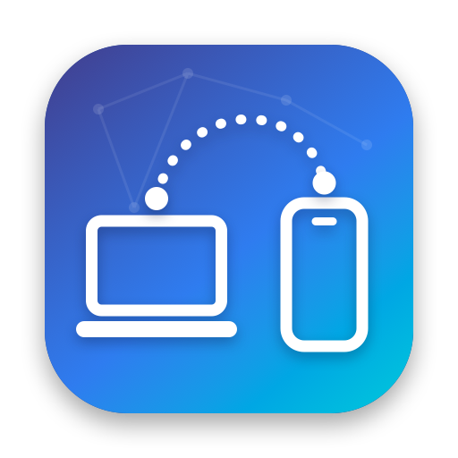
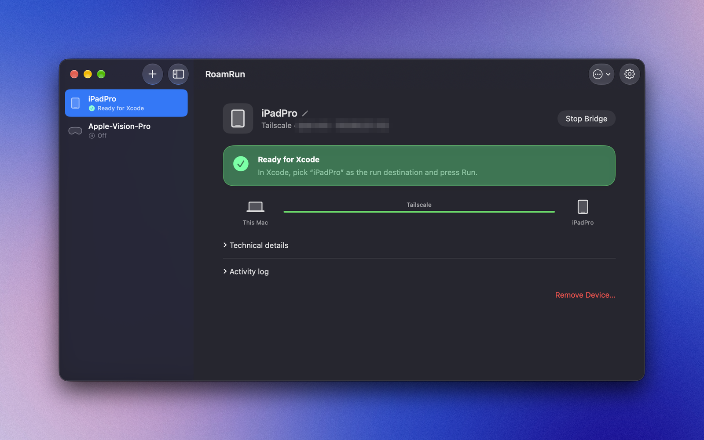
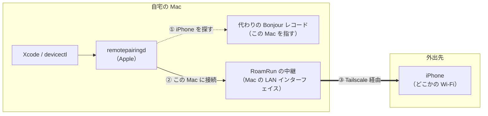
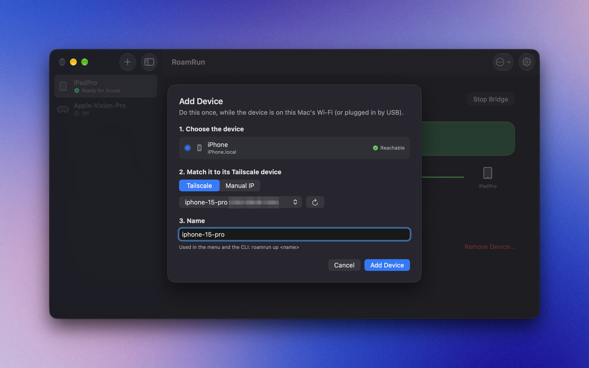
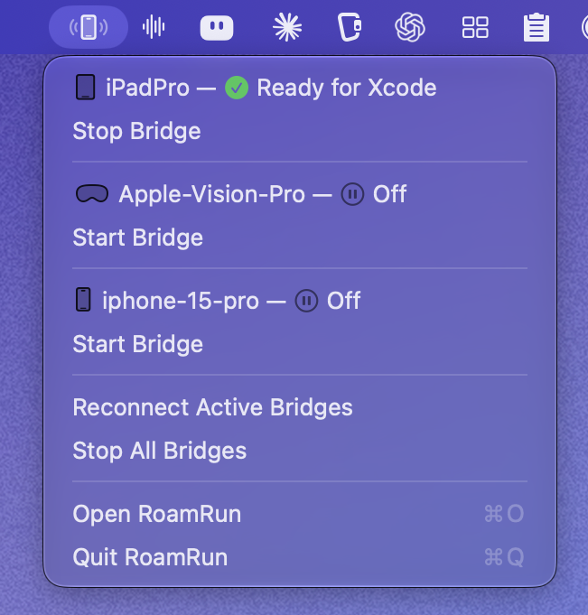
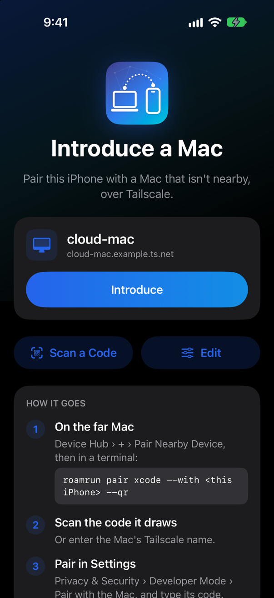
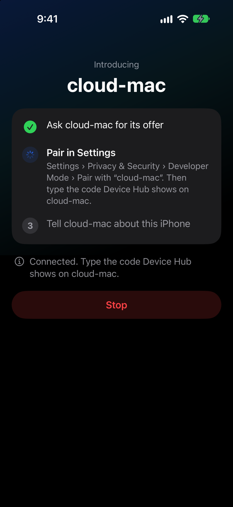
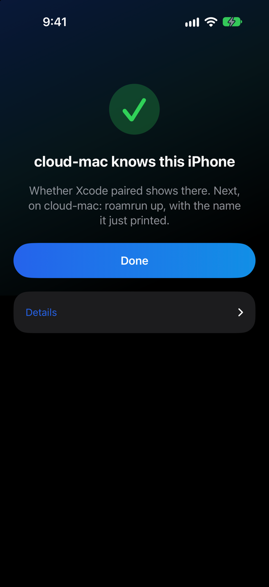

<p align="center">
  
</p>

<h1 align="center">RoamRun</h1>

<p align="center"><strong>Run your iOS apps wherever your device is.</strong></p>

<p align="center">
  <a href="https://github.com/mh-mobile/RoamRun/actions/workflows/ci.yml"></a>
  <a href="LICENSE"></a>
  
</p>

<p align="center"><a href="https://mh-mobile.github.io/RoamRun/">Web サイト</a> · <a href="README.md">English</a> | 日本語</p>

<p align="center"></p>

RoamRun は、macOS のメニューバーアプリです。Xcode のワイヤレスデバッグを、Tailscale などの mesh VPN 越しでも使えるようにします。`roamrun` コマンドも付いています。iPhone、iPad、Apple Vision Pro が Mac と別のネットワークにあっても、Xcode や `devicectl` からは手元のデバイスとして見えます。ビルド、インストール、起動、デバッグは、いつもどおりにできます。RoamRun では、このつながりを「ブリッジ」と呼びます。

ほかに、次の 3 つのことができます。

- コマンドラインや AI エージェントから、**デバイスの画面を見て操作する**（[デバイスの画面を見て操作する](#デバイスの画面を見て操作する)）
- クラウドの Mac のように、**デバイスと同じ場所にいたことのない Mac をペアリングする**（[離れた Mac を Xcode 用にペアリングする](#離れた-mac-を-xcode-用にペアリングする)）
- ブリッジもペアリングも使わずに、**デバイス自身にビルドをインストールさせる**（[ブリッジを使わずにインストールする](#ブリッジを使わずにインストールするota)）

RoamRun を入れていないマシン（Linux、Windows、別の Mac）向けには、[`roamrunctl`](Rust/roamrunctl/README.ja.md) という別のコマンドがあります。これを使うと、CI のジョブからアプリをデバイスへインストールして起動できます（[CI からインストールして起動する](#ci-からインストールして起動する)）。

## なぜ必要か

iOS 17 以降のワイヤレスデバッグは、Bonjour（`_remotepairing._tcp`）でデバイスを探します。Bonjour はローカルネットワークの中だけで働くので、Tailscale のような VPN は越えられません。そのうえ、Mac の `remotepairingd` は、デバイスを見つけたネットワークインターフェイスに接続を限定します（動作を見て確かめたことです）。そのため、デバイスの VPN 上のアドレスを知らせるだけでは足りません。

そこで RoamRun は、Xcode には「デバイスは同じ Wi-Fi にある」と見せて、実際の通信を VPN に流します。



ペアリングの検証と暗号化は、Apple の実装のまま、Mac とデバイスの間で行われます。RoamRun は通信を中継するだけで、中身を読むことも書き換えることもありません。詳しい仕組みは [docs/how-it-works.ja.md](docs/how-it-works.ja.md)にあります。

## 必要なもの

- **Apple シリコンの Mac と、macOS 13 以降**。管理者アカウントも必要です。RoamRun は `log stream` で `remotepairingd` のログを読みます。macOS から管理者権限が必要だと返された場合は、その旨を表示して止まります。
- **iOS 17.4 以降のデバイス**。RoamRun が中継するのは TCP だけです。iOS 17.0〜17.3 の QUIC トンネルには対応していません。iPad と Apple Vision Pro でも動かしています。以下の「デバイス」は、この 3 種類を指します。
- **`devicectl` を含む Xcode**（Xcode 15 以降）。デバイスの iOS のバージョンに対応している必要があります。対応は [Apple の表](https://developer.apple.com/support/xcode/)で確かめられます。`roamrun logs` と `run --logs` は、Xcode 16 で入った `devicectl` の `--console` を使います。
- **Tailscale**。デバイスのアドレスを手で入力する形なら、ほかの mesh VPN でも使えます。Mac とデバイスの両方で接続しておきます。
- **この Mac と一度ペアリングしたデバイス**。デベロッパモードを有効にしておきます。ペアリングは、USB で行うか、Xcode 27 と iOS 27 なら同じ Wi-Fi 上で行えます（Device Hub › ＋ › Pair Nearby Device）。
- **ブリッジを始めるときに、デバイスが Wi-Fi に接続していること**。モバイル通信だけの状態では、試したかぎり、デバイスは応答しませんでした。ブリッジが Ready になったあとなら、モバイル通信に移ってもセッションを保てます。それには「Keep debugging on cellular」をオンにしておく必要があります（初期設定はオフです）。[Mac から離れて作業する](#mac-から離れて作業する)を参照してください。

デバイスの画面を見て操作する機能には、iOS 27 以降が必要です。離れた Mac を Xcode 用にペアリングするには、iOS 27 と Xcode 27 が必要です。

## インストール

Homebrew を使う場合は、次のコマンドでインストールします。

```sh
brew install --cask mh-mobile/tap/roamrun
```

`/Applications` に `RoamRun.app` が入り、`roamrun` コマンドも使えるようになります。アップデートは `brew upgrade --cask roamrun` です。

Homebrew を使わない場合は、[Releases](https://github.com/mh-mobile/RoamRun/releases) から dmg をダウンロードし、RoamRun を「アプリケーション」にドラッグして開きます。最初の画面で、`roamrun` コマンドをインストールするか尋ねられます。あとから入れるには、Open RoamRun › Settings › Command line tool › Install… を使います。アップデートするには、RoamRun を終了して、アプリを新しいものに置き換えます。自動アップデートはありません。保存したデバイスはそのまま残り、動いていたブリッジは再び始まります。

アプリは Developer ID で署名し、Apple の公証を受けています。

ソースからビルドするには、Xcode 26 以降と、[rustup](https://rustup.rs) で入れた Rust が必要です。`make` は、リポジトリが指定するバージョンの Rust で、デバイス操作用のライブラリをビルドします。

```sh
git clone https://github.com/mh-mobile/RoamRun && cd RoamRun
make run            # ここに RoamRun.app をビルドして開く。インストール済みの RoamRun は先に終了しておく
make install-cli    # /usr/local/bin/roamrun をこのビルドにリンクする（別の場所にするなら BINDIR=$HOME/bin）
```

署名用の証明書がない場合、ビルドはアドホック署名になり、macOS はビルドし直すたびに別のアプリとして扱います。そのビルドでデバイス操作を設定すると、ビルドし直すたびに、キーチェーンが RoamRun の鍵へのアクセスを確認してきます。「常に許可」を選んでください。SSH でしか入れない Mac では、この確認に答える画面がないので、新しいビルドは保存済みのペアリングを読めません。その場合は、キーチェーンの 2 つの項目を削除して（[Mac に作られるものとアンインストール](#mac-に作られるものとアンインストール)を参照）、ペアリングを設定し直すか、取り込み直してください。キーチェーンに Apple Development の証明書があれば、`make app` はその証明書で署名します。

## 使い方

1. デバイスを USB でつなぐか、Mac と同じ Wi-Fi に接続します。メニューバーのアイコン › Open RoamRun › Add Device を選びます。
2. 一覧からデバイスを選び、Tailscale 上の同じデバイスと対応づけます（アドレスの直接入力もできます）。最後に名前を付けます。以降のコマンドでは、この名前を使います。
3. Start Bridge を押し、「Ready for Xcode」（または「On this Wi‑Fi」）と表示されるまで待ちます。
4. デバイスは、Xcode の Devices ウインドウに表示され続けます。ビルド、インストール、デバッグは、いつもどおりにできます。

デバイスが Mac と同じ Wi-Fi にある間、ブリッジは何もせずに待機し、「On this Wi‑Fi」と表示します。このとき、Xcode はデバイスに直接つながっています。デバイスが別のネットワークに移ると、ブリッジが自動で引き継ぎます。Mac のアドレスが変わった場合、ブリッジは再起動します。

<p align="center">
  
  
</p>

## Mac から離れて作業する

Mac を自宅に置いたまま、手元のデバイスだけで、ビルドして試す作業を繰り返せます。

**新しくブリッジを始めるには、インターネットに接続できる Wi-Fi が必要です**。デバイスを、その Wi-Fi に接続しておきます。カフェやホテルの Wi-Fi、モバイルルーター、別の電話のテザリングが使えます。モバイル通信だけでは接続できません。デバイス自身のテザリングも使えません。その場合、デバイス自身は Wi-Fi に接続していないためです。

**モバイル通信でもセッションを保つには**、Settings › Network › Keep debugging on cellular をオンにします。初期設定はオフです。オンにすると、Run のたびに、デバイスのモバイルデータ通信を使うためです。この設定が効くのは、ブリッジ中の状態、つまり Ready for Xcode のときだけです。「On this Wi‑Fi」と表示されているとき、Xcode はローカルネットワーク経由でデバイスにつながっています。そのため、自宅からそのままモバイル通信に移ると、セッションは切れます。これを避けるには、自宅でも、別の機器が作る Wi-Fi にデバイスを接続しておきます。トラベルルーターや、テザリング中の予備の電話が使えます。こうしておくと、RoamRun は最初からデバイスをブリッジします。

新しいセッションを始めるには、もう一度 Wi-Fi が必要です。デバイスを再起動したあとなどが、これにあたります。設定がオフの場合、RoamRun は、デバイスが Wi-Fi を離れるとセッションを閉じ、Wi-Fi に戻ると接続し直します。

サインインの画面が出る Wi-Fi では、先にサインインしてください。「インターネット接続なし」と表示される Wi-Fi に接続して、通信をモバイル通信に流す使い方は、試しましたが動きませんでした。UDP を通さないネットワークでは、Tailscale が中継サーバーを使います。この場合も動きますが、遅くなります。経路は `roamrun doctor` で確かめられます。

デバイスから Mac を操作する方法は、3 つあります。

| 方法 | デバイス側で使うもの | 向いている作業 |
|---|---|---|
| AI エージェント | 自宅の Mac のエージェントを電話から操作する機能。Claude Code の [Remote Control](https://code.claude.com/docs/en/remote-control.md) や、ChatGPT アプリの [Codex](https://learn.chatgpt.com/docs/remote-connections) など | 「ビルドして iPhone で実行して」と頼み、結果を見て、また頼む作業 |
| SSH のターミナル | SSH クライアントと Tailscale | `roamrun`、`xcodebuild`、`devicectl`、`lldb` を直接使う作業 |
| Mac の画面 | 画面共有か VNC クライアントと、Tailscale | Xcode のウインドウで Run やブレークポイントを使う作業 |

外出先でデバッガを付けて実行すると、自宅より時間がかかります。lldb の接続だけでも、通信の往復が数百に上るためです。600 KB のアプリをテザリング越しに実行したとき、デバッガを付けると約 1 分、付けないと約 4 秒かかりました。ブレークポイントが要らないときは、Edit Scheme › Run › Info の「Debug executable」をオフにしてください。ブレークポイントが要るときは、同じ画面の「Queue Debugging」（Options）と「Main Thread Checker」（Diagnostics）をオフにすると、速くなりました。

表にあるエージェントの機能は、会話の内容を、それぞれのサービスのサーバーに送ります。仕事用の Mac で使う前に、会社の方針を確かめてください。

## CLI

RoamRun の実行ファイルは、`roamrun` コマンドとしても使えます。SSH 越しの操作や、スクリプトで使うためのものです。

```sh
roamrun devices               # 保存したデバイス（名前、UDID、id）と状態
roamrun up <name>             # ブリッジを始めて、進み具合を表示する。Ctrl-C で止めるまで動く
roamrun up <name> -d          # バックグラウンドで始める。ターミナルを閉じても動き続ける
roamrun status <name>         # Xcode からデバイスを使える状態なら、終了コード 0
roamrun down <name>           # ブリッジを止める。アプリが始めたものも、別のターミナルが始めたものも止められる
roamrun doctor                # Mac → Tailscale → デバイスの順に確かめ、直し方を表示する
roamrun run <name> [--scheme S] [--logs]   # プロジェクトのフォルダで実行する。ビルド、インストール、起動まで行う
roamrun install <name> <App.ipa|App.app>   # そのデバイス向けに署名したビルドをインストールする
roamrun logs <name> <bundle-id>            # アプリを起動し直して、print / os_log の出力を流す
roamrun screenshot <name> [file.png]       # デバイスの画面を PNG で保存し、パスを表示する
roamrun ota [<name>] <App.ipa> [--replace] # デバイスが自分でインストールできるように、ビルドを公開する
```

`<name>` は、RoamRun でデバイスに付けた名前です。大文字と小文字は区別せず、同じ名前は付けられません。名前は `roamrun devices` で確かめられ、デバイスのページの鉛筆のアイコンで変えられます。iOS の「設定」に出るデバイス名は使いません。その名前のデバイスが保存されていなければ、Tailscale 上の名前（`roamrunctl` に渡すのと同じ `iphone-15-pro` など）でも指定できます。`iphone-15-pro.tail1234.ts.net` のような完全な名前は使えません。デバイスの id か、その先頭 8 文字以上でも指定できます。

デバイスは、アプリから追加するほかに、次のコマンドでも追加できます。それぞれの使い方は、あとの章で説明します。

- `roamrun devices add <line>`（別の Mac が出力した行を渡す）
- `roamrun key import <file>`
- `roamrun pair xcode --with <Tailscale name>`
- `roamrun pair control --with <Tailscale name>`

各コマンドの細かい動作は、次のとおりです。

- `up -d` は、Ready（または On this Wi‑Fi）になるまで最大 60 秒待ち、ならなければ終了コード 1 で終わります。その場合も、ブリッジはバックグラウンドで試み続けます。やり直しても直らないエラーのときだけ止まります。ログは `~/Library/Logs/RoamRun/` に出ます。
- `status` は、名前を付けずに実行すると、保存したデバイスをすべて表示します。1 台でも使える状態なら、終了コードは 0 です。スクリプトで特定のデバイスの状態を知りたいときは、名前を指定してください。`--wait N` を付けると、最大 N 秒待ちます。1 回の確認ごとに `devicectl` を呼ぶため、数秒遅れて戻ることがあります。
- `doctor` にも、名前を指定できます。指定しなければ、ブリッジが動いているデバイスを確かめます。動いているブリッジがなければ、すべてのデバイスを確かめます。
- `run` は、いまいるフォルダの Xcode プロジェクトを `-allowProvisioningUpdates` 付きでビルドします。そのため、Xcode と同じく、プロビジョニングプロファイルを作ることがあります。`--scheme` は、スキームが複数あるときだけ必要です。`--workspace`、`--project`、`--configuration`（既定は `Debug`）も指定できます。
- `run` と `logs` には、起動時のオプションを渡せます。`--arg A`（繰り返し指定できます）、`--env NAME=value`（同じく）、`--url myapp://settings` の 3 つです。`logs` がアプリを起動し直すのは、`devicectl` が実行中のアプリにコンソールをつなげられないためです。
- `install` は、先に署名を確かめます。受け付けるのは、Debugging か Release Testing（Ad Hoc）用に書き出したビルドで、プロビジョニングプロファイルにそのデバイスが入っているものです。Enterprise 用のビルドも受け付けます。こちらは、証明書を信頼しているデバイスならどれでも構いません。App Store Connect 用のビルドは拒否します。`install` を使えるのは、この Mac とペアリングしたデバイスだけです。それ以外のデバイスには、`roamrun ota` か TestFlight を使ってください。
- `screenshot` は、ファイル名を指定しなければ `./<名前>-<日時>.png` に保存します。Xcode 26.3 以降で動かしました。それより前のバージョンでは試していません。
- `--json` は `devices`、`status`、`doctor` で使えます。`-v` は `up` で使えます。`devices --json` の `ready` が表すのは、ブリッジが Ready か、デバイスが同じ Wi-Fi にあるかだけです。`status` は、これに加えて CoreDevice にも問い合わせます。対応していないオプションを渡すと、コマンドは終了コード 2 で終わります。`roamrun --help` で、すべてのオプションを確かめられます。

アプリと CLI が、同じデバイスを同時にブリッジすることはありません。あとから始めたほうが拒否されます。ただし、例外が 1 つあります。待機中（On this Wi‑Fi）のブリッジと、エラーになっているブリッジは、引き継げます。引き継げるのは、アプリの Start ボタンを押したときと、`roamrun up` を実行したときだけです。アプリの自動のやり直しでは、引き継ぎません。すでに `roamrun up` が動いているデバイスに 2 つ目の `roamrun up` を実行しても、2 つ目は始まりません。1 つ目が Ready か待機中なら終了コード 0、開始の途中かエラーなら 1 で終わります。

CLI は、アプリの設定をそのまま使います。SSH 越しのように、アプリの設定画面を開けない場合は、`defaults` で設定を変えられます。

```bash
defaults write io.github.mh-mobile.roamrun keepDebuggingOnCellular -bool true    # オフに戻すときは false
```

### ブリッジ越しに使えるほかのツール

ブリッジが Ready の間、Xcode のコマンドラインツールは、デバイスが同じ Wi-Fi にあるときと同じように使えます。次のコマンドは、実際にブリッジ越しで動かしたものです。

```sh
xcrun devicectl device capture screenshot --device <udid> --destination shot.png   # `roamrun screenshot` が実行しているもの
xcrun devicectl device process launch --device <udid> <bundle-id>
xcodebuild test -destination id=<udid> …                                           # デバイス上での UI テスト（XCUITest）
xcrun devicectl device info files --device <udid> --domain-type appDataContainer --domain-identifier <bundle-id>
xcrun devicectl device copy from --device <udid> --domain-type appDataContainer --domain-identifier <bundle-id> --source <path> --destination <local path>
xcrun devicectl device pasteboard copy --file image.png --type public.png --device <udid>
xcrun devicectl device info files --device <udid> --domain-type systemCrashLogs     # クラッシュログ（.ips）
```

UDID は `roamrun status <name>` で確かめられます。XCUITest を土台にしたツールも動きますが、同じ Wi-Fi のときより遅くなります。そのうち 2 つのツールを、テザリング越しに試しました。WebDriverAgent は、1 回のタップに約 2 秒かかりました。agent-device は、1 回の操作に 25〜35 秒かかり、ウインドウ表示の iPad アプリではタップが外れました。

## AI エージェントから使う

Claude Code、Codex、Cursor などのエージェントは、RoamRun を使ってビルド、インストール、デバッグを行えます。使い方は、スキルでエージェントに教えます。

```sh
roamrun init                                  # ~ にあるエージェントすべてにスキルを入れる（.claude、.codex、.cursor、.gemini、.copilot、.devin）
roamrun init --client claude                  # 指定したエージェントだけに入れる（--client は繰り返し指定できる）
```

`init` が入れるのは、いま使っている RoamRun に同梱されているスキルです。そのため、スキルと RoamRun のバージョンがそろいます。RoamRun をアップデートしたら、`roamrun init` をもう一度実行してください。入っているスキルのバージョンが違う場合は、`roamrun status` と `roamrun doctor` がそれを知らせます。スキルを別のツールで管理している場合は、RoamRun のリリースに合わせて固定してください。たとえば、次のようにします。

```sh
gh skill install mh-mobile/RoamRun roamrun --pin "v$(roamrun --version | cut -d" " -f2)"
```

スキルが扱うのは、デバイスの接続とスクリーンショットです。接続では、`roamrun up -d` のあと、`roamrun status --wait 60 --json` で UDID を取得します。デバイスのロック解除のように、人にしかできない作業も含みます。終了コードは、使える状態なら 0、使えないか失敗なら 1、使い方の誤りなら 2 です。

## デバイスの画面を見て操作する

RoamRun から、デバイスの画面を確認して操作できます。できる操作は、タップ、スワイプ、文字入力、ボタンの操作です。この機能を「デバイス操作」と呼びます。**iOS / iPadOS 27 以降**が必要です。ブリッジや Xcode は使いません。RoamRun が、自前のペアリングと接続を作ります。iPhone で動かしました。iPad では試していません。

設定の前に、1 つ知っておいてください。**スイッチがオンの間は、この Mac で実行したどのプログラムでも、デバイスを見て操作できます**。使うつもりのコマンドやエージェントに限られません。詳しくは、この章の後半で説明します。

**設定は、デバイスごとに一度だけ行います**。デバイスを Mac と同じ Wi-Fi に接続した状態で、RoamRun のデバイスのページを開き、Device control › Set Up… を押します。デバイスでは、設定 › プライバシーとセキュリティ › デベロッパモード を開きます。「RoamRun（この Mac の名前）」を選び、Mac に表示されたコードを入力します。設定が済むと、画面に「Device control is set up」と表示されます。`roamrun status <name>` にも「Device control: connected」と出ます。

設定したあとは、デバイスが Wi-Fi 上にあって VPN 越しにつながれば、RoamRun が自動で接続します。接続を保つのは RoamRun のアプリなので、アプリを起動しておく必要があります。接続中にデバイスの Wi-Fi を切っても、接続は保たれました（iOS 27.0 で確認）。

```sh
roamrun look iPhone /tmp/now.png          # いまの画面を PNG で保存する。長辺は最大 1280 ピクセル
roamrun tap iPhone 295 640                # その画像のピクセルで、位置を指定する
roamrun look iPhone /tmp/now.png          # 次の操作の前に、もう一度見る
roamrun swipe iPhone 295 900 295 450      # ある点から別の点までドラッグする
roamrun type iPhone "hello"               # US 配列のキーで入力する。デバイスのキーボードが英語のときだけ正しく入る
roamrun paste iPhone "任意の文字列"         # デバイスのペーストボード経由で、任意の文字列を入れる。iOS が「ペーストを許可」と尋ねる
roamrun press iPhone home                 # home、lock、volume-up、volume-down
roamrun elements iPhone                   # アクセシビリティが返す画面上の要素。位置は含まない
```

決まりは次のとおりです。

- **「見る → 操作する → もう一度見る」の順で使います**。`tap` と `swipe` には、直前 1 分以内の `look` が必要です。1 回の `look` で実行できる操作は、1 回だけです。ただし、`type` と `paste` は、操作のあとも同じ `look` で続けられます（見る → 入力欄を `tap` → `type`）。どちらも、直前の入力から 1 秒たつまで待ってから送ります。
- `look` は、`look 12` のように番号も出します。`tap`、`swipe`、`type`、`paste` に `--look <番号>` を付けると（`type` と `paste` では文字のあと）、その `look` に縛られます。あとにほかの `look`（どの呼び出し元のものでも）、ボタン、`elements`、`--look` を付けない操作があったときや、1 分を過ぎたときは断ります。付けないときは、`tap` と `swipe` は最後の `look` を使い、`type` と `paste` には `look` が要りません。
- 画像の向きは、デバイス内部の画面のままです。横向きのアプリは、横に倒れた状態で写りました（確認済み）。その場合も、位置はその画像のピクセルで指定します。
- `type` で送れるのは、最大 2000 文字です。速さは 1 秒あたり約 16 文字で、改行は Return として送られます。日本語キーボードでは、スペースも変換に使われて、入力されませんでした（確認済み）。その場合は `paste` を使ってください。
- `swipe` には、最後の引数として、かける時間をミリ秒で指定できます（50〜5000、既定は 300）。`elements` には、要素数の上限を指定できます（既定は 40）。`elements` は、読み取りの途中で画面をスクロールすることがあります。

**エージェントからは、同じ機能を MCP のツールとして使えます**。`claude mcp add roamrun -- roamrun mcp` のように登録します。ほかのエージェントでも、同様に登録できます。ツールは `devices`、`look`、`tap`、`swipe`、`type`、`paste`、`press`、`elements` です。コマンドとは、次の 4 点が違います。

- `device` に渡すのは、RoamRun で付けた名前（`devices` が返す名前）だけです。Tailscale 上の名前や id は使えません。
- `look` は、ファイルに保存せず、画像と `look` の番号をエージェントに返します。
- `type` で送れるのは、1 回の呼び出しにつき 500 文字までです。
- `tap`、`swipe`、`type`、`paste` には、その番号を必ず渡します（`"look": 12`）。決まりは `--look` と同じです。このコマンドより古い RoamRun のアプリが相手のときは、この 4 つは送りません。

`install`、`install_status`、`launch`（0.11.0 以降）を使うと、Xcode なしでアプリをデバイスに入れて起動できます。`install` には、この Mac にある .ipa か .app フォルダのパスを渡します。デバイス向けにビルドして署名したものです。`install` はアプリの実行中のプロセスを終わらせてから始め、すぐに id を返します。その id で `install_status` を呼ぶと、入ったかどうかが分かります。入るまでは、そのデバイスへのほかの呼び出しには、インストール中と答えます。`launch` には、バンドル ID を渡します。ファイルは、アプリのために RoamRun 自身のフォルダへコピーされ、インストールが終わると消されます（その間にアプリが終了した場合は、次に起動したときに消されます）。

**tailnet のほかのマシンにいるエージェントからも使えます**（0.11.0 以降）。同じツールを HTTP で提供するには、`roamrun mcp --http <ポート> --allow <tag:名前かログイン名>` を動かします。`--allow` は何回でも指定でき、`--token-file <ファイル>` でトークンも求められます。Ctrl-C で止まります。この Mac の Tailscale の IPv4 アドレスでだけ待ち受けます。受け付けるのは、`tailscale whois` がそのタグを持つと答えたマシンと、そのユーザーのタグのないマシンです。リクエストの扱い、断る場合、デバイスごとの順番、ログは、`roamrunctl mcp --http` と同じです（[その決まり](docs/roamrunctl-reference.ja.md#http-で使う-mcp)）。違いは次のとおりです。コマンドラインでデバイスを指定するのではなく、RoamRun に保存したデバイスを提供し、アプリでスイッチがオンのデバイスだけを操作します。ここでの順番が来たあとに呼び出し元が切れたり取り消したりした呼び出しは、`roamrun mcp` と同じくアプリで取りやめます。デバイスのほかの利用者の後ろでアプリの順番を待っていれば始めず、動いている途中ならきりのよいところで止めます。アップロードは、実行ごとに作るフォルダではなく、RoamRun 自身のフォルダに置きます。`roamrun mcp` と同じく、RoamRun のアプリが動いている必要があります。

`--allow-install [--max-upload <MiB>]` を付けると、roamrunctl と同じように、`install` および `install_status` を提供します。呼び出し元は `PUT /upload` で .ipa を送り（既定では 1024 MiB まで）、返ってきた id と sha256 でインストールします。パスでは受け付けません。アップロードは 1 つだけ、送ってきたマシンがインストールするために置きます。アプリが始めなかったインストール（デバイスが設定されていない、スイッチがオフ、インストール中、アプリでの順番の前に呼び出し元が切れた）では、使われずに残ります。その .ipa のインストールを始めたとアプリが答えたとき、どの呼び出し元でも次のアップロードを始めたとき、使われないまま 30 分たったとき、Ctrl-C で止めたときに消えます。強制終了したサーバーが残したものは、1 日以上たってから RoamRun のアプリか同じ設定のサーバーが起動したときに消えます。`--allow-install` を付けなければ、どちらもありません。`roamrun mcp` と同じく、RoamRun のアプリが動いている必要があります。

**操作している間、デバイスでは画面共有のセッションが動きます**。`look` や操作のたびにセッションが始まり、RoamRun は最後の操作から約 5 秒間、そのセッションを保ちます。デバイスには、画面共有として表示されました（確認済み）。セッション中の音とマイクの様子は、一度の試行でアプリごとに記録してあります。音が鳴り続けたアプリもあれば、再生は続いても聞こえなくなったアプリ、再生の止まったアプリも 1 つありました。音声入力は何も拾いませんでした。詳しくは [docs/sound-while-looking.md](docs/sound-while-looking.md)（英語）にあります。

デバイス操作は、特定のエージェントやコマンドだけに許可されるものではありません。スイッチがオンの間は、**この Mac で実行したどのプログラムでも、アプリを通じてデバイスを見て操作でき、アプリを入れて起動もできます**。ビルドスクリプト、パッケージのインストール処理、別のエージェントも含まれます。`look` には、画面に出ているものがすべて写ります。通知やメッセージも例外ではありません。デバイスをロックしても、操作は止まりません。ロック画面も見えて、操作できました（確認済み）。ただし、ロックの解除には、パスコードか Face ID が必要です。

- デバイスのページの Device control の横にあるスイッチで、すべてのプログラムからの操作をまとめてオフにできます。もう一度押すと、オンに戻ります。Set Up と Pair Again のあとは、スイッチがオンになっています。`roamrun key import <file>` と `roamrun pair control --with <Tailscale name>` のあとも同じです。自分の作業でデバイスを使っていないときは、オフにしてください。
- `look` で保存したファイルは、本人だけが読めます。削除するまで残ります。
- 接続のたびに、Mac とデバイスは互いを検証します。デバイスのアドレスで別のものが応答した場合は、接続を拒否し、入力も送りません。
- ペアリングには、秘密鍵が含まれます。鍵の保管のしかたと、鍵を使える範囲は、[SECURITY.md](SECURITY.md)（英語）にあります。
- デバイス操作を取り消すには、デバイスのデベロッパモードの一覧から、RoamRun の項目を削除します。

### 離れた Mac でデバイス操作を使う

設定には、Mac とデバイスが同じ Wi-Fi にあることが必要です。データセンターの Mac のように、離れた場所にある Mac は、この条件を満たせません。2 台の Mac が同じ tailnet にあれば、デバイスと同じ Wi-Fi にある Mac（以下、デバイスのそばの Mac）が仲介して、離れた Mac が自分のペアリングを作れます。離れた Mac は、そのペアリングを暗号化して保管します。デバイスのそばの Mac は、デバイスの通信の中身を読まずに中継し、何も保存しません。ただし、入力するコードは、デバイスのそばの Mac に表示されます。仲介には、信頼できる Mac を使ってください。

```sh
roamrun pair control --with macbook-pro              # 離れた Mac で実行する。RoamRun のアプリを開いておく
roamrun pair introduce --host cloud-mac --to iPhone   # デバイスのそばの Mac で、自分で実行する。iPhone は、デバイスのそばの Mac の RoamRun での名前
roamrun look iPhone                                  # 離れた Mac で、ペアリングできたと表示されたあとに実行する
```

`macbook-pro` はデバイスのそばの Mac、`cloud-mac` は離れた Mac の、Tailscale 上の名前です。デバイスで「cloud-mac」を選び、`pair introduce` が表示したコードを入力します。`pair introduce` は、自分のターミナルで、自分で実行してください。エージェントに実行させると、コードがエージェントの出力に入ってしまいます。

- 離れた Mac は、デバイスのそばの Mac を最大 10 分待ちます。そのあと、ペアリングを最大 9 分待ちます。
- コードを間違えると、`pair introduce` は終了します。離れた Mac のコマンドは終了しません。`pair introduce` をもう一度実行すると、離れた Mac が新しいコードを作ります。試せるのは、全部で 5 回です。
- 離れた Mac では、ログインしたセッションで RoamRun のアプリを開いておく必要があります。Xcode は要りません。デバイスをあらかじめ保存しておく必要もありません。
- 離れた Mac に、そのデバイスとの有効なペアリングがすでにある場合、仲介は始まりません。先に、離れた Mac のデバイスのページで、そのペアリングを削除してください。
- 結果がデバイスのそばの Mac に届かなかった場合は、離れた Mac で `roamrun pair control --last` を実行すると、直前の試行の結果を確かめられます。

2 台の Mac の間に Tailscale がない場合は、デバイスのそばの Mac でペアリングを作り、ファイルとして運びます。

```sh
roamrun key create iPhone ~/iphone-for-cloud.json --as cloud-mac   # デバイスのそばの Mac で実行する。デバイスで「cloud-mac」を選び、コードを入力する
roamrun key import ~/iphone-for-cloud.json                         # 離れた Mac で、RoamRun のアプリを起動した状態で実行する。デバイスとのペアリング情報を保存し、ファイルを削除する
```

このファイルには、ペアリングの秘密鍵が含まれています。ファイルを持っていて、デバイスに接続できる人は、だれでもデバイスを見て操作できます。パスワードと同じように扱い、コピーを残さないでください。`key import` は、接続できた場合にだけペアリングを保存します。そのため、取り込むときに、デバイスに接続できる必要があります。

ファイルを作ったあとにデバイスが再起動していると、デバイスのポートが変わっています。離れた Mac にまだ保存していないデバイスなら、`key import` がポートを探します。すでに保存してあるデバイスの場合は、先にデバイスのページの Find RemotePairing Port を使ってください。

この方法で作ったペアリングは、デバイスのデベロッパモードの一覧に、それぞれの名前で表示されます。デバイスで 1 つずつ削除できます。

何もない状態の Mac に、Tailscale、RoamRun、ペアリングをまとめて用意する手順は、[docs/another-mac.md](docs/another-mac.md)（英語）にあります。そのためのスクリプトも付いています。

## 離れた Mac を Xcode 用にペアリングする

ブリッジには、Xcode がデバイスとペアリングした Mac が必要です。Xcode のペアリングは、1 つのネットワークの中で行われます。データセンターの Mac、エージェント用の Mac、別の場所にある自分の Mac は、デバイスと同じネットワークに入ることがありません。**iOS 27 と Xcode 27** なら、デバイスのそばの Mac（デバイスと同じネットワークにある Mac）が一度だけ仲介して、離れた Mac をペアリングできます。

離れた Mac には、Xcode、RoamRun、Tailscale が必要です。何もない状態の Mac を用意する手順は、[docs/another-mac.md](docs/another-mac.md)（英語）にあります。

2 台の Mac が同じ tailnet にあれば、互いの名前を指定するだけで済みます。手で運ぶものはありません。

```sh
# 離れた Mac で。Xcode の Device Hub › ＋ › Pair Nearby Device を開いておく（コマンドの前でも後でもよい）
roamrun pair xcode --with macbook-pro                # macbook-pro は、デバイスのそばの Mac の Tailscale 上の名前

# デバイスのそばの Mac で。デバイスは、デバイスのそばの Mac の RoamRun に保存しておく
roamrun pair introduce --host cloud-mac --to iPhone   # cloud-mac は、離れた Mac の Tailscale 上の名前
#   デバイスで、設定 › プライバシーとセキュリティ › デベロッパモード › Pair with “cloud-mac” を選び、
#   離れた Mac の Device Hub に表示されたコードを入力する

# 離れた Mac で。デバイスを保存したと表示されたあとに実行する
roamrun up iPhone
```

知っておくべきことは、次のとおりです。

- 離れた Mac は、デバイスのそばの Mac を最大 10 分待ちます。そのあと、ペアリングを最大 7 分待ちます。
- 「保存した」は、「ペアリングできた」という意味ではありません。離れた Mac は、ペアリングが試みられた時点でデバイスを保存します。ペアリングができたかどうかは、離れた Mac で `roamrun up` を実行すると分かります。`pair introduce` からは、コードの間違いと、まだ入力されていない状態を区別できません。
- 離れた Mac の Device Hub でボタンを押し、表示されたコードを読む人が必要です。画面の前にいるか、画面共有で操作します。ssh だけではできません。
- この作業の間だけ、デバイスは、デバイスのそばの Mac と同じ Wi-Fi にある必要があります。ペアリングが済めば、ブリッジはどこからでも使えます。
- `pair introduce` を実行すると、Wi-Fi 上に公開を始める前に、離れた Mac の持ち主が表示されます。Tailscale の情報をもとにした表示です。Apple Vision Pro の場合は、代わりに、離れた Mac の側にデバイスの持ち主が表示されます。

**ペアリングした Mac は、デバイスを開発者として使えるようになります**。アプリのインストールと実行、デバッグ、アプリのデータの読み取りができます。取り消すには、デバイスの 設定 › プライバシーとセキュリティ › デベロッパモード で、その Mac を削除します。一覧には、その Mac 自身に付いている名前で表示されます。その名前は、`pair introduce` の出力で確かめられます。デバイス操作と違って、Xcode のペアリングは RoamRun からオフにできません。デバイスで削除するしかありません。

ほかの方法と細かい決まりは、[docs/far-mac.ja.md](docs/far-mac.ja.md)にあります。1 行のテキストを手で運ぶ方法、それぞれの側が確かめること、離れた Mac でのデバッグに必要なシンボル、これまでに試したことを載せています。

### デバイス自身に仲介させる

デバイスのそばに RoamRun を入れた Mac がない場合は、デバイス上のアプリが仲介します。[`iOS/`](iOS/) にある RoamRun Introducer です。Xcode でビルドしてインストールするアプリで、iOS 27 以降で動きます。App Store にはありません。

<p align="center">
  
  
  
</p>

```sh
# 離れた Mac で。Device Hub › ＋ › Pair Nearby Device を開いて、次を実行する
roamrun pair xcode --with iphone-15-pro --qr   # iphone-15-pro は、デバイスの Tailscale 上の名前
# デバイスで。アプリを開き、Scan（または離れた Mac の名前を入力）、Introduce の順に操作する。続けて、
#   設定 › プライバシーとセキュリティ › デベロッパモード › Pair with “cloud-mac” を選び、Device Hub に表示されたコードを入力する
# 離れた Mac で。デバイスを保存したと表示されたあとに実行する
roamrun up iphone-15-pro
```

`--qr` を付けると、離れた Mac の Tailscale 上の名前が、QR コードとしてターミナルに表示されます。アプリでこれを読み取ります。アプリは名前を覚えるので、次からは QR コードは要りません。

デバイス操作のペアリングも、同じ流れでできます。離れた Mac で RoamRun のアプリを開き、`roamrun pair control --with iphone-15-pro` を実行します。この場合、入力するコードは、デバイスに通知として表示されます。iOS がアプリにバックグラウンドでの処理を認めなかった場合、アプリが動けるのは約 30 秒です。アプリにその旨が表示されるので、すぐに「設定」を開いて、コードを入力してください。

### Windows や Linux のマシンに仲介させる

デバイスのそばのマシンが仲介する方法もあります。RoamRun を入れていないマシン向けのコマンド、[`roamrunctl`](Rust/roamrunctl/README.ja.md) を使います。

```sh
# 離れた Mac で。Device Hub › ＋ › Pair Nearby Device を開いて、次を実行する
roamrun pair xcode --with my-pc                                # my-pc は、仲介するマシンの Tailscale 上の名前
# 仲介するマシンで。デバイスと同じ Wi-Fi に接続しておく
roamrunctl pair introduce --host cloud-mac --to iphone-15-pro   # cloud-mac は離れた Mac、iphone-15-pro はデバイスの、Tailscale 上の名前
# デバイスで。設定 › プライバシーとセキュリティ › デベロッパモード › Pair with “cloud-mac” を選び、Device Hub に表示されたコードを入力する
# 離れた Mac で。デバイスを保存したと表示されたあとに実行する
roamrun up iphone-15-pro
```

デバイス操作のペアリングも、同じ流れでできます。離れた Mac で RoamRun のアプリを開き、`roamrun pair control --with my-pc` を実行します。この場合、入力するコードは `roamrunctl` が表示するので、`roamrunctl` は自分で実行してください。

逆に、Mac の `roamrun pair introduce` の `--host` には、Linux や Windows のマシンも指定できます。相手のマシンでは、`roamrunctl pair control --with <name>` を実行して待っておきます。この場合にできるのは、デバイス操作のペアリングだけです。`roamrunctl` を使うと、Mac も Xcode もないマシンでデバイスとペアリングして、デバイスを使えます。詳しくは [roamrunctl の README](Rust/roamrunctl/README.ja.md#xcode-のないマシンからデバイスを使う) を参照してください。

`roamrun` と `roamrunctl` は互いに通信するので、同じバージョンにそろえてください。0.7.0 より前の `pair introduce` は、相手のマシンを `--mac` で指定していました。いまは、どちらのコマンドでも `--host` です。

### Apple Vision Pro

Apple Vision Pro のペアリングは、iPhone とは手順が違います。Vision Pro のほうが待っていて、Mac が Vision Pro を選びます。使うコマンドは、iPhone の場合と同じ 2 つです。

```sh
# デバイスで。設定 › 一般 › Remote Devices を開いたままにする
# 離れた Mac で
roamrun pair xcode --with home-mac            # home-mac は、デバイスのそばの Mac の Tailscale 上の名前
# デバイスのそばの Mac で。デバイスは、デバイスのそばの Mac の RoamRun に保存しておく
roamrun pair introduce --host cloud-mac --to vision-pro
# 離れた Mac で。コマンドに案内が出たら、Device Hub › ＋ › Pair Nearby Device › Apple Vision Pro を開き、
# デバイスを選んで Next を押し、デバイスに表示されたコードを入力する
roamrun up vision-pro
```

- 離れた Mac のコマンドは、Device Hub でペアリングが済むと、自動で終了します。終了の判断には、Device Hub がシステムログに書く 1 行を使います。この行にはデバイスの名前が含まれません。そのため、コマンドが動いている間は、Device Hub でほかのデバイスをペアリングしないでください。コマンドは、Ctrl-C を押したときと、5 分たったときにも終了します。
- デバイスのそばの Mac から、Tailscale がデバイスに IPv4 で直接つながっている必要があります。
- コマンドが動いている間、離れた Mac は、自分のネットワーク上にデバイスを公開します。中継するのは、離れた Mac 自身からデバイスへの接続だけです。コマンドが終了するまでに離れた Mac がデバイスに接続できていれば、デバイスが保存されます。
- `--host` に指定できるのは Mac だけです。待っている状態のデバイスに対して、`pair introduce` は Mac 以外の `--host` を拒否します。Introducer アプリと `roamrunctl` は、Vision Pro の仲介に対応していません。
- ペアリングのあと、Device Hub にデバイスが出てこない場合は、「Available」と「Unavailable」の見出しが折りたたまれていないか確かめてください。見出しにポインタを合わせると矢印が出るので、それをクリックします。

2026-10-13 に、Apple Vision Pro 1 台と、仮想マシンの離れた Mac で、上のコマンドを実行しました。ペアリングができ、離れた Mac のコマンドが自動で終了し、離れた Mac でブリッジが Ready になりました。ブレークポイント、自宅の外にあるデバイス、Apple TV は試していません。

## ブリッジを使わずにインストールする（OTA）

`roamrun ota` は、tailnet の中のページにビルドを公開します。デバイスは、そのページから HTTPS で、自分でビルドをインストールします。ブリッジもペアリングも要りません。Wi-Fi でもモバイル通信でも使えます。次のような場合に使います。

- デバイスがモバイル通信だけで、ブリッジが動いていない
- この Mac とペアリングしたことのないデバイスに入れたい（ほかの人の電話など）
- Development ビルドではなく、テスターに配る Ad Hoc ビルドを試したい
- 同じ tailnet のほかの人に、Mac なしでインストールしてもらいたい

できるのは**インストールだけ**です。デバッガ、`roamrun logs`、`roamrun screenshot` は使えません。

```sh
roamrun ota build/MyApp.ipa            # RoamRun が知っているすべてのデバイスについて、ビルドを確かめる
roamrun ota iPhone build/MyApp.ipa     # 名前を指定すると、そのデバイスについてだけ確かめる
```

実行すると、そのビルドをインストールできるデバイスと、ページのアドレスが表示されます。デバイスでそのアドレスを開き、Install をタップします。ページには、アプリごとに直近 5 つのビルドが、新しい順に並びます。

必要なものは、次の 3 つです。

- **Release Testing（Ad Hoc）か Enterprise 用に署名した .ipa**。有料の Apple Developer アカウントが必要です。Development ビルド、App Store / TestFlight 用のビルド、署名のないビルド、プロビジョニングプロファイルの期限が切れたビルドは、`roamrun ota` が拒否します。
- **tailnet の HTTPS**。MagicDNS と HTTPS 証明書を有効にしておきます。
- **起動している RoamRun**。ページはアプリが配信します。`tailscale serve` を使い、ポートは 41443 です。

テスターの電話のように、RoamRun が知らないデバイスに入れる場合は、ビルドのプロファイルに自分のデバイスが 1 台も入っていない、という警告が出ます。これは想定どおりの動作です。テスターのデバイスは、Ad Hoc のプロファイルに入っている必要があります。アプリの起動には、デベロッパモードも必要です。

**tailnet のメンバーなら、だれでもこのページを開いて、ビルドをインストールできます**。tailnet を共有している場合は、Tailscale のアクセス制御で制限してください。ページの公開をやめるには、`~/Library/Application Support/RoamRun/ota/` を削除します。

ポートと Funnel、`--replace`、デバイス側のデベロッパモード、ビルドを保存する前に RoamRun が確かめることは、[docs/ota.ja.md](docs/ota.ja.md)にあります。

## CI からインストールして起動する

CI のジョブから、`.ipa` を Tailscale 越しにデバイスへインストールし、起動できます。`.ipa` は、そのジョブで作ったものでも、別に用意したものでもかまいません。使うのは [`roamrunctl`](Rust/roamrunctl/README.ja.md) です。ブリッジも Xcode も通らないので、Linux のランナーでもできます。ジョブは tailnet に参加したうえで、次のどちらかを行います。

- CI のマシンで roamrunctl を動かす。デバイス操作のペアリング（Xcode のものではありません）を、CI のシークレットに置きます。ペアリングは、デバイスと同じ Wi‑Fi のマシンで一度だけ作ります。RoamRun の入った Mac なら `roamrun key create`、どのマシンでも `roamrunctl pair control --to` で作れます。
- 手元の relay のマシンに頼む。そのマシンで `roamrunctl mcp --http` を動かし、ペアリングはそこに置きます。ジョブは `.ipa` を relay に送り、relay がインストールして起動します。

| CI | やり方 | 手順 |
|---|---|---|
| GitHub Actions | Tailscale の action のあとに [mh-mobile/roamrun-action](https://github.com/mh-mobile/roamrun-action) を置く。Linux と macOS のランナーで動く | [docs/ci.ja.md](docs/ci.ja.md) |
| Xcode Cloud | プロジェクトのスクリプトで Tailscale を userspace で動かし、Tailscale の HTTP プロキシを通してデバイスか relay に届く（`ROAMRUNCTL_PROXY`、roamrunctl 0.10.0 以降）。または `curl` で relay を呼ぶ | [docs/xcode-cloud.ja.md](docs/xcode-cloud.ja.md) |
| Bitrise | Step の [mh-mobile/bitrise-step-roamrun](https://github.com/mh-mobile/bitrise-step-roamrun)。Step が自分で tailnet に参加する | [docs/bitrise.ja.md](docs/bitrise.ja.md) |

どれも、iOS 27.0 の iPhone 15 Pro で試しました。やり方と、試していないことは、それぞれの手順にあります。

必要なものは、デバイスと `.ipa` です。デバイスは iOS 27 以降で、デベロッパモードをオンにします。Wi‑Fi につなぎ、Tailscale をオンにして、起動してから一度はロックを解除しておきます。`.ipa` は、そのデバイスを含む開発用プロファイルで署名します。CI のシークレットを読める人は、デバイスを操作できます。それが誰か、各シークレットをどう取り消すかも、それぞれの手順に書いてあります。

## 制限と既知の問題

困ったときは、まず `roamrun doctor` を実行してください。

### 前提

- **RoamRun は、Apple の非公開のプロトコルに依存しています**。iOS 17 以降の CoreDevice と RemotePairing の動作を前提にしています。iOS、macOS、Xcode の新しいバージョンで、動かなくなる可能性があります。困ったときは、まず `roamrun doctor` を実行してください。
- **接続するには、デバイスが Wi-Fi に接続していて、スリープしていない必要があります**。デバイスがスリープすると、デバイスの Tailscale も止まります。デバッグ中は、ロックを解除して、画面をつけたままにしてください。
- **ブリッジが使うネットワークインターフェイスは、1 つだけです**。通常は en0 で、en0 にアドレスがなければ、ほかの en* を使います。Open RoamRun › Settings › Network で、別のインターフェイスを選ぶこともできます。Ethernet で LAN につながっている Mac では、Ethernet を選んでください。
- **離れた Mac のペアリングには、iOS 27 と Xcode 27 が必要です**。この機能は、両者のペアリングの仕組みに依存しています。そのため、どちらかがアップデートされると、RoamRun 側にも変更が必要になる可能性があります。

### セキュリティとプライバシー

- **ブリッジ中、RoamRun は、そのインターフェイスのネットワークに、デバイスの Bonjour の識別子を公開します**。この値は固定です。そのため、同じネットワークにいる人は、デバイスがいることに気づけます。カフェの Wi-Fi のように、ブリッジ中のノート型の Mac が接続したネットワークでも同じです。中継は、この Mac 以外からの接続をすべて切断します。
- **tailnet のほかのメンバーも、デバイスのペアリング用ポートに接続できます**。ペアリングの検証で拒否されますが、tailnet を共有している場合は、Tailscale のアクセス制御で制限してください。
- **同じネットワークに別の Mac があると、その Mac の Xcode にも、デバイスが一時的に表示されることがあります**。中継は、その Mac からの接続を拒否します。
- **デバイスの画面を見たり操作したりすると、デバイスで画面共有のセッションが動きます**。セッションは、最後の操作から約 5 秒後まで続きます。

### 既知の問題

- **macOS が RoamRun のローカルネットワークへのアクセスを止めていると、デバイスは常に「離れた場所にある」ように見えます**。その場合、RoamRun は、すぐ横にあるデバイスをブリッジし続けます。RoamRun は、ウインドウ、ログ、`roamrun status`、`roamrun doctor` でこの状態を知らせます。システム設定 › プライバシーとセキュリティ › ローカルネットワーク で、RoamRun を許可してください。スイッチがすでにオンになっている場合は、許可が正しく効いていません。これまでに見つかった直し方は、`brew uninstall` に `--zap` を付けてアンインストールしてから、入れ直すことだけです（[#23](https://github.com/mh-mobile/RoamRun/issues/23)）。`--zap` は `~/Library/Application Support/RoamRun` のフォルダごと削除します。保存したデバイスも、デバイス操作のペアリングも、このフォルダにあります。これらを残すには、まず `roamrun up` で始めたブリッジを止めます（`roamrun down <name>`）。`-d` を付けたものも、ターミナルで動いているものも止めます。次に RoamRun を終了し、フォルダを別の場所にコピーします。そのうえで `brew uninstall --zap --cask roamrun` を実行して、もう一度インストールします。そのあと、RoamRun を開く前、`roamrun` を実行する前に、フォルダを元の場所に戻します。フォルダを戻したあとも許可が効いたままかどうかも、デバイス操作がそのままデバイスを開けるかどうかも、試していません。
- **iOS の Tailscale が、接続中に見えたまま通信を通さなくなることがあります**。スリープやネットワークの切り替えのあとに起きました（「MagicSock function ReceiveIPv4 is not running」と表示されます）。VPN を一度オフにして、オンに戻してください。
- **USB でつないだデバイスがあると、ブリッジ中の別のデバイスが Ready にならないことがあります**。USB のデバイスを外してください。
- **Mac が数分間スリープすると、Xcode のセッションは切れます**。スリープから戻ったあとに、もう一度 Run してください。
- **デバイスを再起動すると、ペアリング用のポートは変わることがあります**。デバイスのページの Find RemotePairing Port を使ってください。再起動のあと、一度 USB でつながないと、Xcode からデバイスを使えなかったこともあります。
- **デバイスの Bonjour のレコード（identifier や authTag）が変わった場合は**、同じ Wi-Fi で、デバイスを追加し直してください。

### 試していないもの

- **動作を確かめたのは、Xcode と `devicectl` です**。Flutter と React Native では試していません（[#5](https://github.com/mh-mobile/RoamRun/issues/5)）。

## Mac に作られるものとアンインストール

RoamRun は、自分のファイルを次の場所に置きます。

| 場所 | 中身 |
|---|---|
| `~/Library/Application Support/RoamRun/` | 保存したデバイス、ブリッジの状態、デバイス操作のペアリング（暗号化済み）、OTA 用に保存したビルド |
| `~/Library/Logs/RoamRun/` | `roamrun up -d` のログ |
| `io.github.mh-mobile.roamrun`（defaults） | 設定と、動いていたブリッジの記録 |
| `/usr/local/bin/roamrun` | アプリか `make install-cli` で CLI を入れた場合だけ。Homebrew は、代わりに `/opt/homebrew/bin/roamrun` をリンクします |
| `~/.claude/skills/roamrun/` など | `roamrun init` を実行した場合だけ |
| ログインキーチェーンの「RoamRun device control」と「RoamRun device control (devices switched on)」 | デバイス操作を設定した場合だけ |

このほかに、次のものがあります。

- 一時ファイル（ビルドを展開するときと、`devicectl` の応答を受け取るとき）
- コマンドが、実行した場所や指定した場所に書くファイル（スクリーンショット、`look` の画像、鍵）
- 「Open at login」をオンにした場合の、ログイン項目
- `roamrun ota` のビルドを配信している間の、`tailscale serve` の設定 1 つ

アンインストールは、次の順で行います。

1. `roamrun up` で始めたブリッジ（`-d` を付けたものも、ターミナルで動いているものも）を止めます（`roamrun down <name>`）。このブリッジは、アプリがなくても動き続けます。
2. スキルを入れた場合は、ここで `roamrun init --uninstall` を実行します。`roamrun` コマンドがあるうちに実行してください。
3. 「Open at login」をオンにしていた場合はオフにして、RoamRun を終了します。終了するとき、RoamRun は `tailscale serve` の設定を自分で片づけます。
4. Homebrew を使っている場合は、`brew uninstall --zap --cask roamrun` を実行します。アプリ、CLI のリンク、設定、ログ、保存したデバイスが削除されます。キーチェーンの 2 つの項目は残るので、下の `security` の 2 行で削除してください。Homebrew を使っていない場合は、下の行のうち、該当するものを実行します。

OTA のポートを変えていた場合は、何かを削除する前に、ポートを確かめてください。`defaults read io.github.mh-mobile.roamrun otaPort` で確かめられます。`tailscale serve` の行では、そのポートを指定します。

```sh
rm /usr/local/bin/roamrun                 # アプリか make で CLI を入れた場合
rm -rf ~/Library/Application\ Support/RoamRun ~/Library/Logs/RoamRun
security delete-generic-password -s io.github.mh-mobile.roamrun.device-control -a pairings   # デバイス操作を設定した場合
security delete-generic-password -s io.github.mh-mobile.roamrun.device-control -a allowed
tailscale serve --https=41443 --set-path=/ off   # ビルドの配信中に、RoamRun を強制終了したか、異常終了した場合だけ
defaults delete io.github.mh-mobile.roamrun      # 上の行のあとに実行する。ポートを変えた場合、その値はここにある
defaults delete com.roamrun.app 2>/dev/null      # 0.1.12 より前のバージョンが残した設定
# 最後に /Applications/RoamRun.app を削除する
```

## 困ったとき

動かない場合や、説明が分かりにくい場合は、[issue](https://github.com/mh-mobile/RoamRun/issues) を作成してください。`roamrun --version` の出力、macOS・Xcode・iOS のバージョン、`roamrun doctor --json` の出力を添えてもらえると助かります。

脆弱性の報告のしかたと、RoamRun が外部に公開するものについては、[SECURITY.md](SECURITY.md)（英語）にまとめてあります。

## クレジット

RoamRun は、mh-mobile の指示のもとで、Claude Code（Claude Opus 5.5）が作りました。

基本的な中継の仕組みは、`dns-sd -P` と `socat` を使った次の公開記事を参考にしています。

- Kevin Paterson, ["How to remotely iterate & deploy your sideloaded iOS-apps over tailnet"](https://dev.to/kvnpt/how-to-remotely-iterate-deploy-your-sideloaded-ios-apps-over-tailnet-jak)

デバイス操作は、[idevice](https://github.com/jkcoxson/idevice)（Jackson Coxson）を使っています。Mac がデバイスと通信するためのプロトコルを、Rust で実装したものです。RoamRun は、フォークの特定のコミットからビルドしています。idevice と、ほかのクレートのライセンスは、[THIRD-PARTY-LICENSES.txt](THIRD-PARTY-LICENSES.txt) にあります。同じファイルが、アプリにも入っています。

## 関連プロジェクト

同じ問題に取り組んでいるプロジェクトや、近い領域を別の道具で扱っているプロジェクトです。

- [Viaaaron/iphone-tailnet-bridge](https://github.com/Viaaaron/iphone-tailnet-bridge)：Bonjour と socat の中継を、シェルスクリプトで実現したもの
- [ahmadtawakol/iphone-tailnet-bridge](https://github.com/ahmadtawakol/iphone-tailnet-bridge)：上のフォークに、macOS アプリと Go のツールを加えたもの
- [CodeEagle/remote-ios-deploy-skill](https://github.com/CodeEagle/remote-ios-deploy-skill)：同じ方式を、エージェントのスキルにしたもの
- [lyo-eos/ios-ota](https://github.com/lyo-eos/ios-ota)：署名済みのアプリを、Tailscale 越しにインストールするもの
- [joshuaswarren/omarchy-apple-dev](https://github.com/joshuaswarren/omarchy-apple-dev)：Xcode も Mac も使わずに、Linux で iOS アプリをビルドして、デバイスに入れるもの

## ライセンス

[MIT](LICENSE)
