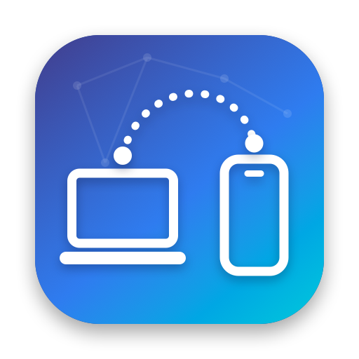
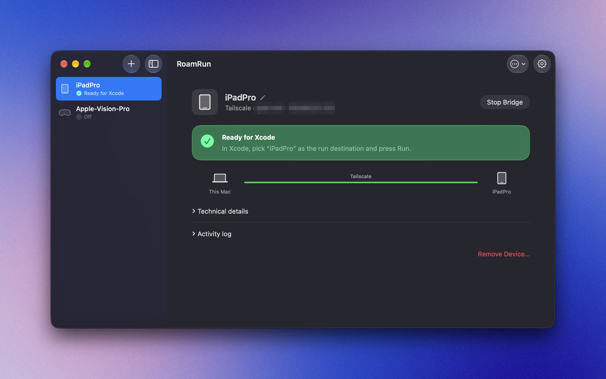
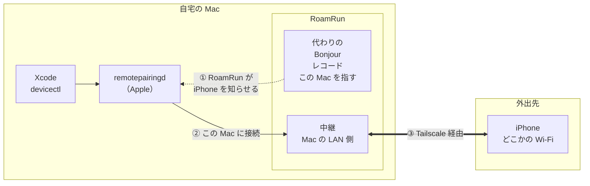
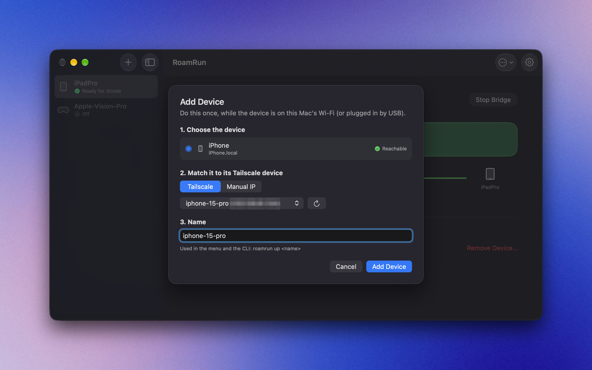
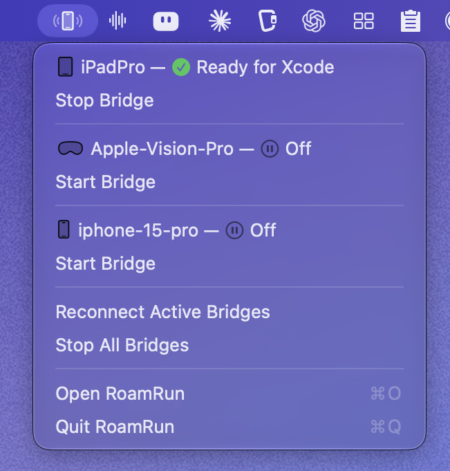

<p align="center">
  
</p>

<h1 align="center">RoamRun</h1>

<p align="center"><strong>Run your iOS apps wherever your device is.</strong></p>

<p align="center">
  <a href="https://github.com/mh-mobile/RoamRun/actions/workflows/ci.yml"></a>
  <a href="LICENSE"></a>
  
  <a href="#1-roamrun-%E3%82%92%E3%82%A4%E3%83%B3%E3%82%B9%E3%83%88%E3%83%BC%E3%83%AB%E3%81%99%E3%82%8B"></a>
  <a href="https://deepwiki.com/mh-mobile/RoamRun"></a>
</p>

<p align="center"><a href="https://mh-mobile.github.io/RoamRun/">Web サイト</a> · <a href="README.md">English</a> | 日本語</p>

<p align="center"></p>

**RoamRun を使うと、Mac とは別のネットワークにある iPhone を、Xcode からそのまま使えます。**

Xcode のワイヤレスデバッグは、ふつう Mac とデバイスが同じネットワークにある間しか使えません。RoamRun と [Tailscale](https://tailscale.com) があれば、Mac を自宅に置いたままデバイスを持ち出して、いつもどおり Xcode からビルド、実行、デバッグができます。iPhone、iPad、Apple Vision Pro、Apple TV で使えます。外出先から Mac を操作する方法は、[Mac から離れて作業する](#mac-から離れて作業する)にあります。

https://github.com/user-attachments/assets/c33edcd8-4d89-455b-8e93-fa8a2d007cb4



1. RoamRun が、デバイスの接続先はこの Mac だと、Mac のネットワークに知らせます。
2. Xcode がデバイスへの接続に使う macOS のサービス `remotepairingd` が、それを見つけて RoamRun に接続します。
3. RoamRun は通信を Tailscale 越しに双方向へ中継します。中身を読むことも書き換えることもありません。

詳しい流れは[RoamRun の仕組み](docs/how-it-works.ja.md)にあります。

Xcode からデバイスを使いたいだけなら、[はじめかた](#はじめかた)だけ読めば足ります。

## やりたいことから探す

| やりたいこと | 読むところ | 必要なもの |
|---|---|---|
| 別のネットワークのデバイスで、Xcode から実行してデバッグする | [はじめかた](#はじめかた) | iOS 17.4 以降 |
| Mac を自宅に置いて、手元のデバイスから作業する | [Mac から離れて作業する](#mac-から離れて作業する) | 同上 |
| コマンドや AI エージェントから、デバイスの画面を見てタップする | [デバイスの画面を見て操作する](#デバイスの画面を見て操作する) | iOS 27 以降 |
| Xcode のない相手のデバイスにも、ビルドをインストールする | [OTA でインストールする](#ブリッジを使わずにインストールするota) | Ad Hoc か Enterprise のビルド |
| CI からアプリをインストールして起動する | [CI から使う](#ci-からインストールして起動する) | iOS 27 以降 |
| クラウドの Mac など、デバイスのそばに置いたことのない Mac を使う | [離れた Mac をペアリングする](#離れた-mac-を-xcode-用にペアリングする) | iOS 27 と Xcode 27 |
| Linux や Windows からデバイスを使う | [`roamrunctl`](Rust/roamrunctl/README.ja.md) | iOS 27 以降 |

## はじめかた

**必要なもの**

- **Apple シリコンの Mac**（macOS 13 以降）と、管理者アカウント
- **iOS 17.4 以降の iPhone か iPad**、Apple Vision Pro、Apple TV のいずれか
- **Xcode 15 以降**（`roamrun logs` は 16 以降）。デバイスの iOS に対応したバージョンが必要です（[Apple の対応表](https://developer.apple.com/support/xcode/)）
- **Tailscale**。Mac とデバイスの両方に入れて接続をオンにし、同じ tailnet（Tailscale の自分専用のネットワーク）に入れます。両方とも同じアカウントでサインインすれば、同じ tailnet に入ります。デバイスのアドレスを手で入力すれば、ほかの mesh VPN も使えます
- **デバイスが接続する、インターネットにつながる Wi-Fi**。RoamRun がデバイスへの接続を始めるときに必要です。モバイル通信だけでは始められません

すべての条件は [docs/install.ja.md](docs/install.ja.md#必要なもの) にあります。

### 1. RoamRun をインストールする

```sh
brew install --cask mh-mobile/tap/roamrun
```

`/Applications` に RoamRun が入り、`roamrun` コマンドも使えるようになります。

Homebrew を使わない場合は、[Releases](https://github.com/mh-mobile/RoamRun/releases) から dmg をダウンロードし、RoamRun を「アプリケーション」にドラッグして開きます。最初の画面で、`roamrun` コマンドをインストールするか尋ねられます。あとから入れるときは、Open RoamRun › Settings › Command line tool › Install… を使います。

### 2. デバイスをこの Mac と一度ペアリングする

この Mac の Xcode からデバイスでアプリを実行できているなら、この手順は飛ばせます。

Xcode を開いて、iPhone か iPad を USB ケーブルで Mac につなぎ、ロックを解除します。確認が出たら「信頼」を選びます。続けて、デバイスの 設定 › プライバシーとセキュリティ › デベロッパモード をオンにします。デバイスは一度再起動します。スイッチはアプリが入ると現れるので、見当たらないときは Xcode からデバイスに一度 Run を実行します。

Xcode 27 と iOS 27 なら、同じ Wi-Fi 上でもペアリングできます。Xcode の Device Hub › ＋ › Pair Nearby Device を開きます。デバイスのデベロッパモードの画面で Mac を選び、Device Hub に表示されたコードを入力します。Apple Vision Pro と Apple TV も Device Hub からペアリングします。デバイスでは、設定 › 一般 › Remote Devices（Apple Vision Pro）か、設定 › リモコンとデバイス › リモコンアプリとデバイス（Apple TV）を開いておきます。

### 3. RoamRun にデバイスを追加する

「アプリケーション」から RoamRun を開きます。デバイスは USB でつなぐか、Mac と同じ Wi-Fi に接続しておきます。メニューバーの RoamRun のアイコンをクリックし、Open RoamRun › Add Device を選びます。デバイスを選び、Tailscale 上の同じデバイスと対応づけて（アドレスの直接入力もできます）、名前を付けます。

<p align="center">
  
  
</p>

### 4. ブリッジを始める

RoamRun では、デバイスへのつながりを「ブリッジ」と呼びます。**Start Bridge** を押して、次のどちらかが出るまで待ちます。

| 表示 | 意味 |
|---|---|
| **Ready for Xcode** | RoamRun が Tailscale か VPN 越しに、デバイスとの通信を中継しています。 |
| **On this Wi‑Fi** | RoamRun がデバイスを Mac と同じ Wi-Fi で見つけ、Xcode が直接つながっています。RoamRun は待機し、デバイスが別の Wi-Fi に移ると自動で引き継ぎます。この Wi-Fi からそのままモバイル通信に移ると、セッションは切れます。 |

### 5. Xcode から実行する

**On this Wi‑Fi** のときは、そのまま Xcode でデバイスを選んで Run を押せます。別のネットワークから試すには、USB ケーブルを抜いて、デバイスをインターネットにつながる別の Wi-Fi に移します。ほかの電話のテザリングでも構いません。**Ready for Xcode** と表示されたら、デバイスを選んで Run を押します。

デバッグ中はデバイスのロックを解除し、画面をつけたままにしてください。デバイスがスリープすると、デバイスの Tailscale も止まります。Mac もスリープさせないでください。Mac が数分間スリープすると、Xcode のセッションは切れます。

動かないときは `roamrun doctor` を実行します。Mac、Tailscale、デバイスの順に確かめて、直し方を表示します。それでも直らないときは、[困ったとき](#困ったとき)の表を見てください。

## Mac から離れて作業する

- **ブリッジを始めるには、インターネット接続のある Wi-Fi にデバイスを接続しておきます**。カフェやホテルの Wi-Fi、モバイルルーター、別の電話のテザリングが使えます。モバイル通信だけでは始められません。デバイス自身のテザリングも使えません。
- **動いているセッションをモバイル通信でも保つには**、Open RoamRun › Settings › Network › Keep debugging on cellular をオンにします。モバイル通信では Run のたびにモバイルデータを使うので、初期設定はオフです。この設定でセッションを保てるのは **Ready for Xcode** のときだけです。**On this Wi‑Fi** のままモバイル通信に移ると、セッションは切れます。
- **デバイスから Mac を操作するには**、AI エージェントのリモート機能、SSH のターミナル、画面共有のどれかを使います。エージェントの会話はそのサービスのサーバーを通ります。仕事用の Mac では会社の方針を確かめてください。

外出先でのデバッグは、自宅より時間がかかります。速くする方法と、上の条件の詳細は [docs/away.ja.md](docs/away.ja.md) にあります。

## コマンド

アプリには `roamrun` コマンドも付いています。SSH 越しの操作やスクリプトで使えます。`<name>` は、RoamRun でデバイスに付けた名前です。

```sh
roamrun devices                  # デバイスの一覧と状態を表示する
roamrun up <name>                # ブリッジを始める。Ctrl-C で止めるまで動く
roamrun up <name> -d             # バックグラウンドで始める
roamrun status <name>            # 使える状態なら終了コード 0。ロック中は警告を出す
roamrun down <name>              # ブリッジを止める
roamrun doctor                   # 問題の場所と直し方を調べる
roamrun run <name>               # プロジェクトのフォルダで、ビルド、インストール、起動まで行う
roamrun logs <name> <bundle-id>  # アプリを起動し直して、出力を流す
roamrun screenshot <name>        # 画面を PNG で保存する（Xcode 26.3 以降で確認）
```

ほかのコマンドと細かい動作は [docs/cli.ja.md](docs/cli.ja.md) にあります。`roamrun --help` ですべて確かめられます。

## AI エージェントから使う

Claude Code、Codex、Cursor などのエージェントは、RoamRun を使ってビルド、インストール、デバッグができます。次のコマンドはホームにあるエージェントのフォルダ（`.claude`、`.codex`、`.cursor`、`.gemini`、`.copilot`、`.devin`）すべてに、RoamRun のスキルを追加します。`--client claude` のように指定すると、そのエージェントだけに追加します。

```sh
roamrun init
```

RoamRun をアップデートしたら、バージョンをそろえるためにもう一度実行してください。詳しくは [docs/cli.ja.md](docs/cli.ja.md#ai-エージェントから使う) にあります。

[デバイス操作](#デバイスの画面を見て操作する)を設定してオンにすると、スキルを入れたエージェントは `roamrun look` や `roamrun tap` を実行できます。MCP のツールも使わせるには、次の順に設定します。

1. [デバイスを追加](#3-roamrun-にデバイスを追加する)して、[デバイス操作](#デバイスの画面を見て操作する)を設定します。
2. RoamRun のアプリを起動したままにします。
3. MCP サーバーを登録します（例: `claude mcp add roamrun -- roamrun mcp`）。ツールの一覧は[エージェントから使う](docs/device-control.ja.md#エージェントから使うmcp)にあります。

エージェントが見た画面は会話に入ります。サービスとして動くエージェントなら、その画面もサービスのサーバーに送られます。

## デバイスの画面を見て操作する

RoamRun を使うと、コマンドや AI エージェントからデバイスの画面を見て、タップ、スワイプ、文字入力、ボタン操作ができます。この機能を「デバイス操作」と呼びます。**iOS / iPadOS 27 以降**が必要です。ブリッジと Xcode は使いません。動作を確かめたのは iPhone で、iPad では試していません。

https://github.com/user-attachments/assets/ff7b6df9-cb46-4813-97ae-202dfc9551b9

> [!WARNING]
> **設定が終わると、デバイス操作はオンになります。オンの間は、この Mac で実行したどのプログラムでも、デバイスを見て操作でき、アプリを入れて起動もできます**。ロック画面、通知、メッセージも見えます。デバイスをロックしても、操作は止まりません。自分の作業で使っていないときは、デバイスのページのスイッチでオフにしてください。詳しくは[だれが使えるか](docs/device-control.ja.md#だれが使えるか)にあります。

**設定はデバイスごとに一度だけです**。デバイスを Mac と同じ Wi-Fi に接続して、次のように操作します。

1. RoamRun にデバイスがなければ、[追加します](#3-roamrun-にデバイスを追加する)。一覧に出ないときは、先に「はじめかた」の[手順 2](#2-デバイスをこの-mac-と一度ペアリングする)を済ませます。ブリッジは要りません。デバイスのページを開き、Device control › Set Up… を押します。
2. デバイスの 設定 › プライバシーとセキュリティ › デベロッパモード で「RoamRun（この Mac の名前）」を選び、Mac に表示されたコードを入力します。
3. RoamRun のアプリは起動したままにします。接続を保つのはアプリです。`roamrun status <name>` に「Device control: connected」と出るまで待ちます。

あとは画面を見てから操作します。タップの前には毎回、`look` で画面を撮り直します。

```sh
roamrun look <name> /tmp/now.png        # 画面を保存する。パス、サイズ、「look 12」のような番号を表示する
roamrun tap <name> 295 640 --look <n>   # その画像の位置をタップする。<n> は look が表示した番号
roamrun look <name> /tmp/now.png        # 次の操作の前に、もう一度見る
```

スワイプ、ピンチ、文字入力、操作の決まり、エージェントからの使い方は [docs/device-control.ja.md](docs/device-control.ja.md) にあります。

## 離れた Mac を Xcode 用にペアリングする

ブリッジには、Xcode がデバイスとペアリングした Mac が必要です。Xcode のペアリングは 1 つのネットワークの中で行われます。そのため、クラウドの Mac をそのままではペアリングできません。**iOS 27 と Xcode 27** なら、デバイスのそばにあるものが一度だけ仲介して、離れた Mac をペアリングできます。

**ペアリングした Mac は、そのあとデバイスを開発者として使えます**。アプリのインストールと実行、デバッグ、アプリのデータの読み取りができます。iPhone と iPad で取り消すには、設定 › プライバシーとセキュリティ › デベロッパモード で、その Mac を削除します。Apple Vision Pro と Apple TV からの削除は試していません。

<a id="apple-vision-pro"></a>

| デバイスのそばにあるもの | 方法 |
|---|---|
| RoamRun を入れた Mac（デバイスが iPhone か iPad の場合） | [2 台の Mac が同じ tailnet にある場合](docs/far-mac.ja.md#2-台の-mac-が同じ-tailnet-にある場合) |
| デバイスだけ（RoamRun Introducer アプリを Xcode で入れておく） | [Introducer アプリ](docs/far-mac.ja.md#デバイス自身に仲介させる) |
| Windows や Linux のマシン | [`roamrunctl`](docs/far-mac.ja.md#windows-や-linux-のマシンに仲介させる) |
| デバイスが Apple Vision Pro か Apple TV で、そばに RoamRun を入れた Mac がある（Introducer と `roamrunctl` では仲介できません） | [専用の手順](docs/far-mac.ja.md#apple-vision-pro) |

## ブリッジを使わずにインストールする（OTA）

`roamrun ota` は、tailnet の中のページにビルドを公開します。デバイスでそのページを開くと、HTTPS でビルドをインストールできます。ブリッジもペアリングも要りません。Wi-Fi でもモバイル通信でも使えます。次のような場合に使います。

- デバイスがモバイル通信だけで、ブリッジが動いていない
- この Mac とペアリングしたことのないデバイスに入れたい（ほかの人の電話など）
- Development ビルドではなく、テスターに配る Ad Hoc ビルドを試したい
- 同じ tailnet のほかの人に、Mac なしでインストールしてもらいたい

できるのは**インストールだけ**です。デバッガ、`roamrun logs`、`roamrun screenshot` は使えません。

> [!WARNING]
> **tailnet のメンバーなら、だれでもこのページを開いて、ビルドをインストールできます**（Ad Hoc のビルドは、プロファイルに入っているデバイスだけです）。tailnet を共有している場合は、公開する前に Tailscale のアクセス制御で制限してください。下のコマンドでデバイス名を指定しても、インストールできる人は変わりません。変わるのは、ビルドを確かめる対象のデバイスだけです。

```sh
roamrun ota build/MyApp.ipa            # RoamRun が知っているすべてのデバイスについて、ビルドを確かめる
roamrun ota iPhone build/MyApp.ipa     # 名前を指定すると、そのデバイスについてだけ確かめる
```

実行すると、そのビルドをインストールできるデバイスと、ページのアドレスが表示されます。デバイスでそのアドレスを開き、Install をタップします。ページには、アプリごとに直近 5 つのビルドが新しい順に並びます。

必要なものは次の 4 つです。

- **Release Testing（Ad Hoc）か Enterprise 用に署名した .ipa**。有料の Apple Developer アカウントが必要です。`roamrun ota` は、Development、App Store / TestFlight 用のビルドと、プロファイルを読み取れないビルド、プロファイルの期限が切れたビルドを拒否します。
- **tailnet の HTTPS**。Tailscale の管理画面の DNS で、MagicDNS と HTTPS 証明書を有効にしておきます。
- **tailnet に入ったデバイス**。ページを開くには、デバイスに Tailscale が必要です。Ad Hoc のビルドでは、ビルドのプロビジョニングプロファイルにもデバイスが入っている必要があります。
- **起動している RoamRun**。ページはアプリが配信します。`tailscale serve` を使い、既定のポートは 41443 です。

テスターの電話のように、ほかの人のデバイスに入れるときは、Ad Hoc のビルドを使います。

1. 相手が Tailscale を入れて、ビルドを公開する Mac と同じ tailnet に参加します。メンバーがアクセスできるのはこのページだけではなく、アクセス制御が許す範囲すべてです。先に制限してください。
2. ビルドする前に、相手のデバイスをプロファイルに追加します。
3. 相手がデバイスでページを開き、Install をタップします。
4. 相手がデベロッパモードをオンにします。アプリの起動に必要です。

確かめる対象のデバイスがプロファイルに 1 台も入っていないと、`roamrun ota` は警告を出します。ほかの人に配るビルドでは、これは想定どおりの動作です。Enterprise のビルドでは、代わりにデバイスで開発元を信頼します（[デバイス側の条件](docs/ota.ja.md#デバイス側の条件)）。

ページの公開をやめるには、`~/Library/Application Support/RoamRun/ota/` を削除します。保存されていたビルドも消えます。

ポートと Funnel、`--replace`、デバイス側のデベロッパモード、ビルドを保存する前に RoamRun が確かめることは、[docs/ota.ja.md](docs/ota.ja.md)にあります。

## CI からインストールして起動する

CI のジョブから、`.ipa` を Tailscale 越しにデバイスへインストールし、起動できます。`.ipa` は、そのジョブで作ったものでも、別に用意したものでもかまいません。使うのは [`roamrunctl`](Rust/roamrunctl/README.ja.md) です。ブリッジも Xcode も使わないので、Linux のランナーでもできます。ジョブは tailnet に参加したうえで、次のどちらかを行います。

- CI のマシンで roamrunctl を動かす。デバイス操作のペアリング（Xcode のものではありません）を、CI のシークレットに置きます。ペアリングはデバイスと同じ Wi‑Fi のマシンで一度だけ作ります。RoamRun の入った Mac なら `roamrun key create`、どのマシンでも `roamrunctl pair control --to` で作れます。
- 手元のマシンを relay にする。relay は、ペアリングを持って `roamrunctl mcp --http` を `--allow-install` 付きで動かすマシンです。ジョブは `.ipa` を relay に送り、relay がインストールして起動します。

1 つ目なら、手元で動かし続けるものは要りません。ペアリングを CI のシークレットに置かず、手元のマシンに残したいときは 2 つ目を選びます。

| CI | やり方 | 手順 |
|---|---|---|
| GitHub Actions | Tailscale の action のあとに [mh-mobile/roamrun-action](https://github.com/mh-mobile/roamrun-action) を置く。Linux と macOS のランナーで動く | [docs/ci.ja.md](docs/ci.ja.md) |
| Xcode Cloud | プロジェクトのスクリプトで Tailscale を userspace で動かし、Tailscale の HTTP プロキシを通してデバイスか relay に接続する（`ROAMRUNCTL_PROXY`、roamrunctl 0.10.0 以降）。または `curl` で relay を呼ぶ | [docs/xcode-cloud.ja.md](docs/xcode-cloud.ja.md) |
| Bitrise | Step の [mh-mobile/bitrise-step-roamrun](https://github.com/mh-mobile/bitrise-step-roamrun)。Step が自分で tailnet に参加する | [docs/bitrise.ja.md](docs/bitrise.ja.md) |

どれも、iOS 27.0 の iPhone 15 Pro で試しました。やり方と、試していないことは、それぞれの手順にあります。

必要なものはデバイスと `.ipa` です。デバイスは iOS 27 以降で、デベロッパモードをオンにします。Wi‑Fi につなぎ、Tailscale をオンにして、デバイスの起動後に一度はロックを解除しておきます。`.ipa` は、そのデバイスを含む開発用プロファイルで署名します。CI のシークレットを読める人は、デバイスを操作できます。それが誰か、各シークレットをどう取り消すかも、それぞれの手順に書いてあります。

## 困ったとき

まず `roamrun doctor` を実行します。これまでに起きた症状と対処は、次のとおりです。

| 症状 | 対処 |
|---|---|
| デバイスにつながらない | ロックを解除して画面をつけたまま、Wi-Fi に接続する |
| デバイスの Tailscale は接続中に見えるのに通信しない | VPN を一度オフにして、オンに戻す |
| USB のデバイスがあると、ブリッジ中の別のデバイスが Ready にならない | USB のデバイスを外す |
| そばにあるデバイスをブリッジし続け、**On this Wi‑Fi** にならない | システム設定 › プライバシーとセキュリティ › ローカルネットワーク で RoamRun を許可する。すでにオンなら、入れ直す前に[既知の問題](docs/troubleshooting.ja.md#既知の問題)を読む（保存したデバイスを残す方法があります） |
| デバイスを再起動したら、ブリッジが動かなくなった | デバイスのページで **Technical details** を開き、**Find RemotePairing Port** を押す。再起動のあと、一度 USB でつなぐ必要があったこともある |

RoamRun は Apple の非公開のプロトコルに依存しているので、iOS、macOS、Xcode の新しいバージョンで動かなくなる可能性があります。制限の一覧と、動作中に公開されるものは[制限と既知の問題](docs/troubleshooting.ja.md)にあります。

## Mac に作られるものとアンインストール

RoamRun が Mac に置くものと、削除の手順は、[docs/install.ja.md](docs/install.ja.md#mac-に作られるものとアンインストール) にあります。

## ドキュメント一覧

| ページ | 内容 |
|---|---|
| [インストールと必要なもの](docs/install.ja.md) | 必要なものすべて、アップデート、ソースからのビルド、アンインストール |
| [Mac から離れて作業する](docs/away.ja.md) | ネットワーク、モバイル通信、デバッグの速さ |
| [`roamrun` コマンド](docs/cli.ja.md) | ブリッジと Xcode のコマンド、ブリッジ越しのほかのツール、エージェント |
| [デバイス操作](docs/device-control.ja.md) | デバイスの操作、MCP、だれが使えるか |
| [離れた Mac](docs/far-mac.ja.md) | デバイスのそばに置いたことのない Mac のペアリング |
| [OTA インストール](docs/ota.ja.md) | インストールページの詳細 |
| [CI](docs/ci.ja.md) | GitHub Actions。[Xcode Cloud](docs/xcode-cloud.ja.md) と [Bitrise](docs/bitrise.ja.md) も |
| [`roamrunctl`](Rust/roamrunctl/README.ja.md) | Linux、Windows、別の Mac 向けのコマンド |
| [制限と既知の問題](docs/troubleshooting.ja.md) | 確かめること、動かないとわかっていること |
| [仕組み](docs/how-it-works.ja.md) | ブリッジの動作と、ソースの場所 |

## 問い合わせ

動かない場合や、説明が分かりにくい場合は、[issue](https://github.com/mh-mobile/RoamRun/issues) を作成してください。`roamrun --version` の出力、macOS・Xcode・iOS のバージョン、`roamrun doctor --json` の出力を添えてもらえると助かります。投稿する前に、デバイスの識別子、名前、ネットワークアドレスを伏せてください。

脆弱性の報告のしかたと、RoamRun が外部に公開するものについては、[SECURITY.md](SECURITY.md)（英語）にまとめてあります。

## クレジット

RoamRun は、mh-mobile の指示のもとで、Claude Code（Claude Opus 5.5）が作りました。

基本的な中継の仕組みは、`dns-sd -P` と `socat` を使った次の公開記事を参考にしています。

- Kevin Paterson, ["How to remotely iterate & deploy your sideloaded iOS-apps over tailnet"](https://dev.to/kvnpt/how-to-remotely-iterate-deploy-your-sideloaded-ios-apps-over-tailnet-jak)

デバイス操作は、[idevice](https://github.com/jkcoxson/idevice)（Jackson Coxson）を使っています。Mac がデバイスと通信するためのプロトコルを、Rust で実装したものです。RoamRun は、フォークの特定のコミットからビルドしています。idevice と、ほかのクレートのライセンスは、[THIRD-PARTY-LICENSES.txt](THIRD-PARTY-LICENSES.txt) にあります。同じファイルが、アプリにも入っています。

## 記事

[別の Wi-Fi にいる iPhone を Xcode からそのまま使えるアプリ「RoamRun」を作った](https://zenn.dev/mh/articles/4380fe7546a237)
（Zenn、2026-10-29）

RoamRun を作った理由と使い方を、0.11.0 の時点で書いた記事です。

## 関連プロジェクト

同じ問題に取り組んでいるプロジェクトや、近い領域を別の道具で扱っているプロジェクトです。

- [Viaaaron/iphone-tailnet-bridge](https://github.com/Viaaaron/iphone-tailnet-bridge)：Bonjour と socat の中継を、シェルスクリプトで実現したもの
- [ahmadtawakol/iphone-tailnet-bridge](https://github.com/ahmadtawakol/iphone-tailnet-bridge)：上のフォークに、macOS アプリと Go のツールを加えたもの
- [CodeEagle/remote-ios-deploy-skill](https://github.com/CodeEagle/remote-ios-deploy-skill)：同じ方式を、エージェントのスキルにしたもの
- [lyo-eos/ios-ota](https://github.com/lyo-eos/ios-ota)：署名済みのアプリを、Tailscale 越しにインストールするもの
- [joshuaswarren/omarchy-apple-dev](https://github.com/joshuaswarren/omarchy-apple-dev)：Xcode も Mac も使わずに、Linux で iOS アプリをビルドして、デバイスに入れるもの

## ライセンス

[MIT](LICENSE)
