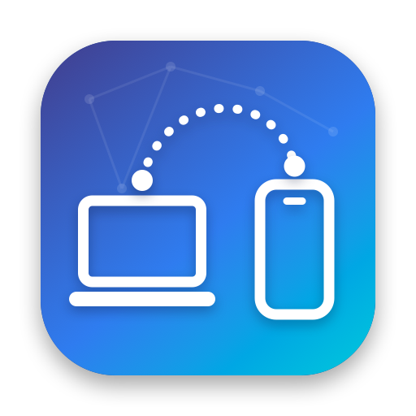
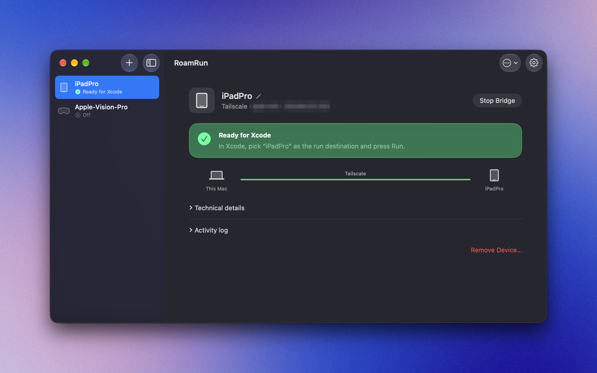
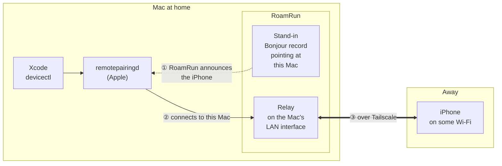
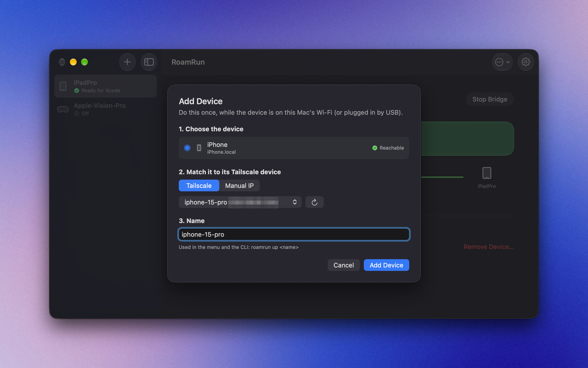
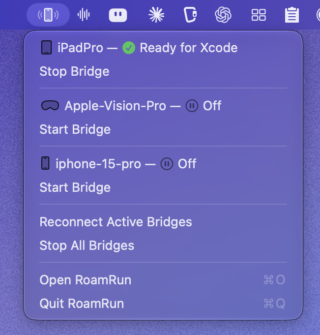

<p align="center">
  
</p>

<h1 align="center">RoamRun</h1>

<p align="center"><strong>Run your iOS apps wherever your device is.</strong></p>

<p align="center">
  <a href="https://github.com/mh-mobile/RoamRun/actions/workflows/ci.yml"></a>
  <a href="LICENSE"></a>
  
</p>

<p align="center"><a href="https://mh-mobile.github.io/RoamRun/">Website</a> · English | <a href="README.ja.md">日本語</a></p>

<p align="center"></p>

**RoamRun lets Xcode use your iPhone when it is on a different network from your Mac.**

Xcode's wireless debugging normally works only while the Mac and the device are on the same
network. With RoamRun and [Tailscale](https://tailscale.com), you can leave the Mac at home, take
the device with you, and keep building, running and debugging from Xcode as usual. It works with
iPhone, iPad, Apple Vision Pro and Apple TV. How to drive the Mac from where you are is in
[Working away from the Mac](#working-away-from-the-mac).



1. RoamRun announces the device on this Mac's network, with this Mac as its address.
2. `remotepairingd`, the macOS service Xcode uses to reach devices, finds it and connects to RoamRun.
3. RoamRun relays the connection both ways over Tailscale, without reading or changing it.

The details are in [How RoamRun works](docs/how-it-works.md).

If you only want Xcode to reach your device, [Get started](#get-started) is all you need to read.

## What do you want to do?

| I want to… | Read | Needs |
|---|---|---|
| Run and debug from Xcode on a device on another network | [Get started](#get-started) | iOS 17.4 or later |
| Work from the device while the Mac stays at home | [Working away from the Mac](#working-away-from-the-mac) | The same |
| See and tap the device's screen from a command or an AI agent | [Seeing and operating the device](#seeing-and-operating-the-device) | iOS 27 or later |
| Install a build on a device with no Xcode at its end, even someone else's | [Installing over the air](#installing-without-the-bridge-over-the-air) | An Ad Hoc or Enterprise build |
| Install and launch my app from CI | [Installing from CI](#installing-and-launching-from-ci) | iOS 27 or later |
| Use a Mac that was never near the device, such as a cloud Mac | [Pairing a far Mac](#pairing-a-far-mac-for-xcode) | iOS 27 and Xcode 27 |
| Use a device from Linux or Windows | [`roamrunctl`](Rust/roamrunctl/README.md) | iOS 27 or later |

## Get started

**You need:**

- A **Mac with Apple silicon** on macOS 13 or later, and an administrator account
- An **iPhone or iPad on iOS 17.4 or later**, an Apple Vision Pro, or an Apple TV
- **Xcode 15 or later** (16 for `roamrun logs`), new enough for the device's iOS
  ([Apple's table](https://developer.apple.com/support/xcode/))
- **Tailscale** on both the Mac and the device, turned on and in the same *tailnet*, your private
  Tailscale network. Signing in to both with one account does that. Another mesh VPN also works if
  you enter the device's address by hand
- The device **on a Wi-Fi with internet access** when RoamRun starts connecting to it. Cellular alone
  can't start a connection

The full list is in [docs/install.md](docs/install.md#requirements).

### 1. Install RoamRun

```sh
brew install --cask mh-mobile/tap/roamrun
```

This puts RoamRun in Applications and makes the `roamrun` command available.

Without Homebrew, download the dmg from [Releases](https://github.com/mh-mobile/RoamRun/releases),
drag RoamRun to Applications and open it. Its first screen offers to install the `roamrun` command.
If you skip it, it is later under Open RoamRun › Settings › Command line tool › Install….

### 2. Pair the device with this Mac, once

If this Mac's Xcode already runs apps on the device, skip this step.

Open Xcode and connect the iPhone or iPad to the Mac with a USB cable. Unlock it, and tap Trust if
it asks. Then, on the device, turn on Settings › Privacy & Security › Developer Mode; it restarts
once. The switch appears once an app is installed, so if it isn't there yet, press Run on the
device in Xcode once.

With Xcode 27 and iOS 27 you can pair on the same Wi-Fi instead: in Xcode's Device Hub › + › Pair
Nearby Device, then on the device under Developer Mode, pick the Mac and enter the code Device Hub
shows. An Apple Vision Pro or Apple TV pairs in Device Hub too, with Settings › General › Remote Devices
(Apple Vision Pro) or Settings › Remotes and Devices › Remote App and Devices (Apple TV) left open
on it.

### 3. Add the device to RoamRun

Open RoamRun from Applications. With the device on USB or on the Mac's Wi-Fi, click RoamRun's menu
bar icon, then Open RoamRun › Add Device. Pick the device, match it to the
same device on Tailscale (or enter an address), and give it a name.

<p align="center">
  
  
</p>

### 4. Start the bridge

RoamRun calls its connection to the device a *bridge*. Press **Start Bridge** and wait for one of
these:

| RoamRun shows | What it means |
|---|---|
| **Ready for Xcode** | RoamRun is carrying the connection to the device over Tailscale or your VPN. |
| **On this Wi‑Fi** | RoamRun found the device on the Mac's Wi-Fi, so Xcode reaches it directly. RoamRun stands aside, and takes over by itself when the device moves to another Wi-Fi. If the device goes from this Wi-Fi directly to cellular, the session ends. |

### 5. Run from Xcode

With **On this Wi‑Fi**, you can pick the device in Xcode and press Run right away. To try it from
another network, unplug the USB cable and move the device to another Wi-Fi with internet access,
such as another phone's hotspot. Wait for **Ready for Xcode**, then pick the device and press Run.

While debugging, keep the device unlocked with its screen on: when it sleeps, Tailscale on it pauses
too. Keep the Mac awake as well: if it sleeps for a few minutes, Xcode's session ends.

If something doesn't work, run `roamrun doctor`. It checks the Mac, Tailscale and the device step
by step, and says how to fix what it finds. If that doesn't settle it, see
[When something goes wrong](#when-something-goes-wrong).

## Working away from the Mac

- **To start a bridge, the device needs a Wi-Fi with internet access**, such as a café's or hotel's
  Wi-Fi, a pocket router, or another phone's hotspot. Cellular alone does not work, and neither
  does the device's own hotspot.
- **To keep a running session on cellular**, turn on Open RoamRun › Settings › Network › Keep
  debugging on cellular. It is off by default, because every Run on cellular uses the device's
  mobile data. It works only from **Ready for Xcode**: leaving **On this Wi‑Fi** straight onto cellular
  ends the session.
- **To drive the Mac from the device**, use an AI agent's remote feature, a terminal over SSH, or
  Screen Sharing. An agent's conversation goes through that service's servers, so check your
  company's policy on a work Mac.

Debugging is slower away from home. [docs/away.md](docs/away.md) has how to speed it up, and the
cases above in full.

## Commands

RoamRun comes with a `roamrun` command, for use over SSH or in scripts. `<name>` is the name you
gave the device in RoamRun.

```sh
roamrun devices                  # list your devices and their status
roamrun up <name>                # start a bridge; it runs until Ctrl-C
roamrun up <name> -d             # start it in the background
roamrun status <name>            # exits 0 when ready; warns if the device is locked
roamrun down <name>              # stop a bridge
roamrun doctor                   # find out what's wrong, and how to fix it
roamrun run <name>               # in a project folder: build, install, launch
roamrun logs <name> <bundle-id>  # relaunch the app and stream its output
roamrun screenshot <name>        # save the screen as PNG (tried with Xcode 26.3 and later)
```

More commands and what each does are in [docs/cli.md](docs/cli.md). `roamrun --help` lists everything.

## Using it from an AI agent

Claude Code, Codex, Cursor and other agents can build, install and debug through RoamRun. This
adds RoamRun's skill to every agent folder in your home (`.claude`, `.codex`, `.cursor`, `.gemini`,
`.copilot`, `.devin`); `--client claude` limits it to one:

```sh
roamrun init
```

Run it again after updating RoamRun, so that the two match. More in
[docs/cli.md](docs/cli.md#using-it-from-an-ai-agent).

With [device control](#seeing-and-operating-the-device) set up and on, an agent that has the skill
can already run `roamrun look` and `roamrun tap`. To give it the MCP tools as well:

1. [Add the device](#3-add-the-device-to-roamrun) and set up
   [device control](#seeing-and-operating-the-device).
2. Keep the RoamRun app running.
3. Register its MCP server, for example with `claude mcp add roamrun -- roamrun mcp`
   ([the tools](docs/device-control.md#for-an-agent-mcp)).

The pictures an agent looks at go into its conversation, which a hosted agent sends to its service.

## Seeing and operating the device

RoamRun can show the device's screen and tap, swipe, type and press its buttons, from a command or
an AI agent. This is called *device control*. It needs **iOS or iPadOS 27 or later**, and neither
the bridge nor Xcode. It was run on an iPhone; an iPad has not been tried.

> [!WARNING]
> **Set Up leaves device control on. While it is on, any program you run on this Mac can see and
> operate the device, lock screen, notifications and messages included, and install and launch
> apps on it.** Locking the device doesn't stop it. Turn it off with the switch on the device's page
> when nothing of yours is using it. See [who can use it](docs/device-control.md#who-can-use-it).

**Set up once for each device**, with the device on the Mac's Wi-Fi:

1. [Add the device](#3-add-the-device-to-roamrun) if it isn't in RoamRun yet. If it isn't listed
   there, do [step 2 of Get started](#2-pair-the-device-with-this-mac-once) first. You don't need the
   bridge. Then open its page and press Device control › Set Up….
2. On the device, under Settings › Privacy & Security › Developer Mode, pick "RoamRun (this Mac's
   name)" and enter the code the Mac shows.
3. Keep the RoamRun app running: it holds the connection. Wait until `roamrun status <name>` shows
   "Device control: connected".

Then look at the screen and act on it. Each tap needs a new look:

```sh
roamrun look <name> /tmp/now.png        # save the screen; prints the path, its size, then "look 12"
roamrun tap <name> 295 640 --look <n>   # tap a point in that image; <n> is the number look printed
roamrun look <name> /tmp/now.png        # look again before the next action
```

Swipe, pinch, typing, the rules, and use from an agent are in
[docs/device-control.md](docs/device-control.md).

## Pairing a far Mac for Xcode

A bridge needs a Mac that Xcode has paired with the device, and Xcode pairs on one network. A cloud
Mac is never on the device's network. With **iOS 27 and Xcode 27**, something beside the device can
introduce the far Mac, once.

**A Mac you introduce can use the device as a developer from then on**: install and run apps, debug
them, read their data. To withdraw that on an iPhone or iPad, remove the Mac under Settings ›
Privacy & Security › Developer Mode. Removing it from an Apple Vision Pro or Apple TV hasn't been
tried.

<a id="apple-vision-pro"></a>

| What is beside the device | How |
|---|---|
| A Mac with RoamRun, beside an iPhone or iPad | [Both Macs on one tailnet](docs/far-mac.md#both-macs-on-one-tailnet) |
| Only the device, with the RoamRun Introducer app installed from Xcode beforehand | [The Introducer app](docs/far-mac.md#from-the-device-itself) |
| A Windows or Linux machine | [`roamrunctl`](docs/far-mac.md#from-a-windows-or-linux-machine) |
| The device is an Apple Vision Pro or Apple TV, with a Mac with RoamRun beside it (the Introducer and `roamrunctl` can't introduce these) | [Its own steps](docs/far-mac.md#apple-vision-pro) |


## Installing without the bridge: over the air

`roamrun ota` publishes a build on a page in your tailnet, and you install it from that page on
the device, over HTTPS. This needs neither the bridge nor a pairing, and works on Wi-Fi and cellular alike. Use
it when:

- the device is on cellular and no bridge is running;
- the device was never paired with this Mac, such as someone else's phone;
- you want to try the Ad Hoc build your testers will get, not a Development build;
- someone else on your tailnet should install it, with no Mac at their end.

It is **install only**: no debugger, no `roamrun logs`, no `roamrun screenshot`.

> [!WARNING]
> **Anyone on your tailnet can open the page and install the builds on it** (an Ad Hoc build, only
> on devices in its profile). On a tailnet you share, restrict it with Tailscale's access rules
> before you publish. Naming a device below does not limit who can install: it only chooses which
> devices the build is checked against.

```sh
roamrun ota build/MyApp.ipa            # checks it against every device RoamRun knows
roamrun ota iPhone build/MyApp.ipa     # or name one, to check just that device
```

The command prints which of your devices the build covers, and the address of the page. Open that
address on the device and tap Install. The page lists the last 5 builds of each app, newest first.

What it needs:

- An **.ipa signed for Release Testing (Ad Hoc) or Enterprise**, which takes a paid Apple
  Developer account. `roamrun ota` refuses a Development build, an App Store or TestFlight build,
  one without a readable provisioning profile, and one whose profile has expired.
- **HTTPS in your tailnet**: MagicDNS and HTTPS certificates turned on, in Tailscale's admin console
  under DNS.
- **The device on your tailnet**, with Tailscale on it, to open the page. For an Ad Hoc build, the
  device also has to be in the build's provisioning profile.
- **RoamRun running.** The app serves the page, through `tailscale serve`, on port 41443 by default.

To install on someone else's device, such as a tester's phone, use an Ad Hoc build:

1. They install Tailscale and join your tailnet. A member reaches whatever your access rules allow,
   not only this page, so set the rules first.
2. Add their device to the build's profile before you build.
3. They open the page on the device and tap Install.
4. They turn on Developer Mode, which the app needs to launch.

`roamrun ota` warns when the profile names none of the devices it checks the build against. For a
build meant for someone else, that is expected. An Enterprise build needs its developer trusted on
the device instead: [On the device](docs/ota.md#on-the-device).

To take the page down, delete `~/Library/Application Support/RoamRun/ota/`. The builds stored there
go with it.

The rest — the port and Funnel, `--replace`, Developer Mode on the device, and what RoamRun checks
before it stores a build — is in [docs/ota.md](docs/ota.md).

## Installing and launching from CI

A CI job can install an `.ipa` on your device (one it built, or one it was given) and launch it,
over Tailscale, with [`roamrunctl`](Rust/roamrunctl/README.md). It goes through neither the bridge
nor Xcode, so a Linux runner can do it too. The job joins your tailnet, then does one of two
things:

- **roamrunctl on the CI machine**, with a device-control pairing to the device (not Xcode's) kept
  as a CI secret. It is made once on a machine on the device's
  Wi‑Fi: `roamrun key create` on a Mac with RoamRun, or `roamrunctl pair control --to` on any machine.
- **Through a relay machine of yours**: it runs `roamrunctl mcp --http` with `--allow-install` and keeps that pairing; the
  job sends it the `.ipa`, and it installs and launches.

The first needs nothing of yours kept running. Take the second if the pairing must stay on your
machine rather than in the CI's secrets.

| CI | How | Guide |
|---|---|---|
| GitHub Actions | the action [mh-mobile/roamrun-action](https://github.com/mh-mobile/roamrun-action), after Tailscale's own action; Linux and macOS runners | [docs/ci.md](docs/ci.md) |
| Xcode Cloud | a script in the project runs Tailscale in userspace and reaches the device or a relay through Tailscale's HTTP proxy (`ROAMRUNCTL_PROXY`, roamrunctl 0.10.0 or later), or calls a relay with `curl` | [docs/xcode-cloud.md](docs/xcode-cloud.md) |
| Bitrise | the Step [mh-mobile/bitrise-step-roamrun](https://github.com/mh-mobile/bitrise-step-roamrun), which joins the tailnet itself | [docs/bitrise.md](docs/bitrise.md) |

Each was run with an iPhone 15 Pro on iOS 27.0; the guides say how, and what wasn't tried. What it
needs: a device on iOS 27 or later with Developer Mode on, on Wi‑Fi with Tailscale on and unlocked
once since it started; and an `.ipa` signed with a development profile that lists it. Whoever can
read the CI's secrets can operate the device; the guides say who that is and how each secret is
taken back.

## When something goes wrong

Run `roamrun doctor` first. Problems seen so far, and what fixes them:

| What you see | What to do |
|---|---|
| The device doesn't connect | Unlock it and keep its screen on, on a Wi-Fi |
| Tailscale on the device looks connected but passes nothing | Turn its VPN off and on |
| A bridged device stays not Ready while another is on USB | Unplug the USB device |
| RoamRun keeps bridging a device beside the Mac and never shows **On this Wi‑Fi** | Allow RoamRun under System Settings › Privacy & Security › Local Network. If it is already on, see [Known problems](docs/troubleshooting.md#known-problems) before reinstalling: it says how to keep your saved devices |
| The bridge stops working after the device restarted | On the device's page, open **Technical details** and press **Find RemotePairing Port**. Xcode has also needed the device on USB once after a restart |

RoamRun relies on Apple's private protocols, so a new iOS, macOS or Xcode may break it. The full
list of limits, and what RoamRun exposes while it runs, is in
[Limitations and known issues](docs/troubleshooting.md).

## What it creates on your Mac, and uninstalling

What RoamRun keeps on your Mac, and the steps to remove it, are in
[docs/install.md](docs/install.md#what-it-creates-on-your-mac-and-uninstalling).

## All documentation

| Page | What it covers |
|---|---|
| [Install and requirements](docs/install.md) | Everything needed, updating, building from source, uninstalling |
| [Working away from the Mac](docs/away.md) | Networks, cellular, debugging speed |
| [The `roamrun` command](docs/cli.md) | The bridge and Xcode commands, other tools over the bridge, agents |
| [Device control](docs/device-control.md) | Operating a device, MCP, who can use it |
| [Far Macs](docs/far-mac.md) | Pairing a Mac that was never near the device |
| [Over-the-air installs](docs/ota.md) | The install page in detail |
| [CI](docs/ci.md) | GitHub Actions; also [Xcode Cloud](docs/xcode-cloud.md) and [Bitrise](docs/bitrise.md) |
| [`roamrunctl`](Rust/roamrunctl/README.md) | The command for Linux, Windows and other Macs |
| [Limitations and known issues](docs/troubleshooting.md) | What to check, what is known not to work |
| [How it works](docs/how-it-works.md) | What the bridge does, and where it is in the source |

## Getting help

Something broken, or the docs unclear? Open an
[issue](https://github.com/mh-mobile/RoamRun/issues). Please include `roamrun --version`, your
macOS, Xcode and iOS versions, and the output of `roamrun doctor --json`. Remove device identifiers, names and network addresses
before you post it.

How to report a vulnerability, and what RoamRun exposes: [SECURITY.md](SECURITY.md).

## Credits

RoamRun was built by Claude Code, powered by Claude Opus 5.5, under mh-mobile's direction.

It builds on a public write-up: Kevin Paterson,
["How to remotely iterate & deploy your sideloaded iOS-apps over tailnet"](https://dev.to/kvnpt/how-to-remotely-iterate-deploy-your-sideloaded-ios-apps-over-tailnet-jak),
which shows the same arrangement with `dns-sd -P` and `socat`.

Device control is built on [idevice](https://github.com/jkcoxson/idevice) (Jackson Coxson), a Rust
implementation of the protocols a Mac speaks to a device; RoamRun builds it from a fork at a
pinned commit. The licenses of it and of the other crates are in
[THIRD-PARTY-LICENSES.txt](THIRD-PARTY-LICENSES.txt), which the app carries too.

## Article

[I Built "RoamRun", an App That Lets You Use an iPhone on a Different Wi-Fi Directly from Xcode](https://zenn.dev/mh/articles/4380fe7546a237?locale=en)
(Zenn, 2026-10-29)

Why RoamRun was made and how it is used, as of 0.11.0.

## Related projects

Projects on the same problem, or the same ground with other tools:

- [Viaaaron/iphone-tailnet-bridge](https://github.com/Viaaaron/iphone-tailnet-bridge) — Bonjour plus a socat relay, as shell scripts
- [ahmadtawakol/iphone-tailnet-bridge](https://github.com/ahmadtawakol/iphone-tailnet-bridge) — a fork of the above with a macOS app and Go tools
- [CodeEagle/remote-ios-deploy-skill](https://github.com/CodeEagle/remote-ios-deploy-skill) — the same approach as an agent skill
- [lyo-eos/ios-ota](https://github.com/lyo-eos/ios-ota) — installs signed apps over Tailscale
- [joshuaswarren/omarchy-apple-dev](https://github.com/joshuaswarren/omarchy-apple-dev) — builds iOS apps on Linux and puts them on a device, with no Xcode and no Mac

## License

[MIT](LICENSE)
