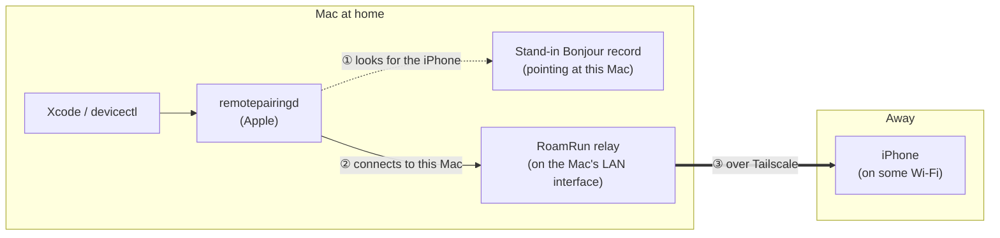

<p align="center">
  
</p>

<h1 align="center">RoamRun</h1>

<p align="center"><strong>Run your iOS apps wherever your device is.</strong></p>

<p align="center">
  <a href="https://github.com/mh-mobile/RoamRun/actions/workflows/ci.yml"></a>
  <a href="LICENSE"></a>
  
</p>

<p align="center"><a href="https://mh-mobile.github.io/RoamRun/">Website</a> · English | <a href="README.ja.md">日本語</a></p>

<p align="center"></p>

RoamRun is a macOS menu bar app, with a `roamrun` command, that makes Xcode's wireless debugging
work over Tailscale or another mesh VPN. An iPhone, iPad or Apple Vision Pro on a different
network from the Mac stays visible to Xcode and `devicectl` as a local device: you can build,
install, launch and debug as usual. RoamRun calls that connection a bridge.

It also does three related things:

- **Shows and operates the device's screen** from the command line or from an AI agent
  ([Seeing and operating the device](#seeing-and-operating-the-device)).
- **Pairs a Mac that was never near the device** — a cloud Mac, for example
  ([A Mac the device was never near](#pairing-a-far-mac-for-xcode)).
- **Lets a device install a build by itself**, with no bridge and no pairing
  ([Installing without the bridge](#installing-without-the-bridge-over-the-air)).

For a machine without RoamRun — Linux, Windows, or another Mac — there is a separate command,
[`roamrunctl`](Rust/roamrunctl/README.md).

## Why it is needed

Since iOS 17, wireless debugging finds devices with Bonjour (`_remotepairing._tcp`). Bonjour
stays on the local network, so it does not cross a VPN such as Tailscale. The Mac's
`remotepairingd` also ties its connection to the network interface where it found the device (as
seen), so advertising the device's VPN address is not enough either.

RoamRun tells Xcode that the device is on the same Wi-Fi, and carries the traffic over the VPN:



Pairing verification and encryption stay end to end between the Mac and the device, as Apple
implements them. RoamRun relays bytes; it does not read or change them. The details are in
[docs/how-it-works.md](docs/how-it-works.md).

## Requirements

- **A Mac with Apple silicon on macOS 13 or later**, and an administrator account. RoamRun reads
  `remotepairingd`'s log with `log stream`, and stops with a message when macOS answers that an
  administrator is required.
- **A device on iOS 17.4 or later.** RoamRun relays TCP only; it has no support for the QUIC
  tunnel of iOS 17.0–17.3. iPad and Apple Vision Pro were also used; "device" below means any
  of the three.
- **Xcode with `devicectl`** (Xcode 15 or later) that supports the device's iOS version; see
  [Apple's table](https://developer.apple.com/support/xcode/). `roamrun logs` and
  `roamrun run --logs` use `devicectl`'s `--console`, which came with Xcode 16.
- **Tailscale**, or another mesh VPN where you enter the device's address by hand, connected on
  both the Mac and the device.
- **The device paired with this Mac once**, with Developer Mode on: over USB, or with Xcode 27
  and iOS 27 on the same Wi-Fi (Device Hub › + › Pair Nearby Device).
- **The device on a Wi-Fi network** when the bridge starts. On cellular alone the device did not
  answer when tried. Once the bridge is Ready the device can move to cellular and keep its session,
  if Keep debugging on cellular is on (it is off by default); see
  [Working away from the Mac](#working-away-from-the-mac).

Seeing and operating the device needs iOS 27 or later. Pairing a far Mac for Xcode needs iOS 27
and Xcode 27.

## Install

With Homebrew:

```sh
brew install --cask mh-mobile/tap/roamrun
```

This installs `RoamRun.app` in `/Applications` and links the `roamrun` command. To update:
`brew upgrade --cask roamrun`.

Without Homebrew, download the dmg from
[Releases](https://github.com/mh-mobile/RoamRun/releases), drag RoamRun to Applications and open
it. The first screen offers to install the `roamrun` command; later it is under Open RoamRun ›
Settings › Command line tool › Install…. To update, quit RoamRun and replace the app. There is no
automatic update. Saved devices stay, and bridges that were running start again.

The app is signed with a Developer ID and notarized by Apple.

To build from source you need Xcode 26 or later and Rust from [rustup](https://rustup.rs) (`make`
builds device control's library with the Rust version the repository names):

```sh
git clone https://github.com/mh-mobile/RoamRun && cd RoamRun
make run            # builds RoamRun.app here and opens it; quit an installed RoamRun first
make install-cli    # links /usr/local/bin/roamrun to this build (BINDIR=$HOME/bin for another place)
```

A build without a signing certificate is signed ad hoc, and macOS treats each rebuild as another
app. If you set up device control (seeing and operating the device) with such a build, the
Keychain asks about RoamRun's key after every rebuild: answer "Always Allow". On a Mac reached
over SSH only there is no screen to answer on, and the new build cannot read the saved pairings:
delete the two Keychain items (see
[What it creates on your Mac](#what-it-creates-on-your-mac-and-uninstalling)) and set up or import
the pairing again. `make app` signs with an Apple Development certificate when the keychain holds
one.

## Usage

1. With the device on USB or on the Mac's Wi-Fi: menu bar icon › Open RoamRun › Add Device.
2. Pick the device from the list, match it to the same device on Tailscale (or enter an address),
   and give it a name. The commands below take that name.
3. Press Start Bridge, and wait for "Ready for Xcode" (or "On this Wi‑Fi").
4. The device stays in Xcode's Devices window. Build, install and debug as usual.

While the device is on the Mac's own Wi-Fi the bridge stands aside and shows "On this Wi‑Fi":
Xcode reaches the device directly. When the device moves to another network, the bridge takes
over by itself. When the Mac's address changes, the bridge restarts.

<p align="center">
  
  
</p>

## Working away from the Mac

You can leave the Mac at home and run the whole build-and-try loop from the device in your hand.

**To start a bridge, the device has to be on a Wi-Fi with internet access.** A café's or hotel's Wi-Fi, a
pocket router, or another phone's hotspot all serve. Cellular alone does not, and neither does the
device's own hotspot, since the device is then not on a Wi-Fi itself.

**To keep a session on cellular**, turn on Settings › Network › Keep debugging on cellular. It is
off by default, because with it on every Run uses the device's mobile data. It applies only from
Ready for Xcode, the bridged state. When the device shows "On this Wi‑Fi", Xcode reaches it over the local network, so leaving
home straight onto cellular ends the session. To avoid that, keep the device on a Wi-Fi that
another device makes even at home — a travel router, or a spare phone sharing its connection — so
that RoamRun bridges it from the start.

A new session needs Wi-Fi again, for example after the device restarts. With the setting off,
RoamRun closes the session when the device leaves Wi-Fi and reconnects when it is back.

On a Wi-Fi with a sign-in page, sign in first. Joining a Wi-Fi marked "No Internet Connection" and
sending traffic over cellular did not work when tried. Where a network blocks UDP, Tailscale goes
through its relay servers: that works, more slowly, and `roamrun doctor` shows the path.

Three ways to drive the Mac from the device:

| Method | On the device | Good for |
|---|---|---|
| An AI agent | A feature for driving an agent on your Mac from your phone, such as Claude Code's [Remote Control](https://code.claude.com/docs/en/remote-control.md) or [Codex](https://learn.chatgpt.com/docs/remote-connections) in the ChatGPT app | Asking "build it and run it on my iPhone", looking at the result, and repeating |
| A terminal over SSH | An SSH client and Tailscale | Using `roamrun`, `xcodebuild`, `devicectl` and `lldb` directly |
| The Mac's screen | Screen Sharing or a VNC client, and Tailscale | Xcode's Run and breakpoints in its window |

Away from home, running with the debugger takes longer than at home: attaching lldb takes hundreds
of round trips. With a 600 KB app over tethering it took about a minute with the debugger and
about 4 seconds without. When you don't need breakpoints, turn off "Debug executable" under Edit
Scheme › Run › Info. When you do, turning off "Queue Debugging" (Options) and "Main Thread
Checker" (Diagnostics) there made it faster.

The agent features in the table send your conversation through each service's servers. Check your
company's policy before using them on a work Mac.

## CLI

The app's binary is also the `roamrun` command, for use over SSH or in scripts.

```sh
roamrun devices               # saved devices (name, UDID, id) and their status
roamrun up <name>             # start a bridge and show its progress; it runs until Ctrl-C
roamrun up <name> -d          # start it in the background; it survives closing the terminal
roamrun status <name>         # exits 0 when Xcode can use the device
roamrun down <name>           # stop a bridge, whether the app or another terminal started it
roamrun doctor                # check Mac → Tailscale → device step by step, and say how to fix
roamrun run <name> [--scheme S] [--logs]   # in a project folder: build, install, launch
roamrun install <name> <App.ipa|App.app>   # install a build signed for the device
roamrun logs <name> <bundle-id>            # relaunch the app and stream its print / os_log output
roamrun screenshot <name> [file.png]       # save the device's screen as PNG and print the path
roamrun ota [<name>] <App.ipa> [--replace] # publish a build for a device to install by itself
```

`<name>` is the name you gave the device in RoamRun. It is
case-insensitive and unique; `roamrun devices` lists the names, and the pencil on the device's page
renames it. The name in the device's Settings app is a separate one. When no saved device has that name, the device's Tailscale name (`iphone-15-pro`, as `roamrunctl` takes it) works too, and so does its id or its first eight or more characters. A device is added in the app, or from the command line with
`roamrun devices add <line>` (a line that another Mac made), `roamrun key import <file>`,
`roamrun pair xcode --with <name>` or `roamrun pair control --with <name>`. All four are described
below.

What each command does, more exactly:

- `up -d` waits up to 60 seconds for Ready (or On this Wi‑Fi) and exits 1 if neither came. The
  bridge keeps trying in the background unless it met an error that retrying cannot fix. Its log
  is in `~/Library/Logs/RoamRun/`.
- `status` without a name lists every saved device and exits 0 if any one is ready, so name the
  device when a script needs the answer for that one. `--wait N` waits up to N seconds; it can
  return a few seconds late, because each round asks `devicectl` once.
- `doctor` takes a name too. Without one it checks the devices that have a bridge running, or all
  of them if none has.
- `run` builds the Xcode project in the current folder with `-allowProvisioningUpdates`, so like
  Xcode it may create provisioning profiles. `--scheme` is needed only when there are several;
  `--workspace`, `--project` and `--configuration` (default `Debug`) are also taken.
- `run` and `logs` take launch options: `--arg A` (repeatable), `--env NAME=value` (repeatable)
  and `--url myapp://settings`. `logs` relaunches the app, because `devicectl` cannot attach a
  console to one that is already running.
- `install` checks the signing first. It takes a build exported for Debugging or Release Testing
  (Ad Hoc), whose provisioning profile names the device, or for Enterprise (any device that trusts
  the certificate). It refuses a build made for App Store Connect. It reaches only devices paired with this Mac; for others, use
  `roamrun ota` or TestFlight.
- `screenshot` writes `./<name>-<date and time>.png` when no file is given. It was run with
  Xcode 26.3 and later; earlier versions were not tried.
- `--json` is taken by `devices`, `status` and `doctor`; `-v` by `up`. In `devices --json`, `ready`
  says only that the bridge is Ready or the device is on this Wi‑Fi; `status` also asks CoreDevice. A command rejects an option
  it does not take, with exit code 2. `roamrun --help` lists everything.

The app and the CLI never bridge the same device at once. Whichever starts second refuses, with
one exception: a bridge that is standing aside or has an error can be taken over, by the app's
Start button or by `roamrun up` (not by the app's automatic retries). A second `roamrun up` beside
a first one does not start: it exits 0 when the first has the device ready or standing aside, and
1 while the first is still starting or has an error.

The CLI uses the app's settings. Where you cannot reach the app's Settings window, such as over
SSH, change them with `defaults`:

```bash
defaults write io.github.mh-mobile.roamrun keepDebuggingOnCellular -bool true    # false to turn it off again
```

### Other tools over the bridge

While the bridge is Ready, Xcode's command-line tools reach the device as if it were on this
Wi-Fi. These were run that way:

```sh
xcrun devicectl device capture screenshot --device <udid> --destination shot.png   # what `roamrun screenshot` runs
xcrun devicectl device process launch --device <udid> <bundle-id>
xcodebuild test -destination id=<udid> …                                           # UI tests (XCUITest) on the device
xcrun devicectl device info files --device <udid> --domain-type appDataContainer --domain-identifier <bundle-id>
xcrun devicectl device copy from --device <udid> --domain-type appDataContainer --domain-identifier <bundle-id> --source <path> --destination <local path>
xcrun devicectl device pasteboard copy --file image.png --type public.png --device <udid>
xcrun devicectl device info files --device <udid> --domain-type systemCrashLogs     # crash logs (.ips)
```

`roamrun status <name>` shows the UDID. Tools built on XCUITest work too, more slowly than on the
same Wi-Fi. Two were tried over tethering: WebDriverAgent took about 2 seconds a tap;
agent-device took 25–35 seconds an action and missed taps in a windowed iPad app.

## Using it from an AI agent

Claude Code, Codex, Cursor and other agents can build, install and debug through RoamRun. A skill
teaches them how:

```sh
roamrun init                                  # add the skill to every agent found in ~ (.claude, .codex, .cursor, .gemini, .copilot, .devin)
roamrun init --client claude                  # or only to the ones you name (repeat --client)
```

`init` installs the skill that ships with your RoamRun, so the two match. After updating RoamRun,
run `roamrun init` again; `roamrun status` and `roamrun doctor` say so when an installed skill is
from another version. If another tool manages your skills, pin it to your RoamRun's release, for
example `gh skill install mh-mobile/RoamRun roamrun --pin "v$(roamrun --version | cut -d" " -f2)"`.

The skill covers connecting the device (`roamrun up -d`, then `roamrun status --wait 60 --json`
for the UDID), screenshots, and what only a person can do, such as unlocking the device. Exit codes
are 0 for ready, 1 for not ready or failed, and 2 for a usage error.

## Seeing and operating the device

RoamRun can show the device's screen and operate it: tap, swipe, type, press its buttons. This is
called device control. It needs **iOS or iPadOS 27 or later**. It does not use the bridge or
Xcode: RoamRun makes a pairing and a connection of its own. It was run on an iPhone; an iPad has
not been tried.

Before you set it up, know this: **while a device is switched on, any program you run on this Mac
can see and operate it**, not only the command or agent you meant it for. The details are under
"Who can use it" below.

**Set up once for each device**, with the device on the Mac's Wi-Fi. Open the device's page in
RoamRun and press Device control › Set Up…. On the device, under Settings › Privacy & Security ›
Developer Mode, pick "RoamRun (this Mac's name)" and enter the code the Mac shows. The sheet then
says "Device control is set up", and `roamrun status <name>` shows "Device control: connected".

After that RoamRun connects whenever the device is on a Wi-Fi and reachable over the VPN. The
RoamRun app holds the connection, so it has to be running. A connection that was open stayed open
when the device's Wi-Fi was switched off (seen on iOS 27.0).

```sh
roamrun look iPhone /tmp/now.png          # the screen now, as PNG, 1280 pixels at most on its longer side;
                                          # prints the path, its size, then "look 12"
roamrun tap iPhone 295 640                # a point, in the pixels of that image (--look 12: of that look only)
roamrun look iPhone /tmp/now.png          # look again before the next action
roamrun swipe iPhone 295 900 295 450      # drag from one point to another
roamrun type iPhone "hello"               # US keys; right only while the device's keyboard is an English one
roamrun paste iPhone "任意の文字列"         # any text, through the device's pasteboard; iOS asks "Allow Paste"
roamrun press iPhone home                 # home, lock, volume-up, volume-down
roamrun elements iPhone                   # what accessibility says is on the screen, without positions
```

The rules:

- **Look, act, look again.** A `tap` or `swipe` needs a `look` taken within the last minute, and
  each look serves one action. `type` and `paste` may still go by a look an action used (look, tap
  a field, type), and wait until a second after the last input before they are sent.
- `--look <n>` on `tap`, `swipe`, `type` and `paste` (after the text for those two) holds them to
  look n, the number `look` prints: refused once another look (by any caller), a button,
  `elements` or an action without `--look` came since, or after a minute. Without it, a `tap` or `swipe` goes by the last look, and `type` or `paste` needs none.
- The image is the screen as the device holds it. An app in landscape appeared turned on its side
  (seen), and points are still pixels of that image.
- `type` sends at most 2000 characters, about 16 a second, and a newline is Return. Under a
  Japanese keyboard even a space converts instead of being typed (seen); use `paste` there.
- `swipe` takes a duration in milliseconds as a last argument (50–5000, default 300). `elements`
  takes a limit (default 40) and may scroll the screen while it reads.

**For an agent** the same are MCP tools: `claude mcp add roamrun -- roamrun mcp`, or the like for
another agent. The tools are `devices`, `look`, `tap`, `swipe`, `type`, `paste`, `press` and
`elements`. They differ from the commands in three ways: `look` returns the picture to the agent,
with the look's id, instead of writing a file; `type` takes 500 characters a call; and `tap`,
`swipe`, `type` and `paste` must give that id (`"look": 12`), as `--look` does. An app older than
the `roamrun` it is asked from gets none of these four.

**What the device does meanwhile.** Each look and each action runs a screen-sharing session on the
device, which RoamRun keeps for about five seconds after the last one. The device showed it as
screen sharing (seen). What happened to sound and the microphone during such sessions was noted app by
app in one sitting — some apps went on sounding, some played unheard, one stopped, and dictation
took nothing: [docs/sound-while-looking.md](docs/sound-while-looking.md).

**Who can use it.** Device control is not given to one agent or one command. **While a device is
switched on, any program you run on this Mac can see and operate it** through the app: a build
script, a package's install step, another agent. A `look` shows whatever is on the screen,
notifications and messages included, and locking the device does not stop it: the lock screen is
seen and operated too (seen), though unlocking still takes the passcode or Face ID.

- The switch beside Device control on the device's page turns it off for every program, and back
  on. It is on after Set Up, Pair Again, `roamrun key import <file>` and `roamrun pair control --with <name>`.
  Turn it off when nothing of yours is using the device.
- A `look` written to a file is readable by you alone and stays until you delete it.
- At every connection the Mac and the device verify each other. Something else answering at the
  device's address is refused and gets no input.
- The pairing holds a private key. How it is kept, and who can use it: [SECURITY.md](SECURITY.md).
- To withdraw device control, remove RoamRun's entry on the device under Developer Mode.

### Device control on a far Mac

Setting up needs the Mac and the device on one Wi-Fi. A Mac elsewhere, such as one in a data
centre, never is. When both Macs are on one tailnet, a Mac on the device's Wi-Fi introduces the
far Mac, and the far Mac makes its own pairing and keeps it, sealed. The Mac beside the device
relays the device's connection without reading it and saves nothing of it, but it shows the code
to type: introduce with a Mac you trust.

```sh
roamrun pair control --with macbook-pro              # on the far Mac, with the RoamRun app open
roamrun pair introduce --host cloud-mac --to iPhone   # on the Mac beside the device, run by you; iPhone is saved in RoamRun there
roamrun look iPhone                                  # on the far Mac, once it says the device is paired
```

The names are the Macs' Tailscale names. On the device, pick "cloud-mac" and type the code that
`pair introduce` prints. Run `pair introduce` yourself, in your own terminal: an agent that ran it
would have the code in its output.

- The far Mac waits up to 10 minutes for the other Mac, then up to 9 minutes for the pairing.
- A wrong code ends `pair introduce`, not the far Mac's command. Run `pair introduce` again and
  the far Mac makes a new code: five tries in all.
- The far Mac needs the RoamRun app open in a logged-in session. It needs neither Xcode nor the
  device saved beforehand.
- It does not begin for a device that Mac already holds a working pairing for: remove that one
  first, on the device's page there.
- `roamrun pair control --last` on the far Mac says what came of the last attempt, for when its
  end did not reach the other Mac.

Without Tailscale between the two Macs, make the pairing on a Mac beside the device and carry it:

```sh
roamrun key create iPhone ~/iphone-for-cloud.json --as cloud-mac   # beside the device: pick "cloud-mac" on it, enter the code
roamrun key import ~/iphone-for-cloud.json                         # on the far Mac, with the RoamRun app running: saves the device and its pairing, removes the file
```

The file is a key. Whoever has it and reaches the device can see and operate it, so move it as you
would a password and keep no copy. `key import` keeps the pairing only if it connects, so the
device has to be reachable then. If the device restarted since the file was made, its port has
changed: for a device not yet saved on the far Mac, `key import` looks for the port; for one that
is saved, use Find RemotePairing Port on its page first. Each pairing made this way is listed on the device under its own
name and can be removed there alone.

Setting such a Mac up from nothing — Tailscale, RoamRun, the pairing — is in
[docs/another-mac.md](docs/another-mac.md), with a script that does it.

## Pairing a far Mac for Xcode

A bridge needs a Mac that Xcode has paired with the device, and Xcode pairs on one network. A Mac
elsewhere — in a data centre, an agent's, yours in another place — never shares one with the
device. With **iOS 27 and Xcode 27**, a Mac that does share one can introduce it, once.

The far Mac needs Xcode, RoamRun and Tailscale. Setting such a Mac up from nothing is in
[docs/another-mac.md](docs/another-mac.md).

When both Macs are on one tailnet, each names the other and nothing is carried by hand:

```sh
# on the far Mac: Xcode's Device Hub › + › Pair Nearby Device (before or after), and
roamrun pair xcode --with macbook-pro                # macbook-pro: the Tailscale name of the Mac beside the device

# on the Mac beside the device, with the device saved in RoamRun:
roamrun pair introduce --host cloud-mac --to iPhone   # cloud-mac: the far Mac's Tailscale name
#   on the device: Settings › Privacy & Security › Developer Mode › Pair with “cloud-mac”,
#   and the code that Device Hub shows on the far Mac

# on the far Mac, once it says the device is saved:
roamrun up iPhone
```

What to know:

- The far Mac waits up to 10 minutes for the other Mac, then up to 7 minutes for the pairing.
- "Saved" is not "paired". The far Mac saves the device when a pairing was tried; `roamrun up`
  there shows whether it was made. `pair introduce` cannot tell: a wrong code looks the same to it
  as one not yet typed.
- Someone has to press the button in Device Hub on the far Mac and read its code, at its screen
  or over screen sharing. It cannot be done over ssh alone.
- The device has to be on the introducing Mac's own Wi-Fi for this one step. Afterwards the bridge
  works from anywhere.
- `pair introduce` says whose Mac the far one is, as Tailscale has it, before it announces
  anything. (For an Apple Vision Pro the far Mac says whose device it is instead.)

**Who gets the device.** Introducing a Mac lets it use the device as a developer from then on:
install and run apps, debug them, read their data. To withdraw that, remove the Mac on the device
under Settings › Privacy & Security › Developer Mode. It is listed there under the name the Mac
gives itself, which `pair introduce` tells you. Unlike device control, Xcode's pairing cannot be
switched off in RoamRun: removing it on the device is the only way.

Other ways to do the same, and the details — the same exchange with a line carried by hand, what
each side checks, debugging symbols on the far Mac, and what was tried — are in
[docs/far-mac.md](docs/far-mac.md).

### From the device itself

Where no Mac with RoamRun is beside the device, an app on the device introduces instead: RoamRun
Introducer, in [`iOS/`](iOS/). It is built and installed with Xcode, for iOS 27 or later, and is
not on the App Store.

<p align="center">
  
  
  
</p>

```sh
# on the far Mac: Device Hub › + › Pair Nearby Device, and
roamrun pair xcode --with iphone-15-pro --qr   # iphone-15-pro: the device's Tailscale name
# on the device: the app, Scan (or type the far Mac's name), Introduce; then
#   Settings › Privacy & Security › Developer Mode › Pair with “cloud-mac”, and the code Device Hub shows
# on the far Mac, once it says the device is saved:
roamrun up iphone-15-pro
```

`--qr` draws the far Mac's Tailscale name as a code in the terminal for the app to read. The app
keeps the name, so the code is not needed next time. `roamrun pair control --with iphone-15-pro`,
with the RoamRun app open on the far Mac, pairs for device control the same way; the code to type
then shows on the device, in a notification. If iOS refuses the app its background task, the app
has about 30 seconds and says so: go to Settings and type the code straight away.

### From a Windows or Linux machine

Or the machine beside the device introduces, with [`roamrunctl`](Rust/roamrunctl/README.md), a
separate command for a machine without RoamRun:

```sh
# on the far Mac: Device Hub › + › Pair Nearby Device, and
roamrun pair xcode --with my-pc                                # my-pc: that machine's Tailscale name
# on that machine, on the device's Wi‑Fi:
roamrunctl pair introduce --host cloud-mac --to iphone-15-pro   # the far Mac's Tailscale name, and the device's
# on the device: Settings › Privacy & Security › Developer Mode › Pair with “cloud-mac”, and the code Device Hub shows
# on the far Mac, once it says the device is saved:
roamrun up iphone-15-pro
```

`roamrun pair control --with my-pc`, with the RoamRun app open on the far Mac, pairs for device
control the same way. `roamrunctl` then prints the code to type, so run it yourself.

In the other direction, the `--host` of a Mac's `roamrun pair introduce` can also be a Linux or Windows
machine that waits with `roamrunctl pair control --with <name>`, for device control only. And
`roamrunctl` can hold a pairing and use a device with no Mac and no Xcode on that machine; see
[its README](Rust/roamrunctl/README.md#using-a-device-from-a-machine-without-xcode). Keep `roamrun`
and `roamrunctl` at the same version, since they talk to each other. Before 0.7.0 `pair introduce`
named its machine with `--mac`; it is `--host` now in both.

### Apple Vision Pro

An Apple Vision Pro is paired the other way round: it waits, and the Mac picks it. The two
commands are the same as for an iPhone.

```sh
# on the device: Settings › General › Remote Devices, left open
# on the far Mac:
roamrun pair xcode --with home-mac            # home-mac: the Tailscale name of a Mac on the device's Wi‑Fi
# on that Mac, with the device saved in RoamRun there:
roamrun pair introduce --host cloud-mac --to vision-pro
# on the far Mac, when its command says so: Device Hub › + › Pair Nearby Device › Apple Vision Pro,
# pick the device, Next, and type the code the device shows
roamrun up vision-pro
```

- The far Mac's command ends by itself once Device Hub has paired. It reads that from a line
  Device Hub writes to the system log, and that line does not name the device: do not pair another
  device in Device Hub meanwhile. It also ends with Ctrl-C, or after five minutes.
- Tailscale has to reach the device directly, over IPv4, on the Wi-Fi of the Mac beside it.
- The far Mac announces the device on its own network while this runs, and carries only its own
  connections to the device. It saves the device if it had connected to it by the time it ends.
- The host has to be a Mac. For a device that waits to be picked, `pair introduce` refuses another
  kind of `--host`, and neither the Introducer app nor `roamrunctl` introduces one.
- If Device Hub lists no device afterwards, its Available and Unavailable headings may be
  collapsed: point at one and click the arrow that appears.

Run with these commands on 2026-10-13, with one Apple Vision Pro and a virtual Mac as the far one:
the pairing, the far Mac's command ending by itself, and the bridge Ready there. Not tried:
breakpoints, the device away from home, Apple TV.

## Installing without the bridge: over the air

`roamrun ota` publishes a build on a page in your tailnet, and the device installs it by itself
over HTTPS. This needs neither the bridge nor a pairing, and works on Wi-Fi and cellular alike. Use
it when:

- the device is on cellular and no bridge is running;
- the device was never paired with this Mac, such as someone else's phone;
- you want to try the Ad Hoc build your testers will get, not a Development build;
- someone else on your tailnet should install it, with no Mac at their end.

It is **install only**: no debugger, no `roamrun logs`, no `roamrun screenshot`.

```sh
roamrun ota build/MyApp.ipa            # checks it against every device RoamRun knows
roamrun ota iPhone build/MyApp.ipa     # or name one, to check just that device
```

The command prints which of your devices the build covers, and the address of the page. Open that
address on the device and tap Install. The page lists the last 5 builds of each app, newest first.

What it needs:

- An **.ipa signed for Release Testing (Ad Hoc) or Enterprise**, which takes a paid Apple
  Developer account. `roamrun ota` refuses a Development build, an App Store or TestFlight build,
  an unsigned one, and one whose provisioning profile has expired.
- **HTTPS in your tailnet**: MagicDNS and HTTPS certificates turned on.
- **RoamRun running.** The app serves the page, through `tailscale serve`, on port 41443.

For a device RoamRun has never seen, such as a tester's phone, the command warns that the build's
profile names none of your devices. That is expected. The tester's device has to be in the Ad Hoc
profile, and needs Developer Mode on to launch the app.

**Anyone on your tailnet can open that page and install those builds.** On a tailnet you share,
restrict it with Tailscale's access rules. To take the page down, delete
`~/Library/Application Support/RoamRun/ota/`.

The rest — the port and Funnel, `--replace`, Developer Mode on the device, and what RoamRun checks
before it stores a build — is in [docs/ota.md](docs/ota.md).

## Limitations and known issues

When in trouble, run `roamrun doctor` first.

### What it rests on

- **RoamRun depends on Apple's private protocols**: how CoreDevice and RemotePairing have behaved
  since iOS 17. A new iOS, macOS or Xcode may break it. When in trouble, run `roamrun doctor`
  first.
- **The device must be on a Wi-Fi to connect**, and stay awake: when the device sleeps, Tailscale
  on it pauses too. While debugging, keep it unlocked with its screen on.
- **The bridge uses one network interface**: en0, or another en* port when en0 has no address,
  unless you choose one under Open RoamRun › Settings › Network. On a Mac that reaches its LAN
  through Ethernet, choose that.
- **Introducing a far Mac needs iOS 27 and Xcode 27**, and rests on how they pair. An update of
  either may need an update of RoamRun.

### Security and privacy

- **While bridging, RoamRun advertises the device's Bonjour identifiers on that interface's
  network.** These values are fixed, so someone on the same network could notice the device's
  presence — also on a network a laptop joins while bridging, such as a café's. The relay drops any
  connection that does not come from this Mac.
- **Other members of your tailnet can reach the device's pairing port.** Pairing verification
  rejects them, but on a shared tailnet, restrict access with Tailscale's rules.
- **If another Mac is on the same network**, the device may briefly show up in that Mac's Xcode
  too. The relay refuses that Mac's connections.
- **Seeing or operating the device runs a screen-sharing session on it**, which lasts until about
  five seconds after the last look or action.

### Known problems

- **If macOS blocks RoamRun's local-network access, the device always looks "away"**, and RoamRun
  goes on bridging a device that sits beside it. RoamRun says so in its window, its log,
  `roamrun status` and `roamrun doctor`. Allow RoamRun under System Settings › Privacy & Security ›
  Local Network. If the switch is already on, the permission is stuck. The only way found to clear
  it was to uninstall with `brew uninstall --zap` and install again
  ([#23](https://github.com/mh-mobile/RoamRun/issues/23)). `--zap` deletes the folder
  `~/Library/Application Support/RoamRun`, with your saved devices and device control's pairings in
  it. To keep them: stop the bridges `roamrun up` started, with `-d` or in a terminal
  (`roamrun down <name>`), and quit RoamRun; copy that folder aside; run `brew uninstall --zap --cask roamrun` and install
  again; then put the folder back before you open RoamRun or run `roamrun`. Whether the
  permission stays cleared with the folder put back hasn't been tried, nor whether device control
  then opens its devices as before.
- **Tailscale on iOS has been seen to stop passing traffic** after sleep or a network change while
  it still looks connected ("MagicSock function ReceiveIPv4 is not running"). Turn the VPN off and
  on.
- **A device plugged in over USB can keep a bridged one from becoming Ready.** Unplug it.
- **Xcode's session does not survive the Mac sleeping for minutes.** Run again afterwards.
- **After the device restarts**, its pairing port may have changed: use Find RemotePairing Port on
  the device's page. Xcode has also needed the device on USB once after a restart, to prepare it
  again.
- **If the device's Bonjour record changes** (its identifier or authTag), add the device again on
  the same Wi-Fi.

### Not tried

- **Tested with Xcode and `devicectl`.** Flutter and React Native have not been tried
  ([#5](https://github.com/mh-mobile/RoamRun/issues/5)).

## What it creates on your Mac, and uninstalling

RoamRun keeps its own files in these places:

| Location | Contents |
|---|---|
| `~/Library/Application Support/RoamRun/` | Saved devices, bridge status, device control's pairings (sealed), and builds kept for over-the-air installs |
| `~/Library/Logs/RoamRun/` | Logs of `roamrun up -d` |
| `io.github.mh-mobile.roamrun` (defaults) | Settings, and which bridges were running |
| `/usr/local/bin/roamrun` | Only if you installed the CLI from the app or with `make install-cli`. Homebrew links `/opt/homebrew/bin/roamrun` instead |
| `~/.claude/skills/roamrun/` and the like | Only if you ran `roamrun init` |
| Login Keychain: "RoamRun device control", "RoamRun device control (devices switched on)" | Only if you set up device control |

Beyond those: temporary files (while it unpacks a build, and for `devicectl`'s answers), files
that commands write where you run them or where you say (a screenshot, a look, a key), a login
item if you turned on "Open at login", and one `tailscale serve` entry while it serves builds for
`roamrun ota`.

To uninstall, in this order:

1. Stop the bridges `roamrun up` started, with `-d` or in a terminal (`roamrun down <name>`). They
   run without the app.
2. If you installed the skill, run `roamrun init --uninstall` now, while the command still exists.
3. Turn off "Open at login" if you turned it on, and quit RoamRun. Quitting gives its
   `tailscale serve` entry back.
4. With Homebrew, `brew uninstall --zap --cask roamrun` removes the app, the CLI link, settings,
   logs and saved devices. The two Keychain items stay: remove them with the `security` lines
   below. Without Homebrew, run the lines below that apply to you.

If you changed the over-the-air port, look it up before you delete anything, and use it in the
`tailscale serve` line: `defaults read io.github.mh-mobile.roamrun otaPort` shows it.

```sh
rm /usr/local/bin/roamrun                 # if you installed the CLI from the app or with make
rm -rf ~/Library/Application\ Support/RoamRun ~/Library/Logs/RoamRun
security delete-generic-password -s io.github.mh-mobile.roamrun.device-control -a pairings   # if you set up device control
security delete-generic-password -s io.github.mh-mobile.roamrun.device-control -a allowed
tailscale serve --https=41443 --set-path=/ off   # only if RoamRun was force-quit or crashed while serving builds
defaults delete io.github.mh-mobile.roamrun      # after the line above: it holds the port, if you changed it
defaults delete com.roamrun.app 2>/dev/null      # left by versions before 0.1.12
# finally delete /Applications/RoamRun.app
```

## Getting help

Something broken, or the docs unclear? Open an
[issue](https://github.com/mh-mobile/RoamRun/issues). Please include `roamrun --version`, your
macOS, Xcode and iOS versions, and the output of `roamrun doctor --json`.

How to report a vulnerability, and what RoamRun exposes: [SECURITY.md](SECURITY.md).

## Credits

RoamRun was built by Claude Code, powered by Claude Opus 5.5, under mh-mobile's direction.

It builds on a public write-up: Kevin Paterson,
["How to remotely iterate & deploy your sideloaded iOS-apps over tailnet"](https://dev.to/kvnpt/how-to-remotely-iterate-deploy-your-sideloaded-ios-apps-over-tailnet-jak),
which shows the same arrangement with `dns-sd -P` and `socat`.

Device control is built on [idevice](https://github.com/jkcoxson/idevice) (Jackson Coxson), a Rust
implementation of the protocols a Mac speaks to a device; RoamRun builds it from a fork at a
pinned commit. The licenses of it and of the other crates are in
[THIRD-PARTY-LICENSES.txt](THIRD-PARTY-LICENSES.txt), which the app carries too.

## Related projects

Projects on the same problem, or the same ground with other tools:

- [Viaaaron/iphone-tailnet-bridge](https://github.com/Viaaaron/iphone-tailnet-bridge) — Bonjour plus a socat relay, as shell scripts
- [ahmadtawakol/iphone-tailnet-bridge](https://github.com/ahmadtawakol/iphone-tailnet-bridge) — a fork of the above with a macOS app and Go tools
- [CodeEagle/remote-ios-deploy-skill](https://github.com/CodeEagle/remote-ios-deploy-skill) — the same approach as an agent skill
- [lyo-eos/ios-ota](https://github.com/lyo-eos/ios-ota) — installs signed apps over Tailscale
- [joshuaswarren/omarchy-apple-dev](https://github.com/joshuaswarren/omarchy-apple-dev) — builds iOS apps on Linux and puts them on a device, with no Xcode and no Mac

## License

[MIT](LICENSE)
