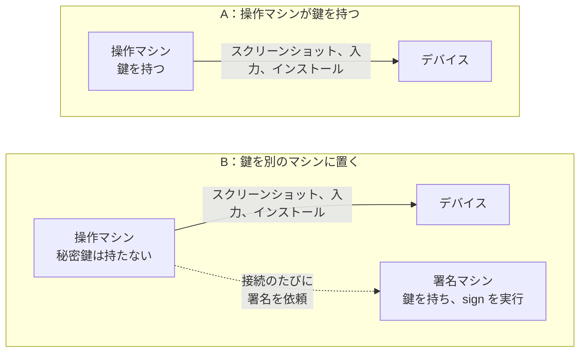
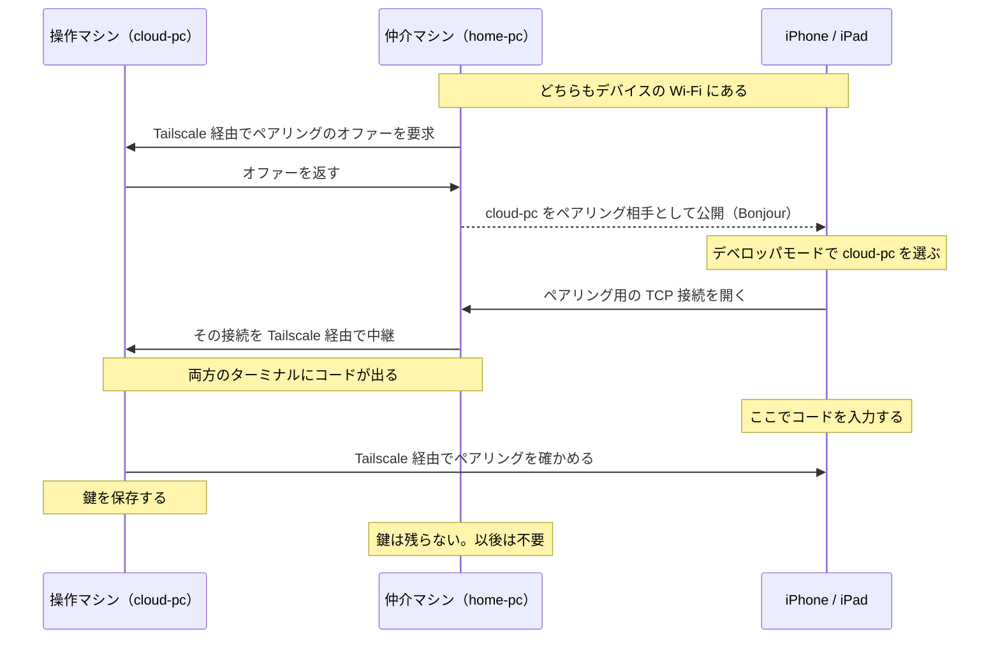
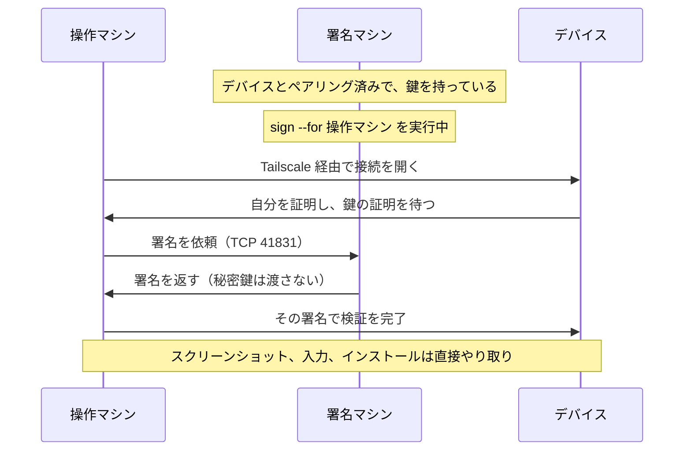

# roamrunctl

<p align="center"><a href="README.md">English</a> | 日本語</p>

`roamrunctl` は、[RoamRun](https://github.com/mh-mobile/RoamRun) に含まれるコマンドラインツールです。Linux、Windows、macOS で動き、実行するマシンに RoamRun や Xcode は要りません。用途は 2 つあります。

1. **手元のマシンから iPhone や iPad を操作する**（0.7.0 以降）。デバイスとペアリングしておけば、Tailscale 経由でスクリーンショットを撮ったり、アプリをインストールして起動したりできます。MCP サーバーとして動かすと、AI エージェントからタップ、スワイプ、文字入力、画面要素の取得もできます。
2. **離れた場所にあるマシンとデバイスのペアリングを仲介する**（`pair introduce`、0.5.0 以降）。デバイスと同じ Wi-Fi にあるマシンが、ペアリングの通信を一時的に中継します。ペアリングを作って持つのは相手のマシンで、仲介した側に鍵は残りません。

## 必要なもの

- 関係するマシンとデバイスに [Tailscale](https://tailscale.com) が入っていて、接続されていること。コマンドで指定する名前は、iOS の「設定」に出るデバイス名ではなく、`tailscale status` に表示される Tailscale 上の名前です。複数のマシンを使う手順では、tailnet のアクセス制御で互いの通信が許可されている必要があります。
- iOS / iPadOS 27 以降の iPhone または iPad。デベロッパモードを有効にして Wi-Fi に接続し、起動後に一度ロックを解除しておきます。モバイル通信だけでは、新しい接続を受け付けません。
- `install` を使うなら、そのデバイス向けにビルドと署名が済んだ `.ipa` か `.app`。`roamrunctl` 自体はビルドも署名もしません。

動作を確認したのは、iOS 27.0 の iPhone 15 Pro です。iPad、Apple Vision Pro、Mac を一度も使わない構成は試していません。ほかに試していない構成は、[リファレンス（英語）](../../docs/roamrunctl-reference.md#what-has-not-been-tested)にまとめてあります。

## インストール

**Linux**（x86_64 / aarch64）。`~/.local/bin` に入ります。

```sh
mkdir -p ~/.local/bin
curl -fsSL "https://github.com/mh-mobile/RoamRun/releases/latest/download/roamrunctl-linux-$(uname -m).tar.gz" \
  | tar -xz -C ~/.local/bin --strip-components 1 "roamrunctl-linux-$(uname -m)/roamrunctl"
~/.local/bin/roamrunctl --version
```

`roamrunctl` だけで実行できない場合は、`~/.local/bin` を `PATH` に追加するか、以降のコマンドをフルパスで実行してください。

**Windows**（PowerShell。x86_64 の例）

```powershell
irm https://github.com/mh-mobile/RoamRun/releases/latest/download/roamrunctl-windows-x86_64.zip -OutFile roamrunctl.zip
Expand-Archive -Force roamrunctl.zip .
.\roamrunctl-windows-x86_64\roamrunctl.exe --version
```

ARM 版の Windows では、ダウンロードするファイル名と実行ファイルのパスの `x86_64` を、どちらも `aarch64` に変えてください。バイナリにコード署名はありません。以降のコマンドは、この実行ファイルのパスで実行するか、フォルダを `PATH` に追加して実行します。

**macOS**、または Homebrew を入れた Linux

```sh
brew install mh-mobile/tap/roamrunctl
```

Rust 1.89 以降があれば、リリースのタグからビルドすることもできます。

```sh
cargo install --locked --git https://github.com/mh-mobile/RoamRun --tag vX.Y.Z roamrunctl
```

`vX.Y.Z` はリリースのタグに置き換えます。アーカイブとチェックサム（`roamrunctl-SHA256SUMS`）は[リリースページ](https://github.com/mh-mobile/RoamRun/releases)にあります。同じペアリングに関わるマシンでは、RoamRun と `roamrunctl` のバージョンをそろえてください。

## Xcode のないマシンからデバイスを使う

ペアリングすると、秘密鍵を含むペアリング情報が保存されます。この鍵を使えて、デバイスに通信が届く人は、デバイスの画面を見ることも操作することもできます。鍵の置き場所は 2 通りあります。デバイスを操作するマシンに置くか（**A**）、別のマシンに置いて、接続のたびに署名だけしてもらうか（**B**）です。

以降の説明に出てくるマシンの呼び方です。

- **操作マシン**：`look`、`install`、`launch`、`mcp` を実行するマシン
- **署名マシン**：秘密鍵を持つマシン。A では操作マシン自身が鍵を持つので、B でだけ登場します
- **仲介マシン**：デバイスと同じ Wi-Fi にあり、離れた場所の操作マシンのペアリングを仲介するマシン



**まずは A で始めてください。** B は、操作マシンに鍵を置きたくない場合（使い捨てのクラウド VM など）のための構成です。B で変わるのは秘密鍵の置き場所だけで、**操作マシン上のソフトウェアがデバイスに対してできることは制限されません。**

ペアリングでは、デバイスにコードを入力します。**ペアリングのコマンドは、AI エージェントに実行させず、自分のターミナルで実行してください。** 以下の例では、Tailscale 上の名前を `my-iphone`、`home-pc`、`cloud-pc` とし、デバイスを `phone` という名前で保存します。実際の名前に読み替えてください。

### A：デバイスと同じ Wi-Fi にあるマシンでペアリングする

マシンがデバイスと同じ Wi-Fi にあり、その Wi-Fi 上で Tailscale がデバイスに IPv4 で直接つながっている必要があります（リレー経由では不可）。先に `tailscale ping my-iphone` で確かめてください。最後の行が `via DERP` ではなく、`via` に続けてローカルのアドレスが出ていれば大丈夫です。

```sh
roamrunctl pair control --to my-iphone --as phone
```

コマンドは、Wi-Fi 上に公開する名前を表示します。これはこのマシンの Tailscale 上の名前です。デバイスで**設定 > プライバシーとセキュリティ > デベロッパモード**を開いてその名前を選び、ターミナルに表示されたコードを入力します。ペアリングが済むと、コマンドは Tailscale 経由で接続を確かめてから鍵を保存し、その旨を表示します。

このとき、デバイスの側からマシンへ TCP で接続してきます。使うポートと、Wi-Fi 上のデバイスのアドレスは、コマンドが表示します。マシンのファイアウォールが外からの接続を止めている場合は、そのアドレスからそのポートへの接続を許可してください。詳しくは[ポートとファイアウォール（英語）](../../docs/roamrunctl-reference.md#ports-and-firewalls)を参照してください。

### A：別のネットワークにあるマシンでペアリングする

操作マシン（`cloud-pc`）がデバイスと別の場所にある場合は、デバイスと同じ Wi-Fi にある仲介マシン（`home-pc`）に、一度だけ仲介してもらいます。

**事前に必要なこと：** この手順と、後述の Introducer アプリを使う手順では、デバイスがそれまでに何か（Xcode を入れた Mac など）とペアリングしたことがある必要があります。一度ペアリングすると、デバイスは仲介に必要なサービスを Wi-Fi 上に公開するようになるためです。まだ一度もペアリングしていないデバイスは、先に同じ Wi-Fi 上で一度ペアリングしてください。

```sh
# cloud-pc（離れた場所にある操作マシン）で
roamrunctl pair control --with home-pc --as phone

# home-pc（デバイスと同じ Wi-Fi にある仲介マシン）で
roamrunctl pair introduce --host cloud-pc --to my-iphone
```

`--host` には、ペアリングを持つことになるマシンを指定します。ここでは操作マシンです。仲介マシンの出力では、このマシンが「the host」と呼ばれます。2 つのコマンドはどちらを先に実行してもよく、それぞれ相手を最大 10 分待ちます。デバイスのデベロッパモードで `cloud-pc` を選び、コードを入力します。コードは両方のコマンドに表示されます。



操作マシンは、仲介マシンからの Tailscale 経由の TCP 接続を、ポート 41830 と、ペアリング中に表示されるもう 1 つのポートで受け付ける必要があります。仲介マシンは、自分が表示したポートでデバイスからの接続を受け付ける必要があります。仲介マシンから操作マシンの 2 つ目のポートに届かない場合は、Wi-Fi 上に何も公開しないうちに、その旨が表示されます。詳しくは[ポートとファイアウォール（英語）](../../docs/roamrunctl-reference.md#ports-and-firewalls)を参照してください。

仲介は、デバイス自身に任せることもできます。それには [Introducer アプリ](https://github.com/mh-mobile/RoamRun/tree/main/iOS)を使います（Xcode でソースからビルドするアプリで、App Store にはありません）。この場合、仲介マシンは要りません。操作マシンで `roamrunctl pair control --with my-iphone --as phone` を実行し、アプリに操作マシンの Tailscale 上の名前を入力します。

### ペアリングしたデバイスを使う

```sh
roamrunctl devices                    # ここで使えるデバイスの一覧
roamrunctl look phone shot.png        # スクリーンショットを PNG で保存（長辺は最大 1280 ピクセル）
roamrunctl install phone App.ipa      # 署名済みの .app フォルダも指定できる
roamrunctl launch phone com.example.App
```

デバイスを使うのをやめるときは、`roamrunctl devices remove phone` を実行します。これで、このマシンからデバイスの情報が消えます。ペアリングそのものを取り消すには、デバイスのデベロッパモードの一覧からも、このマシンを削除してください。

### AI エージェントから使う（MCP）

`roamrunctl mcp` は、標準入出力で通信する MCP サーバーです。`mcpServers` の形式で設定するクライアントでは、次のように登録します。

```json
{
  "mcpServers": {
    "roamrunctl": {
      "command": "roamrunctl",
      "args": ["mcp"]
    }
  }
}
```

クライアントが `PATH` から `roamrunctl` を見つけられない場合は、実行ファイルのフルパスを指定してください。使えるツールは `devices`、`look`、`tap`、`swipe`、`elements`、`type`、`paste`、`press`、`install`、`launch` です。

`tap` と `swipe` の前には、必ず `look` を呼ぶ必要があります。1 回の `look` で実行できるのは、60 秒以内の `tap` か `swipe` を 1 回だけです。同じデバイスに `type`、`paste`、`press`、`elements`、`install`、`launch` のいずれかを実行すると、その `look` は無効になります。`look` のあとにデバイスの向きが変わったとデバイスが報告した場合も、`tap` と `swipe` は拒否されます。このサーバーが使うのはデバイスのスクリーンショットと入力コマンドで、画面共有のストリームは張りません。

エージェントに使い方を教える[スキル](https://github.com/mh-mobile/RoamRun/tree/main/skills/roamrunctl)も用意しています（`npx skills add mh-mobile/RoamRun`）。スキルを入れても、MCP サーバーの登録や起動は行われません。

### 鍵のファイル（A）

A では、鍵は Linux と macOS なら `~/.config/roamrunctl/devices/phone.json` に保存されます（`$XDG_CONFIG_HOME` が絶対パスで設定されていれば、その下）。Windows では `%LOCALAPPDATA%\roamrunctl\devices` です。Linux と macOS では、所有者だけが読めるファイルとして作られます。それでも、**そのユーザーの権限で動くプログラムなら、エージェントも含めて、暗号化していない鍵を使ってデバイスを操作できます。**

`pair control` に `--passphrase` を付けると、age で暗号化した `phone.age` として保存されます。パスフレーズは、`ROAMRUNCTL_PASSPHRASE_FILE`、`ROAMRUNCTL_PASSPHRASE_COMMAND`、`ROAMRUNCTL_PASSPHRASE` のうち、この順で最初に設定されているものから取得します。どれも設定されていなければ、ターミナルで入力を求めます。`mcp` は入力を求められないので、いずれかの設定が必要です。なお、ファイルを暗号化しても、パスフレーズ自体を読めるソフトウェアからは守れません。

### B：鍵を別のマシンに置く

B では、操作マシンは秘密鍵を持ちません。デバイスに接続するたびに必要になる署名を、署名マシンが代わりに行います。スクリーンショット、入力、インストールの通信は、これまでどおり操作マシンとデバイスの間で直接やり取りされます。

```sh
# home-pc（署名マシン。ペアリングのときはデバイスと同じ Wi-Fi にある）で
roamrunctl pair control --to my-iphone --as phone --passphrase
roamrunctl sign phone --for cloud-pc  # パスフレーズを入力し、実行したままにする

# cloud-pc（操作マシン）で。どちらも自分のマシンで、タグが付いていなければ設定は不要
roamrunctl devices
roamrunctl look phone
```



署名マシンは、操作マシンからの TCP 41831 への接続を受け付ける必要があります。操作マシンが署名マシンを自動で見つけられるのは、両方がオンラインで、タグが付いておらず、同じ Tailscale ユーザーのものである場合だけです。それ以外の場合（クラウドの VM によくあるタグ付きのマシン、別のユーザーのマシン、ほかのマシンが同じデバイス名を名乗れる tailnet）は、最初に使う前に署名マシンを指定してください。操作マシンで `export ROAMRUNCTL_SIGNER=home-pc` を実行します（PowerShell では `$env:ROAMRUNCTL_SIGNER = 'home-pc'`、MCP では MCP サーバーの環境変数に設定）。自動で見つける方法は実機で動作を確かめていますが、`ROAMRUNCTL_SIGNER` で指定する方法はまだ実機で試していません。

`sign` が動いている間は、操作マシン上のどのプログラムでもデバイスを操作できます。`sign` を止めると新しい接続には署名されなくなりますが、すでに開いている接続（動作中の MCP セッションなど）は切れません。開いている接続を使って別のペアリングを作れるかどうかは試していないので、B でそれを防げるとは考えないでください。詳しくは[セキュリティの詳細（英語）](../../docs/roamrunctl-reference.md#b-remote-signing-and-trust)を参照してください。

操作マシンで `roamrunctl devices remove phone` を実行しても、署名マシンにある鍵は消えません。`sign` がそのデバイスを対象にしている間は、操作マシンの一覧にもまた表示されます。

## 離れた場所の Mac やマシンに、デバイスのペアリングを仲介する

`pair introduce` は、[A：別のネットワークにあるマシンでペアリングする](#a別のネットワークにあるマシンでペアリングする)で仲介マシンが実行したコマンドです。デバイスと同じ Wi-Fi で実行すると、`--host` で指定したマシンがデバイスとペアリングできるようになります。仲介した側には何も残りません。相手は、RoamRun を入れた Mac でも構いません。

```sh
# 仲介マシンで
roamrunctl pair introduce --host <相手のマシンの Tailscale 上の名前> --to my-iphone
```

どのペアリングになるかは、相手のマシンで実行しているコマンドで決まります。

| 相手のマシンで実行するコマンド | できるペアリング |
|---|---|
| `roamrunctl pair control --with home-pc` | roamrunctl のデバイス操作（上の A） |
| `roamrun pair control --with home-pc`（RoamRun のアプリを開いておく） | RoamRun のデバイス操作 |
| `roamrun pair xcode --with home-pc`（Xcode の Device Hub で待機しておく） | Xcode |

デバイス操作の 2 つでは、ペアリングのコードは仲介マシンのコマンドに表示されます。相手が `roamrunctl` のときは、相手側にも表示されます。Xcode の場合は、相手のマシンの **Device Hub > Pair Nearby Device** に表示されるコードを使います。このとき仲介マシンが標準出力に何を表示するか、終了コードごとに何をすればよいかは、[リファレンス（英語）](../../docs/roamrunctl-reference.md#pair-introduce-options-and-results)にあります。Ctrl-C を押すと、仲介マシンは Wi-Fi 上への公開を取り下げます。

## リファレンスとセキュリティ

時間制限、ポートとファイアウォール、パスフレーズ、鍵の取り込み、各ツールの正確な動作、プラットフォームごとの制限、うまくいかないときの対処、試していない構成は、[roamrunctl-reference.md](../../docs/roamrunctl-reference.md)（英語）にまとめてあります。セキュリティについては [SECURITY.md](https://github.com/mh-mobile/RoamRun/blob/main/SECURITY.md) も参照してください。
