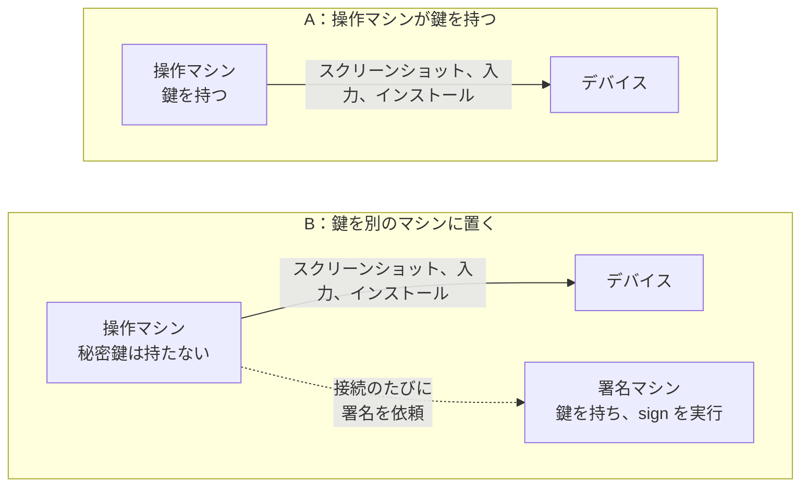
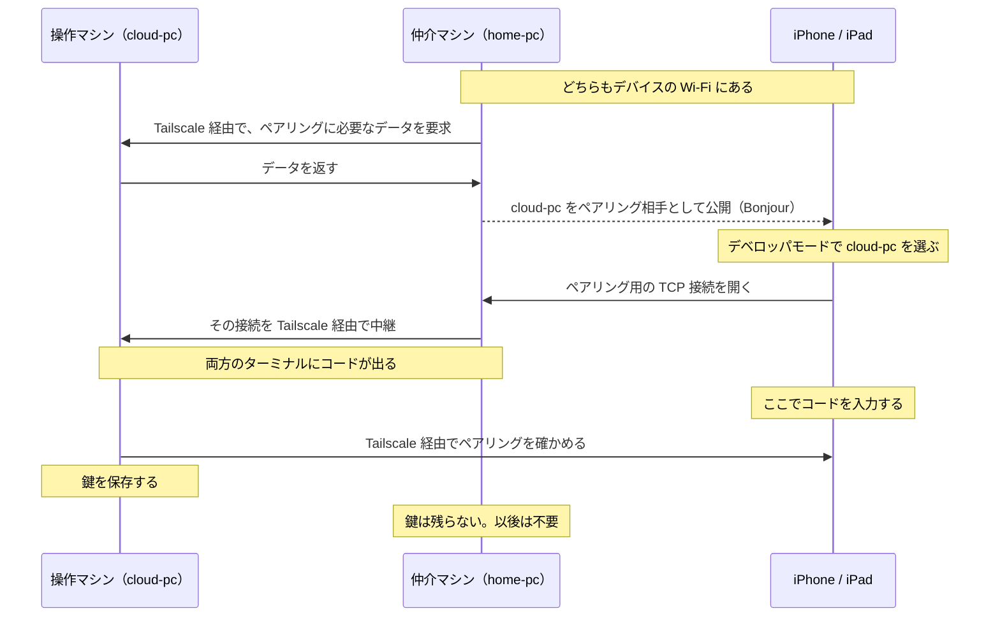
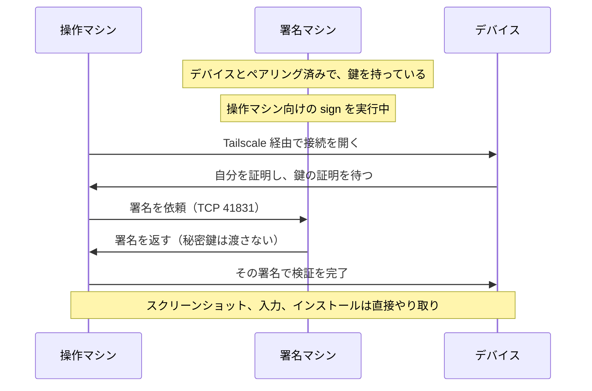

# roamrunctl

<p align="center"><a href="README.md">English</a> | 日本語</p>

`roamrunctl` は、[RoamRun](https://github.com/mh-mobile/RoamRun) に含まれるコマンドラインツールです。Linux、Windows、macOS で動き、実行するマシンに RoamRun や Xcode は要りません。用途は 2 つあります。

1. **手元のマシンから iPhone や iPad を操作する**（0.7.0 以降）。デバイスとペアリングしておけば、Tailscale 経由でスクリーンショットを撮ったり、アプリをインストールして起動したりできます。MCP サーバーとして動かすと、AI エージェントからタップ、スワイプ、文字入力、画面要素の取得もできます。
2. **離れた場所にあるマシンとデバイスのペアリングを仲介する**（`pair introduce`、0.5.0 以降）。デバイスと同じ Wi-Fi にあるマシンが、離れた場所の Mac やほかのマシンに向けて、ペアリングの通信を一時的に中継します。ペアリングするのは離れた側のマシンで、仲介した側に鍵は残りません。

## 必要なもの

- 関係するマシンとデバイスに [Tailscale](https://tailscale.com) が入っていて、接続されていること。コマンドで指定する名前は、iOS の「設定」に出るデバイス名ではなく、`tailscale status` に表示される Tailscale 上の名前です。複数のマシンを使う手順では、tailnet のアクセス制御で互いの通信が許可されている必要があります。
- iOS / iPadOS 27 以降の iPhone または iPad。デベロッパモードを有効にして Wi-Fi に接続し、起動後に一度ロックを解除しておきます。モバイル通信だけでは、新しい接続を受け付けません。
- `install` を使うなら、そのデバイス向けにビルドと署名が済んだ `.ipa` か `.app`。`roamrunctl` 自体はビルドも署名もしません。

動作を確認したのは、iOS 27.0 の iPhone 15 Pro です。iPad での動作と、Mac を一度も使わない構成は試していません。Apple Vision Pro も、`roamrunctl` では試していません。Vision Pro を離れた Mac とペアリングする手順は、RoamRun を入れた Mac どうしで動作を確かめてあり、[本体の README](https://github.com/mh-mobile/RoamRun/blob/main/README.ja.md#apple-vision-pro) にあります。ほかに試していない構成は、[リファレンス](../../docs/roamrunctl-reference.ja.md#試していない構成)にまとめてあります。

## インストール

Linux（x86_64 / aarch64）では、次のコマンドで `~/.local/bin` に入ります。

```sh
mkdir -p ~/.local/bin
curl -fsSL "https://github.com/mh-mobile/RoamRun/releases/latest/download/roamrunctl-linux-$(uname -m).tar.gz" \
  | tar -xz -C ~/.local/bin --strip-components 1 "roamrunctl-linux-$(uname -m)/roamrunctl"
~/.local/bin/roamrunctl --version
```

`roamrunctl` だけで実行できない場合は、`~/.local/bin` を `PATH` に追加するか、以降のコマンドをフルパスで実行してください。

Windows では、PowerShell で次のように実行します。x86_64 の例です。

```powershell
irm https://github.com/mh-mobile/RoamRun/releases/latest/download/roamrunctl-windows-x86_64.zip -OutFile roamrunctl.zip
Expand-Archive -Force roamrunctl.zip .
.\roamrunctl-windows-x86_64\roamrunctl.exe --version
```

ARM 版の Windows では、ダウンロードするファイル名と実行ファイルのパスの `x86_64` を、どちらも `aarch64` に変えてください。バイナリにコード署名はありません。以降のコマンドは、この実行ファイルのパスで実行するか、フォルダを `PATH` に追加して実行します。

macOS と、Homebrew を導入済みの Linux では、次のコマンドでインストールできます。

```sh
brew install mh-mobile/tap/roamrunctl
```

Rust 1.89 以降があれば、リリースのタグからビルドできます。

```sh
cargo install --locked --git https://github.com/mh-mobile/RoamRun --tag vX.Y.Z roamrunctl
```

`vX.Y.Z` はリリースのタグに置き換えます。アーカイブとチェックサム（`roamrunctl-SHA256SUMS`）は[リリースページ](https://github.com/mh-mobile/RoamRun/releases)にあります。同じペアリングに関わるマシンでは、RoamRun と `roamrunctl` のバージョンをそろえてください。

## Xcode のないマシンからデバイスを使う

ペアリングすると、秘密鍵を含むペアリング情報が保存されます。この鍵を使えて、デバイスに接続できる環境なら、だれでも画面を見たり操作したりできます。鍵の置き場所は 2 通りあります。デバイスを操作するマシンに置くか（**A**）、別のマシンに置いて、接続のたびに署名だけしてもらうか（**B**）です。

以降では、マシンを次のように呼びます。

| 呼び方 | 役割 |
|---|---|
| 操作マシン | `look`、`install`、`launch`、`mcp` を実行するマシン |
| 署名マシン | 秘密鍵を持ち、接続時の署名を代行するマシン（アプリのコード署名とは別の話です）。A では操作マシン自身が鍵を持つので、B でだけ登場します |
| 仲介マシン | デバイスと同じ Wi-Fi にあり、離れた場所の操作マシンのペアリングを仲介するマシン |



**まずは A で始めてください。** B は、操作マシンに鍵を置きたくない場合（使い捨てのクラウド VM など）のための構成です。B で変わるのは秘密鍵の置き場所だけで、**操作マシン上のソフトウェアがデバイスにできる操作は、A と変わりません。**

ペアリングでは、デバイスにコードを入力します。**ペアリングのコマンドは、AI エージェントに実行させず、自分のターミナルで実行してください。** 以下の例に出てくる名前は、次のものを表します。実際の名前に読み替えてください。

| 例での名前 | 表すもの |
|---|---|
| `my-iphone` | デバイスの Tailscale 上の名前 |
| `home-pc` | デバイスと同じ Wi-Fi にあるマシンの Tailscale 上の名前 |
| `cloud-pc` | 離れた場所にあるマシンの Tailscale 上の名前 |
| `phone` | ペアリングしたデバイスに、このマシン上で付ける名前（`--as` で指定） |

### A：デバイスと同じ Wi-Fi にあるマシンでペアリングする

マシンがデバイスと同じ Wi-Fi にあり、その Wi-Fi 上で Tailscale がデバイスに IPv4 で直接つながっている必要があります（リレー経由では不可）。先に `tailscale ping my-iphone` で確かめてください。最後の行が `via DERP` ではなく、`via` に続けてローカルのアドレスが出ていれば問題ありません。

```sh
roamrunctl pair control --to my-iphone --as phone
```

実行すると、Wi-Fi 上に公開する名前（このマシンの Tailscale 上の名前）が表示されます。デバイスで**設定 > プライバシーとセキュリティ > デベロッパモード**を開いてその名前を選び、ターミナルに表示されたコードを入力します。ペアリングが済むと、Tailscale 経由の接続を確認してから鍵が保存され、完了が表示されます。

ペアリング中は、デバイスからこのマシンへ TCP 接続が張られます。コマンドの出力に、ポート番号とデバイスの Wi-Fi 上のアドレスが表示されます。このマシンのファイアウォールが外からの接続を止めている場合は、そのアドレスからそのポートへの接続を許可してください。詳しくは[ポートとファイアウォール](../../docs/roamrunctl-reference.ja.md#ポートとファイアウォール)を参照してください。

### A：別のネットワークにあるマシンでペアリングする

操作マシン（`cloud-pc`）がデバイスと別の場所にある場合は、デバイスと同じ Wi-Fi にある仲介マシン（`home-pc`）に、一度だけ仲介してもらいます。

**前提条件：** この手順と、後述の Introducer アプリを使う手順では、デバイスが過去に一度は（Xcode を入れた Mac などと）ペアリングしている必要があります。一度ペアリングしたデバイスは、仲介で使うサービスを Wi-Fi 上で公開し始めるためです。一度もペアリングしていないデバイスは、まずデバイスと同じ Wi-Fi にあるマシンで一度ペアリングしてください。

```sh
# cloud-pc（離れた場所にある操作マシン）で
roamrunctl pair control --with home-pc --as phone

# home-pc（デバイスと同じ Wi-Fi にある仲介マシン）で
roamrunctl pair introduce --host cloud-pc --to my-iphone
```

`--host` には、デバイスとペアリングするマシン（ここでは操作マシン）を指定します。仲介マシン側の出力では、指定した操作マシンを「the host」と呼びます。2 つのコマンドはどちらを先に実行してもよく、それぞれ相手を最大 10 分待ちます。デバイスのデベロッパモードで `cloud-pc` を選び、コードを入力します。コードは両方のターミナルに表示されます。



操作マシンでは、仲介マシンからの Tailscale 経由の TCP 接続を、ポート 41830 と、ペアリング中に表示されるもう 1 つのポートで受け付けられるようにしておきます。仲介マシン側は、自分が表示したポートでデバイスからの接続を受け付けます。仲介マシンから 2 つ目のポートに届かないときは、Wi-Fi 上に公開を始める前にそう表示されます。詳しくは[ポートとファイアウォール](../../docs/roamrunctl-reference.ja.md#ポートとファイアウォール)を参照してください。

仲介は、デバイス自身に任せることもできます。それには [Introducer アプリ](https://github.com/mh-mobile/RoamRun/tree/main/iOS)を使います（Xcode でソースからビルドするアプリで、App Store にはありません）。この場合、仲介マシンは要りません。操作マシンで `roamrunctl pair control --with my-iphone --as phone` を実行し、アプリに操作マシンの Tailscale 上の名前を入力します。

### ペアリングしたデバイスを使う

```sh
roamrunctl devices                    # ここで使えるデバイスの一覧
roamrunctl look phone shot.png        # スクリーンショットを PNG で保存（長辺は最大 1280 ピクセル）
roamrunctl install phone App.ipa      # 署名済みの .app フォルダも指定できる
roamrunctl launch phone com.example.App
```

このマシンからデバイスの登録を削除するには、`roamrunctl devices remove phone` を実行します。ペアリングそのものを取り消すには、デバイスのデベロッパモードの一覧からも、このマシンを削除してください。

### AI エージェントから使う（MCP）

`roamrunctl mcp` は、標準入出力で通信する MCP サーバーです。`mcpServers` の形式で設定するクライアントでは、次のように登録します。

```json
{
  "mcpServers": {
    "roamrunctl": {
      "command": "roamrunctl",
      "args": ["mcp"]
    }
  }
}
```

クライアントが `PATH` から `roamrunctl` を見つけられない場合は、実行ファイルのフルパスを指定してください。使えるツールは `devices`、`look`、`tap`、`swipe`、`elements`、`type`、`paste`、`press`、`install`、`launch` です。

`tap` と `swipe` は、先に `look` を呼んでおかないと実行できません。`look` 1 回につき、60 秒以内に `tap` か `swipe` を 1 回だけ実行できます。同じデバイスに `type`、`paste`、`press`、`elements`、`install`、`launch` のいずれかを実行すると、その `look` は無効になります。`look` のあとに向きが変わったとデバイスから通知された場合も、`tap` と `swipe` は拒否されます。このサーバーが使うのはデバイスのスクリーンショットと入力コマンドで、画面共有のストリームを張り続けることはありません。

エージェントに使い方を教える[スキル](https://github.com/mh-mobile/RoamRun/tree/main/skills/roamrunctl)も用意しています（`npx skills add mh-mobile/RoamRun`）。スキルを入れても、MCP サーバーの登録や起動は行われません。

### 鍵のファイル（A）

A では、鍵は Linux と macOS なら `~/.config/roamrunctl/devices/phone.json` に保存されます。`$XDG_CONFIG_HOME` が絶対パスで設定されていれば、その下になります。Windows では `%LOCALAPPDATA%\roamrunctl\devices` です。Linux と macOS では、所有者だけが読めるファイルとして作られます。それでも、**そのユーザーの権限で動くプログラムなら、エージェントも含めて、暗号化していない鍵を使ってデバイスを操作できます。**

`pair control` に `--passphrase` を付けると、age で暗号化した `phone.age` として保存されます。パスフレーズは、次の 3 つの環境変数のうち、最初に設定されているものから取得します。順に `ROAMRUNCTL_PASSPHRASE_FILE`、`ROAMRUNCTL_PASSPHRASE_COMMAND`、`ROAMRUNCTL_PASSPHRASE` です。どれも設定されていなければ、ターミナルで入力を求めます。`mcp` は入力を求められないので、いずれかの設定が必要です。ファイルを暗号化しても、パスフレーズ自体を読めるソフトウェアからは守れません。ファイルや環境変数で渡すパスフレーズは 1 つで、暗号化したすべてのデバイスに使われます。コマンドには、どのデバイスのためかが渡されるので、デバイスごとに違うパスフレーズを返せます（[リファレンス](../../docs/roamrunctl-reference.ja.md#ペアリング情報とパスフレーズ)）。

### B：鍵を別のマシンに置く

B では、操作マシンは秘密鍵を持ちません。デバイスへの接続のたびに必要な署名は、署名マシンが代わりに行います。スクリーンショット、入力、インストールの通信は、A と同じく、操作マシンとデバイスの間で直接やり取りされます。

```sh
# home-pc（署名マシン。ペアリングのときはデバイスと同じ Wi-Fi にある）で
roamrunctl pair control --to my-iphone --as phone --passphrase
roamrunctl sign phone --for cloud-pc  # パスフレーズを入力し、実行したままにする

# cloud-pc（操作マシン）で
# 両方のマシンが同じ Tailscale ユーザーに属し、タグが付いていなければ、追加の設定は不要
roamrunctl devices
roamrunctl look phone
```



署名マシンは、操作マシンからの TCP 41831 への接続を受け付ける必要があります。操作マシンが署名マシンを自動で見つけられるのは、両方がオンラインで、タグが付いておらず、同じ Tailscale ユーザーのものである場合だけです。それ以外の場合は、初めて使う前に署名マシンを指定してください。該当するのは、次の場合です。

- どちらかのマシンにタグが付いている場合（クラウドの VM によくあります）
- 2 台が別の Tailscale ユーザーに属する場合
- 同じデバイス名で `sign` を実行できるマシンがほかにもある場合

指定するには、操作マシンで `export ROAMRUNCTL_SIGNER=home-pc` を実行します。PowerShell では `$env:ROAMRUNCTL_SIGNER = 'home-pc'` です。MCP では、MCP サーバーの環境変数に設定します。自動で見つける方法は実機で動作を確かめていますが、`ROAMRUNCTL_SIGNER` で指定する方法はまだ実機で試していません。

`sign` が動いている間は、操作マシン上のどのプログラムでもデバイスを操作できます。`sign` を止めると新しい接続には署名されなくなりますが、すでに開いている接続（動作中の MCP セッションなど）は切れません。開いている接続を使って新しいペアリングを作れるかどうかは試していません。そのため、B の構成なら新しいペアリングの作成を防げる、とは言えません。詳しくは[リファレンスの「B：署名と信頼関係」](../../docs/roamrunctl-reference.ja.md#b署名と信頼関係)を参照してください。

操作マシンで `roamrunctl devices remove phone` を実行しても、署名マシンにある鍵は消えません。`sign` がそのデバイスを対象にしている間は、操作マシンの一覧にもまた表示されます。

## 離れた場所のマシンとデバイスのペアリングを仲介する

`pair introduce` は、[A：別のネットワークにあるマシンでペアリングする](#a別のネットワークにあるマシンでペアリングする)で仲介マシンが実行したコマンドです。デバイスと同じ Wi-Fi で実行すると、`--host` で指定したマシンがデバイスとペアリングできるようになります。仲介した側には何も残りません。`--host` には、RoamRun を入れた Mac も指定できます。

```sh
# 仲介マシンで
roamrunctl pair introduce --host <相手のマシンの Tailscale 上の名前> --to my-iphone
```

ペアリングの種類は、相手のマシンで実行するコマンドによって決まります。

| 相手のマシンで実行するコマンド | できるペアリング |
|---|---|
| `roamrunctl pair control --with home-pc` | roamrunctl のデバイス操作（上の A） |
| `roamrun pair control --with home-pc`（RoamRun のアプリを開いておく） | RoamRun のデバイス操作 |
| `roamrun pair xcode --with home-pc`（Xcode の Device Hub で待機しておく） | Xcode |

表の上 2 行（デバイス操作）では、ペアリングのコードは仲介マシンのコマンドに表示されます。相手が `roamrunctl` のときは、相手側にも表示されます。Xcode の場合は、相手のマシンの **Device Hub > Pair Nearby Device** に表示されるコードを使います。このとき仲介マシンが標準出力に何を表示するか、終了コードごとに何をすればよいかは、[リファレンス](../../docs/roamrunctl-reference.ja.md#pair-introduce-のオプションと結果)にあります。Ctrl-C を押すと、仲介マシンは Wi-Fi 上への公開をやめます。

## リファレンスとセキュリティ

細かい決まりは、[リファレンス](../../docs/roamrunctl-reference.ja.md)にまとめてあります。時間制限、ポートとファイアウォール、パスフレーズ、鍵の取り込み、各ツールの正確な動作などです。うまくいかないときの対処と、試していない構成も載せています。セキュリティについては [SECURITY.md](https://github.com/mh-mobile/RoamRun/blob/main/SECURITY.md) も参照してください。
