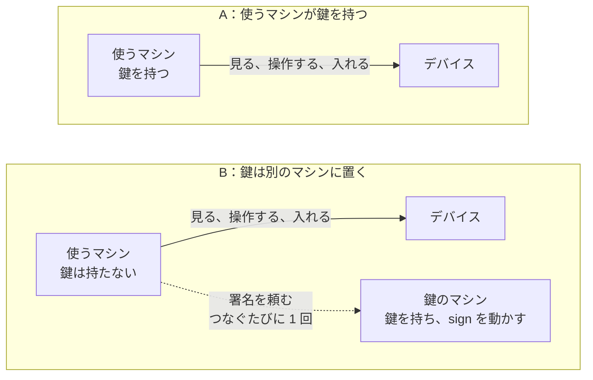
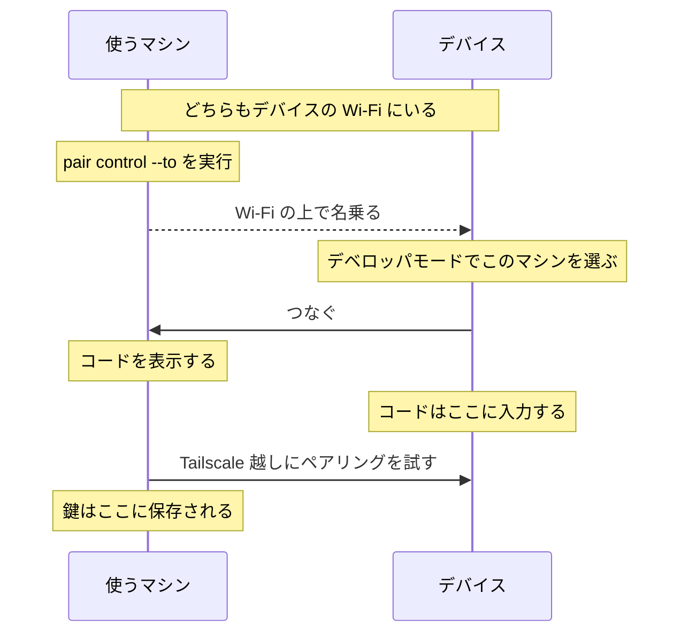
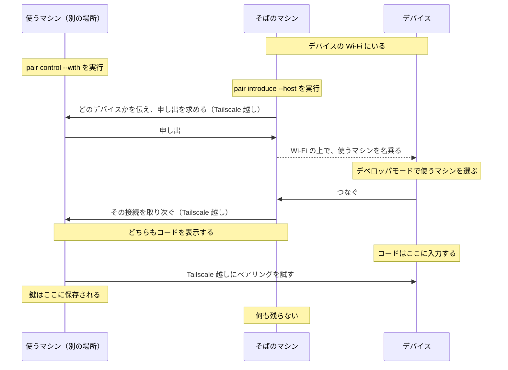
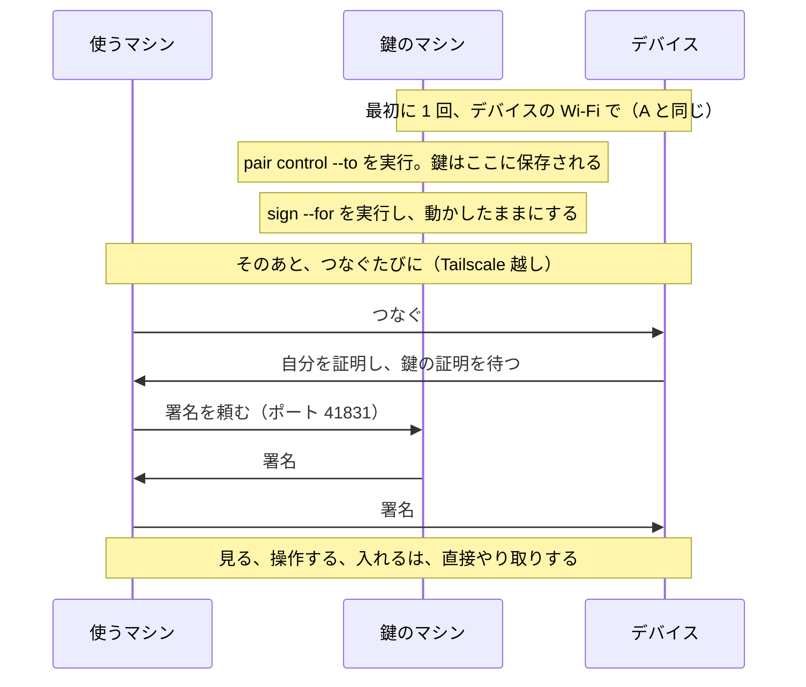

# roamrunctl

<p align="center"><a href="README.md">English</a> | 日本語</p>

RoamRun の入っていないマシン（Windows、Linux、Mac）のためのコマンドです。0.7.0 から、iPhone や iPad とのペアリングを自分で持ち、Xcode なしで、Tailscale 越しにデバイスを使えます。できるのは、スクリーンショット、アプリのインストールと起動です。エージェント向けには、同じことを MCP ツールとして使えます。詳しくは [Xcode のないマシンからデバイスを使う](#xcode-のないマシンからデバイスを使う) を見てください。

これまでどおり、RoamRun の `pair introduce` と同じこともできます。デバイスの Wi‑Fi の上で、離れた Mac のペアリングの申し出を名乗り、デバイスからの 1 本の接続を Tailscale 越しにその Mac へ取り次ぎます。相手は、その Mac の Xcode か、デバイス操作のための RoamRun のアプリです。動きは `Sources/RoamRun/Introductions.swift` と `PairByName.swift` に合わせてあります。何で試したかは、最後の章にあります。

## インストール

Linux：バイナリを `~/.local/bin` に入れます。

```
mkdir -p ~/.local/bin && curl -fsSL https://github.com/mh-mobile/RoamRun/releases/latest/download/roamrunctl-linux-$(uname -m).tar.gz | tar -xz -C ~/.local/bin --strip-components 1 roamrunctl-linux-$(uname -m)/roamrunctl
```

このあと `roamrunctl` が見つからないときは、`~/.local/bin` がまだ PATH に入っていません。ログインし直すか（たいていのディストリビューションは、このフォルダができると PATH に足します）、`~/.local/bin/roamrunctl` と指定して実行してください。

Windows（PowerShell）：いまいる場所に、`roamrunctl-windows-x86_64` というフォルダができます。ARM の PC では、2 か所の `x86_64` を `aarch64` に読み替えてください。

```
irm https://github.com/mh-mobile/RoamRun/releases/latest/download/roamrunctl-windows-x86_64.zip -OutFile roamrunctl.zip; Expand-Archive -Force roamrunctl.zip .
```

PATH には入りません。`.\roamrunctl-windows-x86_64\roamrunctl.exe` と指定して実行するか、フォルダを好きな場所へ移してください。

macOS、または Homebrew の入った Linux：ソースからビルドします。`brew install mh-mobile/tap/roamrunctl`

Rust があればどこでも：`cargo install --locked --git https://github.com/mh-mobile/RoamRun --tag v<バージョン> roamrunctl`
（この方法では、このフォルダの外でビルドするので、入っている Rust（1.89 以上）と C コンパイラを使います。Windows では、暗号のライブラリがビルドにほかの道具を求めることがあります（x86_64 では NASM、ARM64 では clang）。できるものは、アーカイブに入っている静的リンクのビルドとは別物です。）

Linux と Windows のコマンドは、最新の[リリース](https://github.com/mh-mobile/RoamRun/releases)からアーカイブを取ってきて展開するだけです。アーカイブは `roamrunctl-linux-x86_64.tar.gz`、`roamrunctl-linux-aarch64.tar.gz`、`roamrunctl-windows-x86_64.zip`、`roamrunctl-windows-aarch64.zip` の 4 つです。それぞれに、バイナリ、英語版の README、ビルドに使ったクレートのライセンスが入っています（上の Linux のコマンドは、バイナリだけを取り出します）。チェックサムは、同じ場所の `roamrunctl-SHA256SUMS` にあります。

- Linux 版は静的リンクなので、どのディストリビューションでも動きます。
- Windows 版は署名していません。初めて実行するとき、SmartScreen が確認を出すことがあります。
- Windows のファイアウォールは、初めて名乗るときに、通信を許可するかを尋ねます。その Wi‑Fi の種類（プライベートかパブリックか）に合わせて、許可してください。デバイスがこのマシンへつなぎに来ますし、デバイスからの mDNS の問い合わせにも答えるためです。その確認が出ている間にデバイスが問い合わせていた場合は、「設定」に離れた Mac が出てこないことがあります。そのときは、デベロッパモードの画面を一度出て、開き直してください。

Homebrew 本体や crates.io の一覧には載せていません。バージョンは RoamRun と同じです。離れた Mac の RoamRun と同じバージョンを使ってください。0.7.0 から、`pair introduce` は相手のマシンを `--mac` ではなく `--host` で指定します。`roamrun` でも同じです。どちらかが古いと、案内に出てくるコマンドが、もう一方の書き方になります。

エージェントに使わせる場合は、[`skills/roamrunctl`](../../skills/roamrunctl/SKILL.md) のスキルがあります。`npx skills add mh-mobile/RoamRun` で入れられますし、各アーカイブにも `SKILL.md` として入っています。

マシンのファイアウォールは、デバイスからの接続を通す必要があります。デバイスは、`roamrunctl` が「このポートで名乗った」と表示したポートへ、表示されたデバイスのアドレスから、TCP でつなぎに来ます。Ubuntu の ufw（mDNS は最初から通します）なら `sudo ufw allow proto tcp from <デバイスのアドレス>` です。Windows では、上の確認に答えるだけで足ります。

## Xcode のないマシンからデバイスを使う

0.7.0 から。自分のペアリングを持ったマシンは、Xcode がなくても、Tailscale 越しに自分でデバイスへ届きます。

対象は iPhone と iPad です。Apple Vision Pro では、ここに書いたことを何も試していません。Mac に選ばれるのを待つ状態の Vision Pro（Remote Devices を開いた状態）は、Mac としかペアリングできません。`roamrun pair introduce` は、その場合、Mac 以外を `--host` に指定すると断ります。

以下では、3 つのマシンが出てきます。1 台が 2 つの役を兼ねることもあります。

- **そばのマシン**：デバイスと同じ Wi‑Fi にいるマシン。ペアリングのときに 1 回だけ必要です。
- **使うマシン**：`look`、`install`、`launch`、`mcp` を実行するマシン。エージェントが動くマシンで、クラウドにあることもあります。
- **鍵のマシン**：ペアリングの鍵を置いておくマシン。A では、使うマシンがそのまま鍵のマシンです。B では、あなたの別のマシンで、署名をする係です（`ROAMRUNCTL_SIGNER` で指定します）。

エージェントが動くマシンに鍵を置いてよいなら A、置きたくないなら B です。どちらも、そのマシンのエージェントがデバイスにできることを制限するものではありません。



| | どこで、何を実行するか |
|---|---|
| **A**、使うマシンがデバイスの Wi‑Fi にいる | 使うマシン：`pair control --to <デバイス>` |
| **A**、使うマシンが別の場所にいる | 使うマシン：`pair control --with <そばのマシン>` · そばのマシン：`pair introduce --host <使うマシン> --to <デバイス>` |
| **B** | 鍵のマシン（デバイスの Wi‑Fi で）：`pair control --to <デバイス>`、続けて `sign <名前> --for <使うマシン>` を動かしたままにする · 使うマシン：何もしない。ただし、どちらかのマシンにタグが付いているか、2 台が別のユーザーのものなら（クラウドのマシンはタグ付きのことが多いです）、使うマシンで `ROAMRUNCTL_SIGNER=<鍵のマシン>` を設定します。`mcp` なら、エージェントの MCP の設定に書きます |

`pair` のコマンドは、どれもペアリングのコードを表示します。コードは、持ち主の同意そのものです。自分のターミナルで、自分で実行してください。

始める前に：

- デバイスが Wi‑Fi につながっていること（モバイル通信だけでは断られます）。起動してから一度ロックを解除してあること。Tailscale につながっていること。
- Tailscale の規則が、使うマシンからデバイスへの通信を通すこと。B では、使うマシンから鍵のマシンの TCP ポート 41831 への通信も通すこと。B では、鍵のマシンも tailnet 越しにデバイスへ届く必要があります。ペアリングは、その経路で一度試してから保存されるためです。
- 待つ側のマシンに、相手が入れること（Tailscale の規則と、そのマシンのファイアウォール）。`pair control --to` では、コマンドが表示するポートへ、デバイスが入ります。`pair control --with` では、そばのマシンが、ポート 41830 と、毎回変わるもう 1 つのポートへ入ります（どのポートかは、決まった時点でコマンドが表示します）。そのため、そばのマシンからは、どの TCP ポートにも入れるようにしておきます。入れない場合、相手からは「誰も待っていない」ように見えます。
- `pair control --with` を使うなら、デバイスが以前に何かとペアリングしたことがあること（後述）。
- B では、使うマシンが、自分のデバイス用フォルダ（`~/.config/roamrunctl/devices`、Windows では `%LOCALAPPDATA%\roamrunctl\devices`）に書き込めること。どのデバイスをどのマシンに結び付けたかを、そこに保存します。保存できなければ、デバイスは使いません。

### A. 使うマシンが鍵を持つ

デバイスと同じ Wi‑Fi にいるなら、その場でペアリングします。

```sh
roamrunctl pair control --to <デバイスの Tailscale 名> --as phone
# デバイスで：設定 › プライバシーとセキュリティ › デベロッパモード › このマシンの名前を選び、コードを入力
```



このとき、デバイスのほうからこのマシンへつなぎに来ます。ファイアウォールは、それを通す必要があります。コマンドは、名乗ったポートと、Wi‑Fi でのデバイスのアドレスを表示します（ufw なら `sudo ufw allow proto tcp from <そのアドレス>`）。

別の場所にあるマシン（クラウドのマシンなど）は、そばのマシンに 1 回だけ引き合わせてもらいます。

```sh
# 使うマシンで
roamrunctl pair control --with <そばのマシン> --as phone
# そばのマシンで（Mac なら `roamrun pair introduce` でも同じです）
roamrunctl pair introduce --host <使うマシン> --to <デバイスの Tailscale 名>
# デバイスで：設定 › プライバシーとセキュリティ › デベロッパモード › 使うマシンの名前を選び、コードを入力
```



コードは、両方のマシンに表示されます。そばのマシンの表示では、使うマシンを「the host」と呼びます。そばのマシンは、ペアリングを 5 分待ちます。

デバイスに Introducer アプリ（`iOS/` を Xcode でビルドしたもの）があれば、そばのマシンは要りません。使うマシンでデバイスそのものを指定し（`roamrunctl pair control --with <デバイスの Tailscale 名>`）、アプリでは、離れた Mac の名前を入れる所に、使うマシンの Tailscale 名を入れます。Mac の `roamrun pair introduce` を使う場合は、その Mac の RoamRun にデバイスが保存されている必要があります。

`--with` は、以前に何かとペアリングしたことのあるデバイスのためのものです。一度もペアリングしたことのないデバイスは、そばのマシンが取り次げるものを何も名乗りません。その場合、`pair introduce` がそう表示します。先に一度、Mac の Xcode か、そばのマシンでの `pair control --to` でペアリングしてください。後者の場合、そばのマシンにも鍵が残ります。残したくなければ、そこで `roamrunctl devices remove` で消します。（後者だけで足りるかどうかは、試していません。）

これ以降、使うマシンで：

```sh
roamrunctl look phone shot.png        # デバイス自身のスクリーンショット。長い辺が最大 1280
roamrunctl install phone App.ipa      # そのデバイス向けに、ビルドと署名が済んだアプリ
roamrunctl launch phone com.example.App
roamrunctl mcp                        # 上と同じことに加えて、tap / swipe / type / paste / press / elements を MCP ツールとして
```

エージェントの MCP の設定には、コマンドに `roamrunctl`、引数に `mcp` を書きます。

RoamRun の入った Mac でペアリングを作って、渡すこともできます。Mac で `roamrun key create <デバイス> device.key`、こちらで `roamrunctl key import device.key` です。

保存されたペアリングは、鍵です。それを読めて、デバイスに届く人は、誰でもデバイスの画面を見て、操作できます。場所は `~/.config/roamrunctl/devices/<名前>.json` です（`$XDG_CONFIG_HOME` が設定されていれば、その下。Windows では `%LOCALAPPDATA%\roamrunctl\devices`）。Linux と macOS では、持ち主だけが読める形で作られ、ほかの人が読める状態のものは使いません。Windows では何も確かめません。プロファイルのフォルダの権限に任せています。つまり、**そのユーザーとして動くプログラムは、エージェントも含めて、どれでもデバイスを使えます**。A はそういうやり方です。

`--passphrase`（`pair control` と `key import` に付けます）を使うと、鍵を age のパスフレーズ形式で保存します。こうすると、バックアップや、コピーされたホームフォルダの中のファイルが、それだけでは鍵として使えなくなります。ただし、同じユーザーとして動いていて、パスフレーズの置き場所を読めるプログラムからは、デバイスを守れません。パスフレーズを、コマンドの引数から受け取ることはありません。次の順に探し、どれもなければ入力を求めます：`ROAMRUNCTL_PASSPHRASE_FILE`、`ROAMRUNCTL_PASSPHRASE_COMMAND`（`sh -c`、Windows では `cmd /C` で実行）、`ROAMRUNCTL_PASSPHRASE`。

| コマンド | パスフレーズ |
|---|---|
| `pair control --passphrase`、`key import --passphrase` | 2 回入力する。3 つのどれかが設定されていれば、そこから取る |
| `look`、`install`、`launch` | 毎回。コマンドごとに新しいプロセスになるため |
| `mcp` | 3 つのどれかからだけ。入力はエージェントのもので、そこには何も打ち込めないため |
| `sign` | 起動時に、指定したデバイスのうちパスフレーズ付きのものそれぞれについて 1 回 |
| `devices`、`devices remove` | 尋ねない |

### B. 別のマシンが鍵を持ち、署名する

エージェントが動くマシンに、鍵を置きたくないときのやり方です。

```sh
# 鍵のマシンで（デバイスの Wi‑Fi にいる状態で）：そこでペアリングする
roamrunctl pair control --to <デバイスの Tailscale 名> --as phone --passphrase
# 続けて、これを動かしたままにする。署名するデバイスと、署名してあげる 1 台のマシンを指定する
roamrunctl sign phone --for <使うマシン>

# 使うマシンで：準備は何もない（タグ付きのマシンや、別のユーザーのマシンなら ROAMRUNCTL_SIGNER=<鍵のマシン>）
roamrunctl devices          # phone   its key is kept by <鍵のマシン>, which signs for this machine (not used here yet)
roamrunctl look phone       # 初回は "phone is used for the first time here: <鍵のマシン> signs for it, and that is held to from now on"
roamrunctl mcp              # look、install、launch は A と同じ
```



デバイスにつなぐときは、1 つだけ、ペアリングの鍵で署名するものがあります。使うマシンは、その署名を鍵のマシンに頼み（tailnet の上で、TCP ポート 41831）、ほかはすべて自分でやります。デバイスへは、A と同じように、直接届きます。鍵のマシンは、そのポートへの通信を通す必要があります（Tailscale の規則と、そのマシンのファイアウォール）。

**これで得られること：**

- 鍵が使うマシンにないので、そこからコピーされることがありません。
- `sign` を終わらせるか（Ctrl-C）、鍵のマシンでデバイスを消せば、新しい接続はできなくなります。
- `sign` は、署名した接続を 1 つずつ表示します。

`sign` は、それぞれのデバイスについて、起動したときに読んだファイルを使い続けます。同じ名前でペアリングし直したあとは、`sign` を終わらせて、もう一度実行してください。（使うマシンがそのデバイスを一度でも使ったあとなら、両方の側がそう表示します。それより前は、鍵のマシンの一覧に出ているものに従うだけです。）

（試していないこと：一度できた接続が、デバイスに自分用のペアリングを足せるかどうか。もし足せるなら、B は使うマシンから鍵を遠ざけたことになりません。）

**これでは得られないこと：**

- `sign` が答えている間、使うマシンは、頼んだ回数だけつなげます。そのマシンのどのプログラムでも頼めますし、1 本の接続で何でもできます。
- すでに開いている接続（動いている `roamrunctl mcp`）は、`sign` が終わったあとも、閉じるまで続きます。

B が決めるのは、鍵がどこにあるかと、いつ使えるかです。エージェントに何を許すかではありません。

お互いをどう見つけ、何を信用するか：

- `sign` は、指定した 1 台のマシンにだけ答えます。そのマシンは、tailnet のアドレスと、Tailscale がそのマシンに付けた ID で確かめます。署名するのは、指定したデバイスの分だけで、しかも「接続の確認」の形をしたものだけです。新しいペアリングを作るときに署名するものには、署名しません。頼みは、1 度に 1 つずつ答えます。そのマシンが `sign` を待たせることはできますが、ほかのマシンにはできません。
- 使うマシンは、tailnet にいる同じユーザーのほかのマシンに、「どれが自分のために署名するか」を尋ねます。タグ付きのマシン（CI など）は誰のものでもないので、どこにも尋ねません。別のユーザーのマシンは、あなたのマシンではなく、そのユーザーのマシンに尋ねます。そういう場合は、`ROAMRUNCTL_SIGNER=<鍵のマシン>` を設定してください。`sign` は、起動したときにそう表示します。そこに書いた名前が tailnet にないときは、そのことを表示します。そのマシン自身に保存されているデバイスは、それでも使えます。
- 使うマシンは、あるデバイスを初めて使うときに、どのマシンが署名するかと、それがどのデバイスかを保存します（鍵は保存しません）。以後は、それに従います。保存できなければ、デバイスは使いません。保存するまでは、同じユーザーのマシンのうち、その名前を名乗ったものを信用します（2 台あれば、Tailscale 名が辞書順で先のほう）。tailnet に、ほかの人が動かせるマシンが混ざっているなら、最初から `ROAMRUNCTL_SIGNER` を設定してください。保存した内容は、使うマシンでの `roamrunctl devices remove <名前>` で消せます。
- 使うマシンは、デバイスを、鍵のマシンが保存したときの名前で区別します。1 台のデバイスに 2 台の鍵のマシン（自宅と職場など）が署名するなら、それぞれ別の名前で保存しておく必要があります。

`sign` の起動のたびにパスフレーズを打ちたくなければ、キーチェーンから読むコマンドで渡せます。Mac で、キーチェーンに保存してある場合：`ROAMRUNCTL_PASSPHRASE_COMMAND='security find-generic-password -a "$USER" -s roamrunctl -w'`

### エージェントが見たり操作したりするとき、デバイスで何が起きるか

`look` は、デバイス自身のスクリーンショットです。操作は、画面のストリームなしで送ります。そのため、デバイスは画面共有のセッションを表示しませんし、再生中の音も鳴り続けます（iOS 27.0 で Apple Music を流しながら、`look`、タップ、キー、ボタンで確かめました）。同じ条件でのスワイプと `paste`、それにマイクについては、調べていません。

- `paste` を使うと、デバイスが「ペーストを許可」と尋ねます。
- `tap` と `swipe` だけが、直前に取った `look` と結び付いています。`look` のあとにデバイスの向きが変わったとデバイスが言う場合は、断ります。`type`、`paste`、`press` は、そのとき画面に出ているものに届きます。
- エージェントが順番の来る前に取り消した呼び出しは、実行しません。順番が来たときにエージェントがもういない呼び出しも、実行しません。すでに動いているものは、最後まで動きます。
- `roamrunctl mcp` が動いている間にデバイスを消したり、同じ名前で別のデバイスを保存したりすると、それは開いていたデバイスとは別物です。開き直すか、なくなったと表示します。

`install` は、デバイスに取り込まれる前のアプリを、アプリ自身の名前で置きます。同じ名前の `roamrunctl install` は、どれも同じ場所を使います。.ipa は、中身が何であっても 1 つの決まった名前で置きます。そのため、1 台のデバイスには、1 度に 1 つしかインストールできません。途中で打ち切られたインストールの残りは、.app フォルダを送り直す前に、消せるものは消します（途中で打ち切って、もう一度実行したら入ったことを、1 回確かめています）。

`install` は、最初に送る量を表示し、そのあとはアプリが入るまで何も表示しません。デバイスと同じ Wi‑Fi で、1 MB あたり 3〜4 秒かかりました（3 MB で 25 秒、37 MB で 2 分半）。待つ時間の上限は、5 分に、1 MB あたり 15 秒を足したものです。実際にかかった時間の、およそ 4 倍にあたります。

## 離れた Mac を引き合わせる（`pair introduce`）

```
roamrunctl pair introduce --host <離れた Mac の Tailscale 名> --to <デバイスの Tailscale 名> [--offer <行>] [--as <名前>] [--deadline <秒>] [--on <アドレス>]
```

2 つの名前は、どちらも Tailscale の名前です。`tailscale status` に出てくるもので、最初のラベル（最初のドットの前まで）、またはほかの tailnet のマシンなら名前全体を書きます。デバイスが自分で名乗っている名前ではありません（「iPhone」が 2 台あることもあります）。2 台以上に当てはまる名前は、断ります。

デバイスのネットワークにつながる口が 2 つ以上あるマシン（有線と Wi‑Fi の両方、など）では、システムがデバイス宛てに使う口を選び、ほかの口を表示します。同じネットワークなら、どちらでも構いません。番号の付け方が同じ 2 つの別のネットワークにつながっていて、デバイスに離れた Mac が出てこないときは、`--on <ほかの口のアドレス>` でもう一方を選べます。

Tailscale が入っていて、ログインしている必要があります（PATH に `tailscale` があるか、macOS なら App Store 版のアプリ、Windows ならインストーラーが入れたもの）。

`--offer` を付けない場合、離れた Mac で `roamrun pair xcode --with <このマシン>` を実行しておくと、申し出がポート 41830 で届きます（このとき `--deadline` は最大 300 秒です。RoamRun 自身の `pair introduce` が待つ長さと同じです）。そのあと、離れた Mac がデバイスを自分で保存します。これには、`--with` のあとに Windows や Linux のマシンを指定できる `roamrun`（0.5.0 以降）が必要です。それより古い場合や、そのポートが閉じている場合は、申し出を運びます：`--offer "$(ssh <離れた Mac> roamrun pair xcode)"`

ペアリングを試みると、`roamrun devices add` に渡すデバイスの行を、標準出力に表示します。ほかはすべて、標準エラーに出ます。離れた Mac は、デバイスを Tailscale 名で保存します。`--as` で、別の名前を指定できます。名前を最終的に決めるのは、その Mac です。すでに別のデバイスに使っている名前や、受け付けない名前（Unicode で未割り当ての文字は、こちらでは見分けられません）のときは、保存しません。その場合は、表示された行を、そちらで `roamrun devices add <行> --as <別の名前>` に渡してください。

デバイス操作の場合は、離れた Mac で、RoamRun のアプリを開いた状態で `roamrun pair control --with <このマシン>` を実行します。こちらで実行するコマンドは同じです（この場合は運ぶ行がないので、`--offer` はありません）。デバイスに入力するコードは、離れた Mac が作り、こちらの標準エラーに表示されます。自分のターミナルで、自分で実行してください。エージェントが実行すると、その出力にコードが入ってしまいます。

終わり方。

- Xcode のペアリング：離れた Mac が「デバイスを保存した」と言えば、終了コード 0 です（`--offer` のときは、Mac には何も尋ねません。行を表示して終了コード 0 で終わり、その行をそちらで `roamrun devices add` に渡します）。そう言わなかったときは、行を表示して終了コード 1 です。その行を、そちらで `roamrun devices add` に渡してください。何も試みなかったとき、または試みたがデバイス自身の名乗りがこちらから見えなかったときは、行なしで終了コード 1 です。
- デバイス操作：その Mac のアプリがペアリングを保存すれば終了コード 0、そうでなければ、理由を表示して終了コード 1 です。

Ctrl-C、ターミナルを閉じること、ssh のセッションが切れることのどれでも、終わる前に名乗りを取り下げます（macOS で確認。Windows では、Ctrl-C とコンソールを閉じる場合を確認。Ctrl-Break も同じように受けていますが、試していません）。

## ビルドと確認

```
cargo build --locked && cargo test   # このフォルダで、リポジトリを取ってきた状態で実行。バージョンは ../../Info.plist から取る
python3 scripts/local-check.py target/debug/roamrunctl $(ipconfig getifaddr en0)   # macOS：この Mac だけで仕組みを確かめる
```

この確認は、試験用のサービスの種類（`_rrtest._tcp`）と、127.0.0.1:53050 に立てた偽の離れた Mac、偽のデバイスの記録を使います。本物のデバイスには、何も見えません。確かめるのは、記録が mDNSResponder を通して引けること、知らない相手を断ること、取り次いだ接続で実行が終わること、デバイスの行ができること、取り下げの知らせが、名乗りを探している側（mDNS のブラウザ）に数秒以内に届くことです。

## どこまで確かめてあるか

### ペアリングを自分で持ち、デバイスを使う（0.7.0）

レビューのあと、実機（iPhone 15 Pro、iOS 27.0）で、それぞれ 1 回ずつ試しました。使うマシンは、CI が作った Linux 用のビルド（arm64、tailnet にいる Ubuntu の VM）です。デバイスのそばには Mac を置きました。

- 以前のビルドが VM に保存していたペアリングは、そのまま一覧に出て、開けました。
- A：`look`。`roamrunctl mcp` 経由で、devices、press、look、tap、look、elements。`look` の前のタップと、1 回の `look` に対する 2 回目のタップは、断られました。
- Mac での `pair control --to`：名乗り、デバイスで選び、コードを入力し、tailnet 越しに試して、保存されました。
- いまの形の B：Mac で `sign <名前> --for <VM>`。VM は、何も準備せずにデバイスを一覧に出し、鍵なしで見ることができ、その最初の利用のときに、どのマシンが署名するかを保存しました。同じ `mcp` の呼び出しも通りました。Mac は、接続のたびに署名を 1 つ表示しました。`sign` を終わらせると、VM はすぐ断られ、そこで何を実行すればよいかが表示されました。`sign` が動いている間に Mac でデバイスを消すと、両方の側で断られました（"signs for … no more"）。
- VM での `pair control --with <Mac> --passphrase` を、Mac でのこのクレートの `pair introduce --host` で引き合わせ：ペアリングでき、パスフレーズ付きで保存されました。パスフレーズを渡さないと `look` は断られ、入力すると見られ、`ROAMRUNCTL_PASSPHRASE_FILE` で渡すと `mcp` が動きました。VM がそのデバイスと以前に作ったペアリングは、そのあとデバイスにすぐ断られました（"doesn't accept this pairing"）。ペアリングし直すと、前のものと入れ替わります。
- VM での `pair control --with <デバイスの Tailscale 名>` と、デバイスの Introducer アプリ（離れた Mac の欄には VM の名前）。そばにマシンはなし：アプリは「VM がデバイス操作のためにペアリングする」と表示し、コードは VM に表示され、ペアリングが保存されて、見ることができました。（当時、アプリの最後の画面は `roamrun look` を試すように案内していました。いまは `roamrunctl look` も案内します。）
- Windows 11（ARM。デバイスの Wi‑Fi にブリッジした仮想マシン。CI が作ったビルド。管理者として実行した PowerShell）：`pair control --to … --passphrase` を、パスフレーズを `ROAMRUNCTL_PASSPHRASE_COMMAND`（二重引用符を含むコマンド）で渡して実行し、`%LOCALAPPDATA%` の下に保存されました。`look`。同じパスフレーズをそのまま渡して、もう一度 `look`。Linux の VM のための `sign`：VM はデバイスを一覧に出し、鍵なしで見て、`sign` を終わらせると断られました。このセッションでは、Windows のファイアウォールは何も尋ねませんでした。管理者でないコンソールからは、実行していません。
- デバイスを横向き（左右どちらも）にした状態での、`mcp` 経由のタップ（電卓のキー。2 回とも、狙ったキーが押されました）。
- .app フォルダ（3 MB）の `install` と `launch`。もっと大きいもの（37 MB）を、数秒たったところで Ctrl-C で打ち切り、もう一度インストール（2 分半）して、起動。

それより前、レビューの前に：権限のない Linux のコンテナから、Mac で作った鍵を使って、接続、look、タップ、文字入力、ボタン、インストール、起動、デバイスを再起動したあとのもう一度の起動。`pair control --with` でコードを間違えたときは、何も保存されませんでした。

実機でまだ動かしていないもの：

- 2 台以上のデバイスに対する `sign`、および `ROAMRUNCTL_SIGNER`。
- Mac の `roamrun pair introduce`（RoamRun 自身のもの）で、roamrunctl の入ったマシンを引き合わせること。
- `mcp` の swipe、type、paste、install、launch（どれも、ライブラリから直接、またはコマンドでは送っています）。
- iPad、および上下逆さまに持ったデバイス。
- Windows での `pair control --with`、`mcp`、`install`、`launch`、および x86_64 のビルド。
- Xcode が一度も準備したことのないデバイス（起動には、Xcode がデバイスに残すものが要るかもしれません）、および何ともペアリングしたことのないデバイス（`pair control --with`）。
- Tailscale がユーザースペースモードで動いているマシン（上のコンテナは、ホストの Tailscale を借りていました）。待ち受けたり、つなぎに行ったりするアドレスがないので、`sign` と `pair control --with` は、そこで止まるはずです。
- デバイスのペアリング用のポートの番号が、大きく変わったあと。保存したデバイスは、保存したときのポートと、49152 からの 16 個のポートで探します。再起動のあとにそこで見つからなければ、ペアリングし直すことになります。（2 回再起動し、1 回ネットワークから外して戻しましたが、デバイスは毎回 49152 を名乗り、前と同じように見られました。いつ移るのかは、確かめられていません。）

### `pair introduce`（0.5.0 から）

以下は、どれもフラグが `--mac` だったころに動かしたものです。`--host` になり、表示が「the host」になってからは、Xcode のペアリングはやり直していません。

- macOS でビルドとテスト（`cargo test`）をしています。CI は、Linux と Windows でもビルドとテストをします。
- `scripts/local-check.py` は、macOS で通ります。偽の離れた Mac と偽のデバイスを相手に、仕組みを確かめるものです。
- 実機に対して、Linux で、申し出を運ぶやり方（`--offer`）で 1 回動かしました。デバイスの Wi‑Fi にいる Ubuntu 24.04（arm64、avahi が並んで動いている）、iOS 27 の iPhone 15 Pro、Tailscale の中継サーバー経由でしか届かない離れた Mac、という組み合わせです。デバイスは「Pair with…」の下に離れた Mac を表示し、コードを入力し、表示された行を離れた Mac の `roamrun devices add` に渡すと、そこでブリッジが Ready になりました。その離れた Mac の以前のペアリングは、事前にデバイスから消してありました。デバイスは、別の Mac とはペアリングしたままでした。どの Mac ともペアリングしたことのないデバイスでは、試していません。
- 同じ組み合わせで、行を運ばないやり方でも 1 回：離れた Mac で `roamrun pair xcode --with <Linux のマシン>` を実行すると、Tailscale 越しに申し出を渡し、ペアリングを試みたと知らされた時点で、デバイスを自分で保存しました。そこでブリッジが Ready になり、どちらのマシンにも、名乗りや待ち受けは残りませんでした。離れた Mac の側のやり取りを変えたあと（デバイスに、その Mac の Tailscale 名を伝えるようになりました）にもう一度動かして、同じ結果でした。
- Windows 11（ARM。デバイスの Wi‑Fi にブリッジした仮想マシン）で、行を運ばないやり方で 1 回：上のコマンドでインストールし、離れた Mac を名乗り、Windows のファイアウォールが通信を許可するかを尋ね（プライベートとパブリックの両方で許可）、デバイスが離れた Mac を表示し、コードを入力し、離れた Mac がデバイスを保存して、ブリッジが Ready になりました。あとには、何も名乗ったまま残りませんでした。このマシンは、別の Tailscale のノードから自分の LAN への経路を受け取っていたため（Windows では「Use Tailscale subnets」が最初からオンです）、経路表では、デバイスへは Tailscale 経由で行くことになっていました。そのため、LAN のアドレスは、自分のネットワークの口の中から探しています。
- 同じ Windows のマシンから、デバイス操作のペアリング：デバイスが離れた Mac を選んだ時点で、コードがそこに表示され、入力すると、両方が「ペアリングを保存し、スイッチも入った」と表示しました。そのあと、離れた Mac はデバイス操作を「connected」と表示しました。
- 同じマシンで x86_64 のビルド（ARM の Windows でも動きます）を、申し出を運ぶやり方（`--offer`）で：表示された行を離れた Mac の `roamrun devices add` に渡すと、ブリッジが Ready になりました。
- その Linux のマシンで ufw をオンにし、試験用のサービスの種類で、Mac をデバイスの代わりにして：名乗りは、ufw の初期設定のままで見えて、応答もありました（ufw は mDNS を通します）。接続は、デバイスのアドレスからの TCP を許可するまで応答がなく、許可するとつながりました。firewalld など、ほかのものは試していません。
- x86_64 のマシンの Windows と Linux、avahi のない Linux では、動かしていません。
- 同じ Linux のマシンから、デバイス操作のペアリングを 1 回：離れた Mac で、RoamRun のアプリを開いた状態で `roamrun pair control --with <そのマシン>` を実行し、デバイスが離れた Mac を選んだ時点で、こちらにコードが表示され、入力すると、両方が「ペアリングを保存し、スイッチも入った」と表示しました。そのあと、離れた Mac はデバイス操作を「connected」と表示しました。
- macOS で、行を運ばないやり方、ファイアウォールはオフで 1 回：離れた Mac がデバイスを保存し、ブリッジが Ready になりました。何も名乗ったまま残りませんでした。ファイアウォールをオンにし、試験用のサービスの種類で、Linux のマシンをデバイスの代わりにしたとき：macOS は、`roamrunctl` が外からの接続を受けてよいかを尋ねました。その確認が出ている間に 1 本が通り、許可したあとも通りました。拒否した場合は、試していません。
- 0.5.0 が、これを含む最初のリリースです。それより前は、Linux と Windows のインストールのコマンドを、手元で配ったアーカイブに対して動かしていました。tap の formula と `cargo install --git` は、リリースの作業の中で動かしています。
- レビューを受けて、離れた Mac とのやり取りの読み方、取り次ぎの終わらせ方、ネットワークの口の選び方、止まり方を変えたあと、macOS で仕組みをもう一度確かめました（`cargo test`、`scripts/local-check.py`、おかしな動きをする偽の離れた Mac）。実機に対しても、それぞれ 1 回ずつ：Windows のマシンから、行を運ばないやり方での Xcode のペアリング（離れた Mac がデバイスを保存し、ブリッジが Ready になり、こちらは自分で終わりました）。Linux のマシンから、デバイス操作のペアリング（離れた Mac が「保存し、スイッチも入った」と表示し、動いたままのものや待ち受けは残りませんでした）。その Windows のマシンで、試験用のサービスの種類で：Ctrl-C と、コンソールのウインドウを閉じたときに、名乗りが取り下げられました。Ctrl-Break、実機を相手にした ssh のセッション切れ、デバイスのネットワークに口が 2 つあるマシンは、試していません。
- 2 回目のレビューのあと、切れた接続を取り次ぎがどう終わらせるか、行をどう読むか、申し出を待ったあとに Tailscale へ何を尋ね直すかを変えました。macOS で同じように確かめ、実機に対しても、同じ 2 通りでもう一度動かしました（Windows のマシンから Xcode のペアリング：保存され、Ready。Linux のマシンからデバイス操作のペアリング：保存され、スイッチが入った。どちらにも何も残らず）。離れた Mac は、デバイスの Tailscale 名を全体で受け取り、その名前で保存しました。
