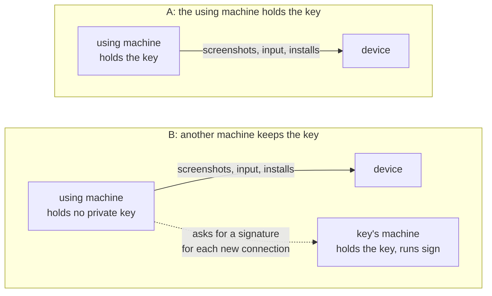
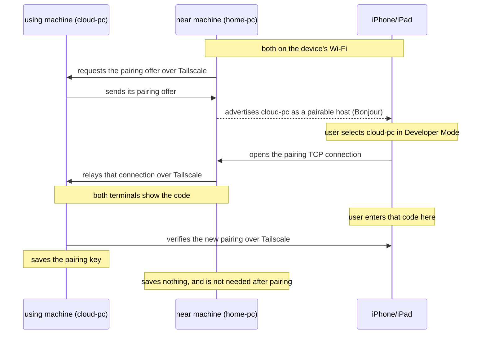
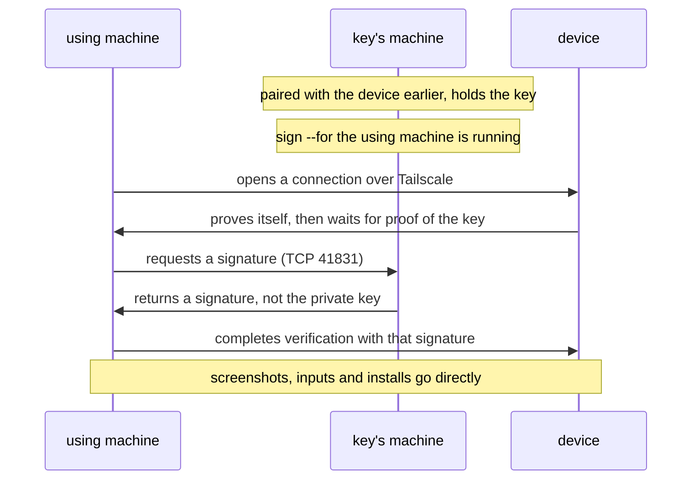

# roamrunctl

<p align="center">English | <a href="https://github.com/mh-mobile/RoamRun/blob/main/Rust/roamrunctl/README.ja.md">日本語</a></p>

`roamrunctl` is a command-line tool from [RoamRun](https://github.com/mh-mobile/RoamRun) for Linux,
Windows, and macOS. The machine running it needs neither RoamRun nor Xcode. It has two uses:

1. **Use an iPhone or iPad from this machine** (0.7.0+). Pair with the device, then take screenshots,
   install apps, and launch apps over Tailscale. An MCP server also lets an AI agent tap, swipe,
   type, and inspect the screen.
2. **Introduce a device to a machine elsewhere** (`pair introduce`). A machine on the device's
   Wi-Fi temporarily relays its pairing connection to a far Mac (0.5.0+) or to a machine with
   `roamrunctl` (0.7.0+). The remote machine makes and keeps the pairing. The introducer passes
   the connection on without reading it and saves nothing of it. For device control it shows the
   code to type, so introduce with a machine you trust.

## Requirements

- [Tailscale](https://tailscale.com) installed and connected on the machines and device involved.
  Commands use Tailscale node names, as shown by `tailscale status`, not the device's name in
  iOS Settings. When a command involves several machines, they must be able to reach each other
  through the tailnet, subject to its access rules.
- An iPhone or iPad with iOS/iPadOS 27 or later, Developer Mode enabled, connected to Wi-Fi,
  and unlocked at least once since boot. A device using cellular alone will not accept these
  new connections.
- To `install` an app: an `.ipa` or `.app` already built and signed for that device. `roamrunctl`
  does not build or sign apps.

Tested with an iPhone 15 Pro on iOS 27.0. An iPad, and a setup without any Mac having ever
participated, have not been tested. `roamrunctl` has not been run with an Apple Vision Pro
either; pairing one with a far Mac was run between Macs with RoamRun, and is in
[the main README](https://github.com/mh-mobile/RoamRun/blob/main/README.md#apple-vision-pro). More [untested configurations](../../docs/roamrunctl-reference.md#what-has-not-been-tested)
are listed in the reference.

## Install

**Linux** (x86_64 or aarch64), into `~/.local/bin`:

```sh
mkdir -p ~/.local/bin
curl -fsSL "https://github.com/mh-mobile/RoamRun/releases/latest/download/roamrunctl-linux-$(uname -m).tar.gz" \
  | tar -xz -C ~/.local/bin --strip-components 1 "roamrunctl-linux-$(uname -m)/roamrunctl"
~/.local/bin/roamrunctl --version
```

If `roamrunctl` is not found by name, add `~/.local/bin` to your `PATH` or use its full path
for the commands below.

**Windows** (PowerShell, x86_64 shown):

```powershell
irm https://github.com/mh-mobile/RoamRun/releases/latest/download/roamrunctl-windows-x86_64.zip -OutFile roamrunctl.zip
Expand-Archive -Force roamrunctl.zip .
.\roamrunctl-windows-x86_64\roamrunctl.exe --version
```

On Windows on ARM, replace `x86_64` with `aarch64` in both the download name and the executable
path. The binaries are not code-signed. For the commands
below, use this executable path or add its folder to your `PATH` so that `roamrunctl` works
by name.

**macOS**, or Linux with Homebrew:

```sh
brew install mh-mobile/tap/roamrunctl
```

With Rust 1.89 or later, you can also build from a release tag:

```sh
cargo install --locked --git https://github.com/mh-mobile/RoamRun --tag vX.Y.Z roamrunctl
```

Replace `vX.Y.Z` with the release tag. Archives and checksums (`roamrunctl-SHA256SUMS`) are on
the [releases page](https://github.com/mh-mobile/RoamRun/releases). Use matching RoamRun and
`roamrunctl` versions on machines participating in the same pairing.

## Using a device from a machine without Xcode

Pairing saves a record that contains a private key. Someone who can use that key and reach the
device can view its screen and operate it. You can keep the key on the machine using the device (**A**),
or on another machine that signs connections on its behalf (**B**).

The **using machine** runs `look`, `install`, `launch`, or `mcp`. The **key's machine** holds the
private key; in A these are the same machine. A **near machine** is on the device's Wi-Fi and
can introduce a using machine that is somewhere else.



**Start with A** unless you specifically need to keep the key off the using machine (for
example, an ephemeral cloud VM). B changes where the private key is stored; it **does not
restrict the device actions** available to software on the using machine.

Pairing requires entering a code on the device. **Run the pairing commands yourself in a
terminal, not through an AI agent.** The examples use these names; replace them with your own:

| Name in the examples | Stands for |
|---|---|
| `my-iphone` | the device's Tailscale name |
| `home-pc` | the Tailscale name of a machine on the device's Wi-Fi |
| `cloud-pc` | the Tailscale name of a machine somewhere else |
| `phone` | the name this machine gives the paired device (set with `--as`) |

### A: on the device's Wi-Fi

The machine has to be on the device's Wi-Fi, and Tailscale has to reach the device directly
there over IPv4, not through a relay. Check first: `tailscale ping my-iphone` should end with
`via` a local address, not `via DERP`.

```sh
roamrunctl pair control --to my-iphone --as phone
```

The command prints the name it announces, which is this machine's Tailscale name. On the
device, go to **Settings > Privacy & Security > Developer Mode**, select that name, and enter
the code printed in the terminal. The command confirms when it has paired, tested the
connection over Tailscale, and saved the key.

The device connects back to this machine on a TCP port that the command prints, together with
the device's address on the Wi-Fi. If a firewall on this machine blocks incoming connections,
allow that port from that address; see
[ports and firewalls](../../docs/roamrunctl-reference.md#ports-and-firewalls).

### A: from another network

Suppose the using machine (`cloud-pc`) is elsewhere. A near machine (`home-pc`) on the
device's Wi-Fi can introduce it once.

**Initial-pairing requirement:** For this `pair control --with` + `pair introduce` flow, and
for the Introducer app below, the device must already have paired with something (such as a Mac running Xcode). That makes
the device advertise the pairing service the near machine needs. If it has never paired,
pair it once on its own Wi-Fi first.

```sh
# On cloud-pc (the using machine, somewhere else):
roamrunctl pair control --with home-pc --as phone

# On home-pc (the near machine, on the device's Wi-Fi):
roamrunctl pair introduce --host cloud-pc --to my-iphone
```

`--host` names the machine that will hold the pairing: here, the using machine. The near
machine's output calls it "the host". Either command can start first; each waits up to ten
minutes for the other. On the device, select `cloud-pc` under Developer Mode and enter the
code, which both commands print.



The using machine must allow incoming Tailscale TCP connections from the near machine on
41830 and on a second port, which it prints during pairing. The near machine must let the
device in on the port it prints. If the near machine cannot reach the using machine's second
port, it says so before it announces anything. See
[ports and firewalls](../../docs/roamrunctl-reference.md#ports-and-firewalls).

The device can also do the introducing itself, with the
[Introducer app](https://github.com/mh-mobile/RoamRun/tree/main/iOS) (built from source with
Xcode; it is not on the App Store). Then no near machine is needed: run
`roamrunctl pair control --with my-iphone --as phone` on the using machine, and enter the using
machine's Tailscale name in the app.

### Use the paired device

```sh
roamrunctl devices                    # list devices available here
roamrunctl look phone shot.png        # save a PNG screenshot (longer side at most 1280 pixels)
roamrunctl install phone App.ipa      # or a signed .app folder
roamrunctl launch phone com.example.App
```

To stop using a device, run `roamrunctl devices remove phone`. That forgets it on this machine.
To withdraw the pairing itself, also remove this machine under Developer Mode on the device.

### Use with an AI agent (MCP)

`roamrunctl mcp` exposes the device through an MCP server over standard input/output. For
clients that accept an `mcpServers` configuration, register it like this:

```json
{
  "mcpServers": {
    "roamrunctl": {
      "command": "roamrunctl",
      "args": ["mcp"]
    }
  }
}
```

Use the full executable path if the client cannot find `roamrunctl` in its `PATH`.
The tools are `devices`, `look`, `tap`, `swipe`,
`elements`, `type`, `paste`, `press`, `install`, `install_status`, and `launch`. Since 0.8.0,
`install` answers once the install has begun; `install_status` says when the app is in, and until
then other calls on that device answer that it is installing.

For `tap`, `swipe`, `type` and `paste`, the agent must first call `look`, and give the id
that look answered with (`"look": 12`; 0.8.0+). A look stands for 60 seconds, and only while it is
the device's latest: another look by any agent (one that failed too), or `press`,
`elements`, `install` or `launch` on that device, ends it. It permits one tap or swipe;
after a tap, swipe, `type` or `paste` by it, a tap or swipe needs another look, while `type`
and `paste` still go by it, so look → tap a field → type needs one look. A tap or swipe is
also refused if the device reports that it was turned since the look, and a call that fails
in a way that may have reached the device ends the look. The server uses the device's
screenshots and input commands, not a continuous screen-sharing stream.

#### Over HTTP, for an agent elsewhere (0.8.0+)

An agent that reaches this machine only over HTTP (one in a cloud environment that is on your
tailnet) uses the same tools from `roamrunctl mcp --http`, which you start and stop:

```sh
roamrunctl mcp --http 9090 --allow tag:codex phone
```

- It listens on this machine's Tailscale IPv4 address alone, on that port, until Ctrl-C.
  The endpoint is `http://<that address>:9090/mcp`. A cloud environment usually has no
  MagicDNS: give it the address, not the name.
- `--allow` says who may call: `tag:<name>` for a tagged machine (a cloud's carries the tag of
  the auth key you gave it), or a login (`someone@example.com`) for a person's own machines.
  Tailscale is asked who each caller is (`tailscale whois`). A machine's name isn't taken.
  A call from this machine itself is refused unless it brings the token.
- `--token-file <file>` makes every request also bring `Authorization: Bearer <token>`: a
  file only you can read, 32 characters or more.
- Only the devices named are listed or used. It doesn't start as root (not checked on
  Windows).
- `--allow-install` also offers `install`, of an `.ipa` sent first to
  `http://<that address>:9090/upload` (`curl -T App.ipa`, 1024 MiB at most unless
  `--max-upload <MiB>` says otherwise): the answer's `upload` id and `sha256` are what `install`
  is given. One upload is kept, and only its sender can install it. It is removed when the
  install ends, after 30 minutes unused, at Ctrl-C, or when another upload begins to come in,
  from any caller. Without the flag there is no install over
  HTTP.
- What is shown and sent passes through whatever lies between: a cloud's proxy sees the
  images, the text typed or pasted, what is uploaded, and the token.

Installing and launching from a CI job, with roamrunctl on the runner or through `mcp --http` on a
machine beside the device, is in [docs/ci.md](../../docs/ci.md).

An optional [agent skill](https://github.com/mh-mobile/RoamRun/tree/main/skills/roamrunctl)
provides instructions: `npx skills add mh-mobile/RoamRun`. Installing the skill does not
register or start the MCP server.

### The key file (A)

In A, the key is saved in `~/.config/roamrunctl/devices/phone.json` on Linux/macOS
(or under `$XDG_CONFIG_HOME` when that is an absolute path), and in `%LOCALAPPDATA%\roamrunctl\devices` on Windows.
Unix files are created readable only by their owner. **Any program running as that user,
including an agent, can nevertheless use an unencrypted key** to operate the device.

Add `--passphrase` to `pair control` to save an age-encrypted `phone.age` file instead.
The passphrase is taken from the first of these that is set: `ROAMRUNCTL_PASSPHRASE_FILE`,
`ROAMRUNCTL_PASSPHRASE_COMMAND`, `ROAMRUNCTL_PASSPHRASE`. If none is set, it is asked for at
the terminal. `mcp` cannot ask, so it requires one of them; `mcp --http` asks at the terminal
as it starts. Encrypting the file does not
protect against software that can read the passphrase itself. What the environment gives is one
passphrase, used for every encrypted device opened under it: one `mcp` server uses one for all.

### B: another machine keeps the key

With B, the using machine holds no private pairing key. The key's machine signs the
challenge needed for each new device connection, but screenshots, inputs, and installs
still travel directly between the using machine and the device.

```sh
# On home-pc (the key's machine, on the device's Wi-Fi for pairing):
roamrunctl pair control --to my-iphone --as phone --passphrase
roamrunctl sign phone --for cloud-pc  # enter the passphrase; leave sign running

# On cloud-pc (the using machine): nothing to set up when both machines are yours and untagged
roamrunctl devices
roamrunctl look phone
```



The key's machine must allow incoming TCP 41831 from the using machine. The using machine
finds the key's machine by itself only when both are online, untagged, and owned by the same
Tailscale user. Otherwise (a tagged machine, as a cloud VM often is; different users; or a
tailnet where another machine could offer the same device name), name it before first use:
`export ROAMRUNCTL_SIGNER=home-pc` on the using machine (in PowerShell,
`$env:ROAMRUNCTL_SIGNER = 'home-pc'`; for MCP, in the MCP server's environment). Finding it
automatically was run against a real device; `ROAMRUNCTL_SIGNER` was not.

While `sign` answers, any program on the using machine can operate the device. Stopping
`sign` prevents new signed connections, not already-open connections (including an
existing MCP session). Whether an open connection can be used to create another pairing
has not been tried; do not assume B prevents that. See the
[security details](../../docs/roamrunctl-reference.md#b-remote-signing-and-trust).

`roamrunctl devices remove phone` on the using machine does not touch the key on the key's
machine, and the using machine lists the device again for as long as `sign` still names it.

## Introduce a device to a remote Mac or another host

`pair introduce` is the near machine's half of the pairing in
[A: from another network](#a-from-another-network): run on the device's Wi-Fi, it lets the
machine named by `--host` pair with the device, and keeps nothing itself. That host can also
be a Mac with RoamRun.

```sh
# On the near machine:
roamrunctl pair introduce --host <the host's Tailscale name> --to my-iphone
```

What the host runs decides whose pairing it is:

| Command on the host | Pairing belongs to |
|---|---|
| `roamrunctl pair control --with home-pc` | roamrunctl device control (A, above) |
| `roamrun pair control --with home-pc` (RoamRun app open) | RoamRun device control |
| `roamrun pair xcode --with home-pc` (Xcode Device Hub waiting) | Xcode |

For the two device-control rows, the near machine's command prints the pairing code; a
`roamrunctl` host prints it too. For Xcode, use the code shown in
**Device Hub > Pair Nearby Device** on the host. What the near machine then prints on standard
output, and what each exit code asks of you, is in the
[reference](../../docs/roamrunctl-reference.md#pair-introduce-options-and-results).
Ctrl-C withdraws the near machine's local advertisement.

## Reference and security

See [roamrunctl-reference.md](../../docs/roamrunctl-reference.md) for time limits,
ports and firewalls, passphrases, imports, exact tool behavior, platform limitations,
troubleshooting, and untested configurations. If you are reading this README from a
downloaded release archive, use the [online reference](https://github.com/mh-mobile/RoamRun/blob/main/docs/roamrunctl-reference.md)
and check that it describes your release. See also [SECURITY.md](https://github.com/mh-mobile/RoamRun/blob/main/SECURITY.md).
