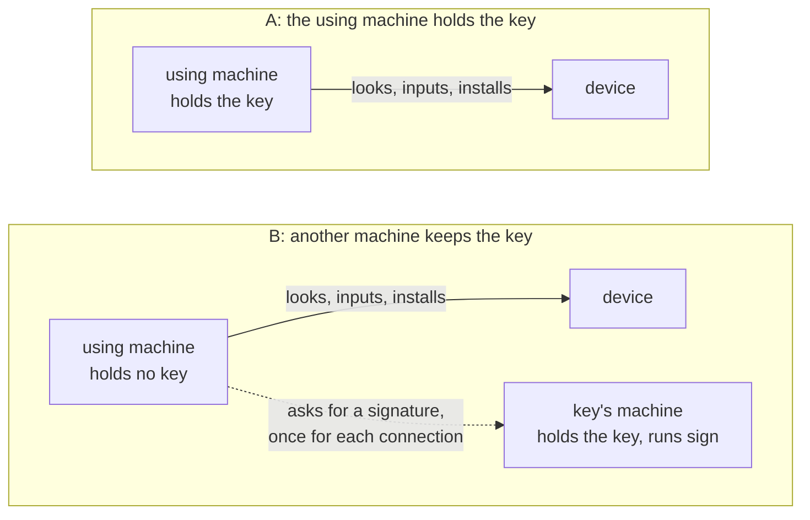
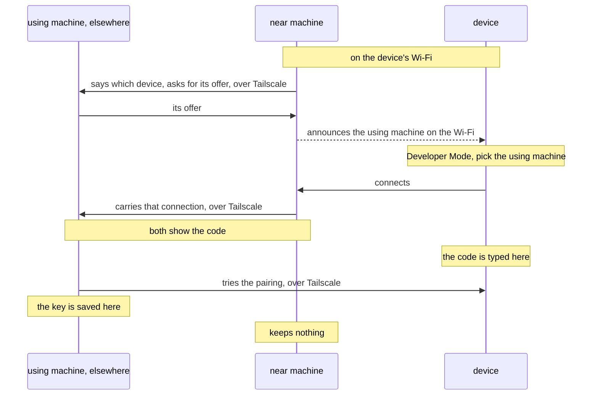
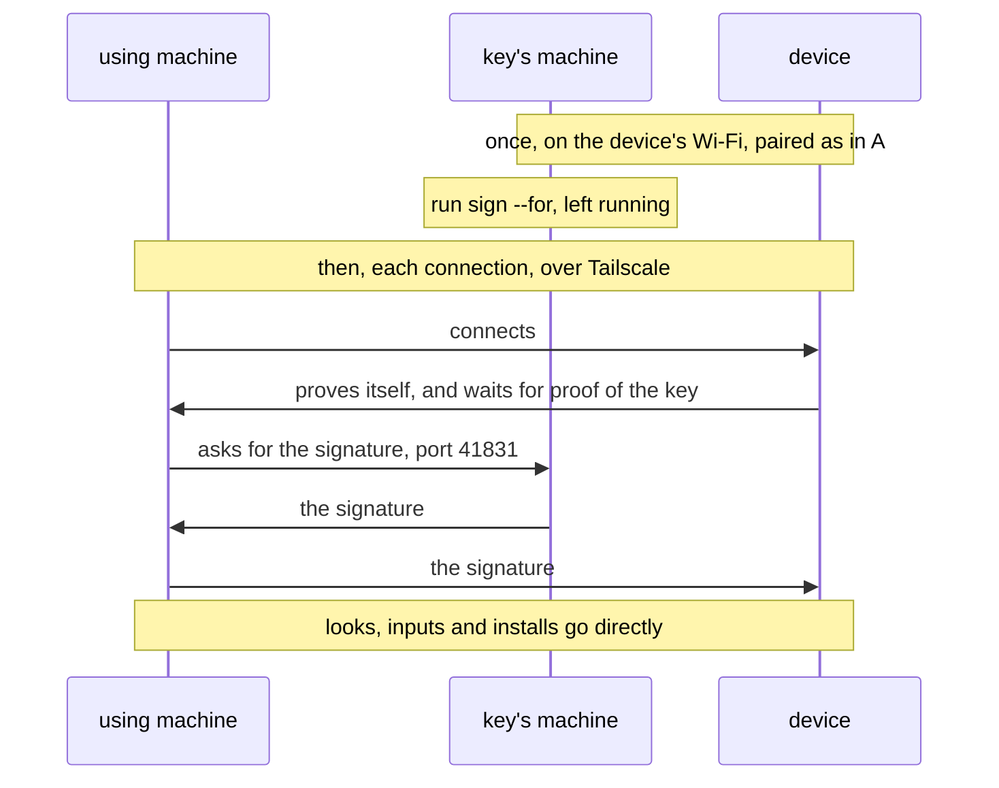

# roamrunctl

A command-line tool from the RoamRun project, for Linux, Windows and macOS. The machine it runs on needs
neither RoamRun nor Xcode. It does two things:

1. **Uses an iPhone or iPad from this machine** (since 0.7.0). The machine pairs with the device and then
   reaches it over Tailscale: screenshots, installing an app, launching it. For an AI agent it is an MCP
   server, which adds taps, swipes, typing and reading what is on the screen.
2. **Introduces a device to a machine elsewhere** (`pair introduce`, since 0.5.0). Run on the device's Wi‑Fi,
   it lets a machine that isn't there pair with the device.

What it needs:

- [Tailscale](https://tailscale.com) on this machine and on the device. Machines and devices are named below
  by their Tailscale names, as `tailscale status` lists them, not by what a device calls itself.
- An iPhone or iPad on iOS 27 or later with Developer Mode on. It has to be on a Wi‑Fi (on cellular alone it
  refuses new connections) and unlocked once since it started.
- For `install`: an app already built and signed for that device. roamrunctl doesn't build or sign.

Not tried with an Apple Vision Pro. And not tried without any Mac: so far a Mac always made the device's first
pairing, introduced, or signed.

## Install

Linux, into `~/.local/bin`:

```
mkdir -p ~/.local/bin && curl -fsSL https://github.com/mh-mobile/RoamRun/releases/latest/download/roamrunctl-linux-$(uname -m).tar.gz | tar -xz -C ~/.local/bin --strip-components 1 roamrunctl-linux-$(uname -m)/roamrunctl
```

Windows (PowerShell), into a folder where you are. On an ARM PC write `aarch64` instead of `x86_64`, here and
in the path below:

```
irm https://github.com/mh-mobile/RoamRun/releases/latest/download/roamrunctl-windows-x86_64.zip -OutFile roamrunctl.zip; Expand-Archive -Force roamrunctl.zip .
```

Then run `.\roamrunctl-windows-x86_64\roamrunctl.exe`. The Windows builds aren't signed: SmartScreen may ask
before the first run.

macOS, or Linux with Homebrew: `brew install mh-mobile/tap/roamrunctl` (built from source).
With Rust 1.89 or later: `cargo install --locked --git https://github.com/mh-mobile/RoamRun --tag v<version> roamrunctl`.

The archives are on the [releases page](https://github.com/mh-mobile/RoamRun/releases), with their checksums
in `roamrunctl-SHA256SUMS`. Use the same version on every machine that takes part, RoamRun's or roamrunctl's.
For an agent there is a skill: `npx skills add mh-mobile/RoamRun`.

## Using a device from a machine without Xcode

A pairing is a key. Whoever holds it and can reach the device in Tailscale can see its screen and operate it.
So the first choice is where that key lives. The *using machine* is where `look`, `install`, `launch` and `mcp`
run; the *key's machine* is where the key is kept.



- **A** is simpler: the machine that uses the device holds the key.
- **B** keeps the key off that machine — for a machine an agent runs on, or one in a cloud.

Neither limits what a program on the using machine does with the device once it is connected.

Each `pair` command shows a pairing code. Typing that code on the device is the owner's consent: run these
commands yourself, in your own terminal, not through an agent.

### A, on the device's Wi‑Fi

```sh
roamrunctl pair control --to <the device's Tailscale name> --as phone
# on the device: Settings › Privacy & Security › Developer Mode › pick this machine, type the code shown here
```

Tailscale has to reach the device directly on that Wi‑Fi (not relayed, and over IPv4). The device connects
back to this machine, so a firewall here has to let it in: the command prints the port and the device's
address (with ufw: `sudo ufw allow proto tcp from <that address>`).

### A, from somewhere else

A machine that isn't on the device's Wi‑Fi is introduced once, by one that is (the *near machine*):

```sh
# on the using machine
roamrunctl pair control --with <the near machine> --as phone
# on the near machine
roamrunctl pair introduce --host <the using machine> --to <the device's Tailscale name>
# on the device: Settings › Privacy & Security › Developer Mode › pick the using machine, type the code
```



- Either command can be started first. The using machine has to let the near machine in on any TCP port
  (Tailscale's rules, and its own firewall).
- What the near machine prints calls the using machine "the host".
- The device must have been paired with something before, such as a Mac's Xcode. A device that never was
  announces nothing for the near machine to pass on, and `pair introduce` says so. (`pair control --to` on the
  near machine may serve as that first pairing. That wasn't tried, and the near machine then holds a key too:
  `roamrunctl devices remove` it there.)
- A Mac with RoamRun can be the near machine: `roamrun pair introduce --host <the using machine> --to <the
  device as RoamRun has it saved>` (not run against a device yet).
- With the Introducer app on the device (built from [`iOS/`](https://github.com/mh-mobile/RoamRun/tree/main/iOS)) no near machine is needed:
  `roamrunctl pair control --with <the device's Tailscale name>`, and the using machine's name in the app.

### Using it

```sh
roamrunctl devices                    # what this machine can use
roamrunctl look phone shot.png        # a screenshot, 1280 pixels at most on its longer side
roamrunctl install phone App.ipa      # or an .app folder
roamrunctl launch phone com.example.App
roamrunctl devices remove phone       # forget it here; on the device, remove this machine under Developer Mode
```

For an agent, the MCP config names the command `roamrunctl` with the argument `mcp`. Its tools are `devices`,
`look`, `tap`, `swipe`, `type`, `paste`, `press`, `elements`, `install` and `launch`. A tap or swipe needs a
look first: one look serves one of them, within a minute, and it is refused if the device was turned since.
Looks are the device's own screenshots and inputs are sent without a screen stream, so the device shows no
screen-sharing session.

`install` prints the size and how long it may take, then nothing until the app is in: a few seconds for each
megabyte on the device's own Wi‑Fi.

### The key file

The key is saved as `~/.config/roamrunctl/devices/<name>.json` (`%LOCALAPPDATA%\roamrunctl\devices` on
Windows), readable by its owner alone on Linux and macOS. **Any program running as that user, an agent among them, can use the
device with it**, and the file works from any machine that reaches the device.

`--passphrase` on `pair control` encrypts it (`<name>.age`), so a copy of the file alone is no key. The
passphrase is typed, or taken from the first of these that is set: `ROAMRUNCTL_PASSPHRASE_FILE`,
`ROAMRUNCTL_PASSPHRASE_COMMAND`, `ROAMRUNCTL_PASSPHRASE`. `mcp` can't ask, so it needs one of them. This
doesn't keep the device from a program that can read the passphrase where you put it.

### B: another machine keeps the key

```sh
# on the key's machine, on the device's Wi‑Fi
roamrunctl pair control --to <the device's Tailscale name> --as phone --passphrase
roamrunctl sign phone --for <the using machine>     # leave it running

# on the using machine: nothing to set up
roamrunctl devices
roamrunctl look phone
```



- The key's machine has to let the using machine in on TCP port 41831.
- The using machine finds the key's machine among its own user's machines that are online. Where either
  machine is tagged, or the two belong to different users (a cloud machine is often tagged), set
  `ROAMRUNCTL_SIGNER=<the key's machine>` on the using machine (for `mcp`, in the agent's MCP config).
- **What this gives:** the key can't be copied from the using machine; ending `sign` (Ctrl-C) ends new
  connections; `sign` prints each connection it signs.
- **What it doesn't:** while `sign` runs, any program on the using machine can connect, as often as it asks,
  and one connection can do everything roamrunctl can. One that is already open stays open after `sign` ends, until it is closed
  or a call on it fails.

## Introducing a machine elsewhere (`pair introduce`)

Run on a machine on the device's Wi‑Fi. The machine elsewhere (the *host*) comes to hold the pairing; this
one only carries the device's connection to it and keeps nothing.

```
roamrunctl pair introduce --host <the host's Tailscale name> --to <the device's Tailscale name>
```

What the host runs first decides what kind of pairing it is:

| On the host | The pairing |
|---|---|
| `roamrunctl pair control --with <this machine>` | roamrunctl's own, as in A above |
| `roamrun pair control --with <this machine>`, with the RoamRun app open (a Mac) | RoamRun's device control |
| `roamrun pair xcode --with <this machine>`, with Xcode's Device Hub › Pair Nearby Device waiting (a Mac) | Xcode's |

Both names are Tailscale's, as `tailscale status` lists them, not what the device calls itself. For the first
two the pairing code is printed here: run the command yourself. For Xcode's the code is the one Device Hub
shows on the host. Ctrl-C takes the announcement back.

## More

- [roamrunctl-reference.md](https://github.com/mh-mobile/RoamRun/blob/main/docs/roamrunctl-reference.md):
  ports and firewalls, time limits, passphrases, moving a key from a Mac, what `sign` checks and whom the
  using machine trusts, the rules of the MCP tools, `pair introduce`'s other flags and exit codes, building
  from this folder — and what hasn't been tried, among it an iPad, x86_64 machines, `sign` for more than one
  device, and `ROAMRUNCTL_SIGNER`.
- Security: [SECURITY.md](https://github.com/mh-mobile/RoamRun/blob/main/SECURITY.md).
