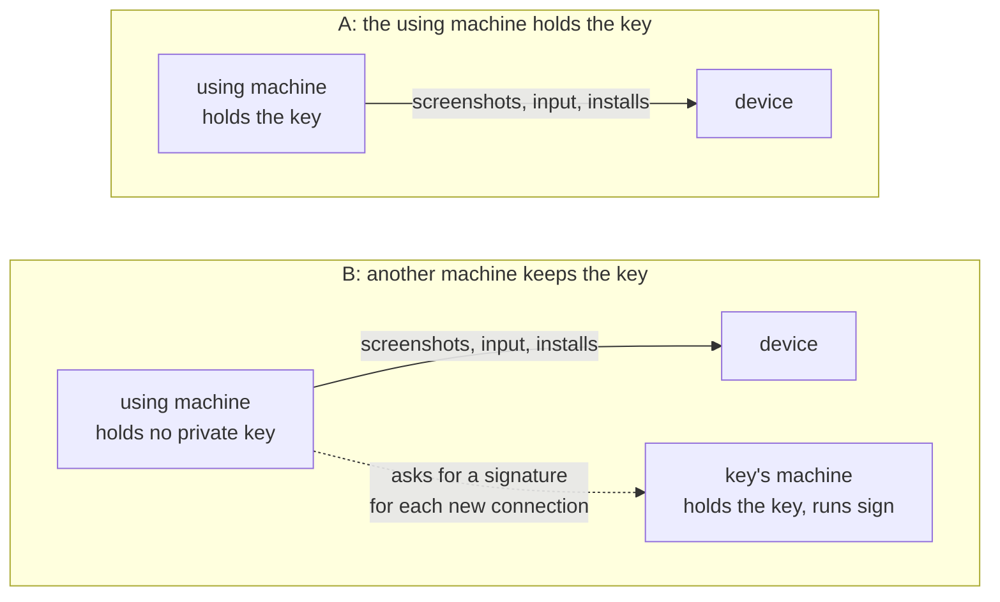
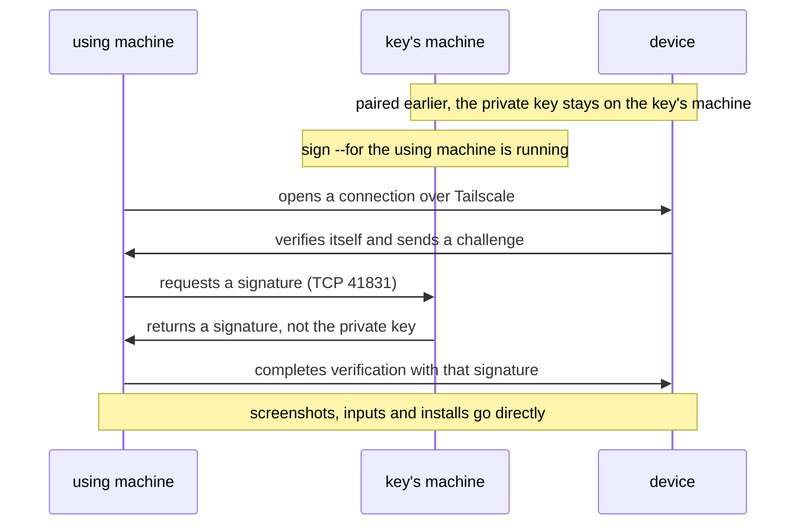

# roamrunctl

`roamrunctl` is a command-line tool from [RoamRun](https://github.com/mh-mobile/RoamRun) for Linux,
Windows, and macOS. The machine running it needs neither RoamRun nor Xcode. It has two uses:

1. **Use an iPhone or iPad from this machine** (0.7.0+). Pair with the device, then take screenshots,
   install apps, and launch apps over Tailscale. An MCP server also lets an AI agent tap, swipe,
   type, and inspect the screen.
2. **Introduce a device to a machine elsewhere** (`pair introduce`, 0.5.0+). A machine on the
   device's Wi-Fi temporarily relays its pairing connection to a remote Mac or another machine.
   The remote machine makes and keeps the pairing; the introducer keeps no key.

## Requirements

- [Tailscale](https://tailscale.com) installed and connected on the machines and device involved.
  Commands use **Tailscale node names**, as shown by `tailscale status`, not the device's name in
  iOS Settings. When a command involves several machines, they must be able to reach each other
  through the tailnet, subject to its access rules.
- An iPhone or iPad with **iOS/iPadOS 27 or later**, Developer Mode enabled, connected to Wi-Fi,
  and unlocked at least once since boot. A device using cellular alone will not accept these
  new connections.
- To `install` an app: an `.ipa` or `.app` already built and signed for that device. `roamrunctl`
  does not build or sign apps.

Tested with an **iPhone 15 Pro on iOS 27.0**. iPad, Apple Vision Pro, and a setup without any Mac
having ever participated have not been tested. More [untested configurations](../../docs/roamrunctl-reference.md#what-has-not-been-tested)
are listed in the reference.

## Install

**Linux** (x86_64 or aarch64), into `~/.local/bin`:

```sh
mkdir -p ~/.local/bin
curl -fsSL "https://github.com/mh-mobile/RoamRun/releases/latest/download/roamrunctl-linux-$(uname -m).tar.gz" \
  | tar -xz -C ~/.local/bin --strip-components 1 "roamrunctl-linux-$(uname -m)/roamrunctl"
~/.local/bin/roamrunctl --version
```

If `roamrunctl` is not found by name, add `~/.local/bin` to your `PATH` or use its full path
for the commands below.

**Windows** (PowerShell, x86_64 shown):

```powershell
irm https://github.com/mh-mobile/RoamRun/releases/latest/download/roamrunctl-windows-x86_64.zip -OutFile roamrunctl.zip
Expand-Archive -Force roamrunctl.zip .
.\roamrunctl-windows-x86_64\roamrunctl.exe --version
```

On Windows on ARM, replace `x86_64` with `aarch64` in both the download name and the executable
path. The binaries are unsigned, so SmartScreen may warn on first launch. For the commands
below, **use this executable path** or add its folder to your `PATH` so that `roamrunctl` works
by name.

**macOS**, or Linux with Homebrew:

```sh
brew install mh-mobile/tap/roamrunctl
```

With Rust 1.89 or later, you can also build from a release tag:

```sh
cargo install --locked --git https://github.com/mh-mobile/RoamRun --tag vX.Y.Z roamrunctl
```

Replace `vX.Y.Z` with the release tag. Archives and checksums (`roamrunctl-SHA256SUMS`) are on
the [releases page](https://github.com/mh-mobile/RoamRun/releases). Use matching RoamRun and
`roamrunctl` versions on machines participating in the same pairing.

## Using a device from a machine without Xcode

A **pairing record contains a private key**: someone who can use that key and reach the device
can view its screen and operate it. You can keep the key on the machine using the device (**A**),
or on another machine that signs connections on its behalf (**B**).

The **using machine** runs `look`, `install`, `launch`, or `mcp`. The **key's machine** holds the
private key; in A these are the same machine. A **near machine** is on the device's Wi-Fi and
can introduce a using machine that is somewhere else.



**Start with A** unless you specifically need to keep the key off the using machine (for
example, an ephemeral cloud VM). B changes where the private key is stored; it **does not
restrict the device actions** available to software on the using machine.

Pairing requires entering a code on the device. **Run the pairing commands yourself in a
terminal, not through an AI agent.** The following examples use `my-iphone`, `home-pc`, and
`cloud-pc` as Tailscale node names, and save the device locally as `phone`. Replace these
with names from your tailnet.

### A: on the device's Wi-Fi

On a machine connected to the device's Wi-Fi:

```sh
roamrunctl pair control --to my-iphone --as phone
```

On the device, go to **Settings > Privacy & Security > Developer Mode**, select the machine
that was announced, and enter the code printed in the terminal. The command confirms when
it has paired, tested the connection over Tailscale, and saved the key.

Tailscale must reach the device **directly over this Wi-Fi using IPv4**, rather than via a
relay. The device connects back to the using machine on a TCP port printed by the command.
If a firewall blocks it, allow **only that port from the device's local IP address**. For
example, with ufw, substituting the actual values printed:

```sh
sudo ufw allow from 192.168.1.50 to any port 54321 proto tcp
```

Remove this temporary rule when pairing is complete. Bonjour/mDNS discovery must also work
on that Wi-Fi; see the [network details](../../docs/roamrunctl-reference.md#ports-and-firewalls).

### A: from another network

Suppose the using machine (`cloud-pc`) is elsewhere. A **near machine** (`home-pc`) on the
device's Wi-Fi can introduce it once, without receiving or keeping its private key.

**Initial-pairing requirement:** For this `pair control --with` + `pair introduce` flow, the
device must already have paired with something (such as a Mac running Xcode). That makes
the device advertise the pairing service the near machine needs. If it has never paired,
complete a local pairing first. This limitation is specific to this introduction flow.

```sh
# On cloud-pc (the using machine, somewhere else):
roamrunctl pair control --with home-pc --as phone

# On home-pc (the near machine, on the device's Wi-Fi):
roamrunctl pair introduce --host cloud-pc --to my-iphone
```

Either command can start first. On the device, select **cloud-pc** under Developer Mode and
enter the code shown by the commands.


The near machine handles Bonjour advertisement and relays the **initial pairing connection**.
The using machine pairs with the device and saves the key. Once it is paired, the near machine
is not needed for normal `look`, `install`, `launch`, or MCP operations.

The using machine must allow incoming Tailscale TCP connections from the near machine on
**41830** and on a **new dynamic port** shown during pairing. Check both the Tailscale access
policy and the operating-system firewall; a blocked dynamic port can make the host appear
but prevent the pairing from finishing. See [ports and firewalls](../../docs/roamrunctl-reference.md#ports-and-firewalls).

There is also an [Introducer app](https://github.com/mh-mobile/RoamRun/tree/main/iOS) for the device itself. With that app, the using
machine can run `roamrunctl pair control --with my-iphone`; the app on the device takes the
near machine's place. It still requires the user to approve pairing on the device.

### Use the paired device

```sh
roamrunctl devices                    # list devices available here
roamrunctl look phone shot.png        # save a PNG screenshot
roamrunctl install phone App.ipa      # or a signed .app folder
roamrunctl launch phone com.example.App
```

`look` saves the device's own screenshot (longer side at most 1280 pixels). `install` waits
for an already-built, signed app to be transferred and installed; `launch` starts an installed
app by bundle identifier. Neither command requires Xcode on the using machine.

### Use with an AI agent (MCP)

`roamrunctl mcp` exposes the device through an MCP server over standard input/output. For
clients that accept an `mcpServers` configuration, register it like this:

```json
{
  "mcpServers": {
    "roamrunctl": {
      "command": "roamrunctl",
      "args": ["mcp"]
    }
  }
}
```

Use the full executable path if the client cannot find `roamrunctl` in its `PATH`.
Configuration formats vary by client. The tools are `devices`, `look`, `tap`, `swipe`,
`elements`, `type`, `paste`, `press`, `install`, and `launch`.

For `tap` and `swipe`, the agent must first call `look`. Each screenshot permits **one
such action within 60 seconds**; another action may invalidate it, and an orientation
change may also invalidate it when detected. The server uses the device's screenshots
and input commands, **not a continuous screen-sharing stream**.

An optional [agent skill](https://github.com/mh-mobile/RoamRun/tree/main/skills/roamrunctl)
provides instructions: `npx skills add mh-mobile/RoamRun`. Installing the skill **does not
register or start** the MCP server.

### The key file (A)

In A, the key is saved in `~/.config/roamrunctl/devices/phone.json` on Linux/macOS
(or under `$XDG_CONFIG_HOME` when set), and in `%LOCALAPPDATA%\roamrunctl\devices` on Windows.
Unix files are created readable only by their owner. **Any program running as that user,
including an agent, can nevertheless use an unencrypted key** to operate the device.

Add `--passphrase` to `pair control` to save an age-encrypted `phone.age` file instead.
The passphrase is entered interactively, or taken in priority order from
`ROAMRUNCTL_PASSPHRASE_FILE`, `ROAMRUNCTL_PASSPHRASE_COMMAND`, or
`ROAMRUNCTL_PASSPHRASE` (the weakest option). Non-interactive `mcp` cannot prompt,
so it requires one of these settings. Encrypting the file does not protect against
software that can read the passphrase itself.

### B: another machine keeps the key

With B, the using machine holds **no private pairing key**. The key's machine signs the
challenge needed for each new device connection, but screenshots, inputs, and installs
still travel **directly between the using machine and the device**.

```sh
# On home-pc (the key's machine, on the device's Wi-Fi for pairing):
roamrunctl pair control --to my-iphone --as phone --passphrase
roamrunctl sign phone --for cloud-pc  # enter the passphrase; leave sign running

# On cloud-pc (the using machine): nothing to set up
roamrunctl devices
roamrunctl look phone
```



The key's machine must allow incoming TCP **41831 from the named using machine**. The using
machine automatically discovers an online signer only when both machines are **untagged and
owned by the same Tailscale user**. For tagged machines, different users, or a tailnet where
another machine could offer the same device name, name the signer **before first use**:
`export ROAMRUNCTL_SIGNER=home-pc` on the using machine (in PowerShell,
`$env:ROAMRUNCTL_SIGNER = 'home-pc'`; for MCP, in the MCP server's environment). Discovery is
what was run against a device; naming the signer this way has not been yet.

B keeps the private key on the signing machine, but **does not grant limited access**: any
program on the allowed using machine can operate the device while `sign` answers. Stopping
`sign` prevents **new signed connections**, not already-open connections (including an
existing MCP session). It has not been established whether an existing connection can be
used to create another pairing; do not assume B prevents that. See the
[security details](../../docs/roamrunctl-reference.md#b-remote-signing-and-trust).

To forget a device here, run `roamrunctl devices remove phone`. For a locally held pairing,
also remove this machine from the device's Developer Mode pairing list. In B, removing the
device **on the using machine** only forgets its association with the signing machine; it
does not delete the private key on the signing machine.

## Introduce a device to a remote Mac or another host

Use `pair introduce` on a machine on the device's Wi-Fi to help a remote **host** pair.
The near machine advertises the host's pairing offer over Bonjour and relays the device's
initial TCP connection. **The host keeps the pairing**, not the near machine.

```sh
# On the near machine:
roamrunctl pair introduce --host cloud-pc --to my-iphone
```

The host must run one of the following:

| Command on the host | Pairing belongs to |
|---|---|
| `roamrunctl pair control --with home-pc` | roamrunctl device control (A, above) |
| `roamrun pair control --with home-pc` (RoamRun app open) | RoamRun device control |
| `roamrun pair xcode --with home-pc` (Xcode Device Hub waiting) | Xcode |

For device control, the pairing code is printed by the commands. For Xcode, use the
code shown in **Device Hub > Pair Nearby Device** on the host. The near machine may print
a device record if Xcode's pairing could not be saved automatically; follow its output
and the [reference](../../docs/roamrunctl-reference.md#pair-introduce-options-and-results).
Ctrl-C withdraws the near machine's local advertisement.

## Reference and security

See [roamrunctl-reference.md](../../docs/roamrunctl-reference.md) for time limits,
ports and firewalls, passphrases, imports, exact tool behavior, platform limitations,
troubleshooting, and untested configurations. If you are reading this README from a
**downloaded release archive**, use the [online reference](https://github.com/mh-mobile/RoamRun/blob/main/docs/roamrunctl-reference.md)
and check that it describes your release. See also [SECURITY.md](https://github.com/mh-mobile/RoamRun/blob/main/SECURITY.md).
