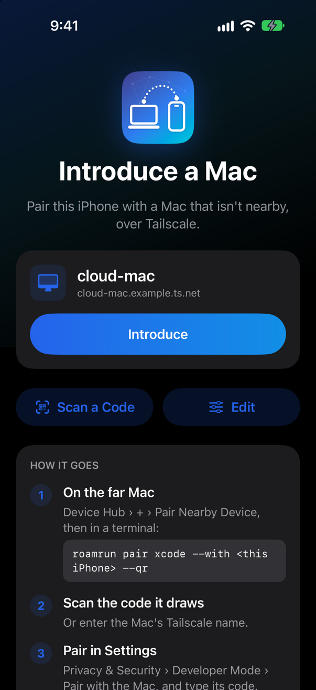
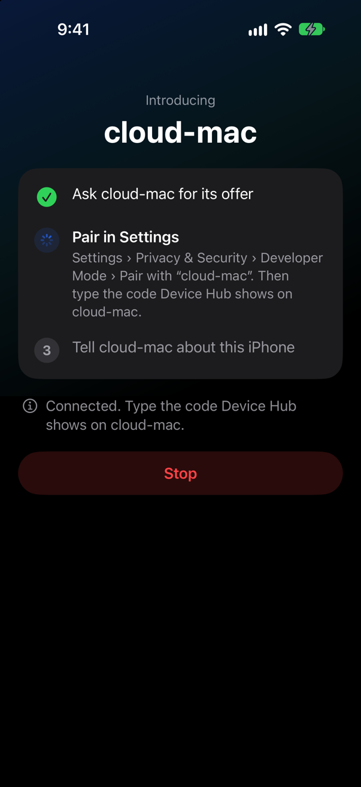
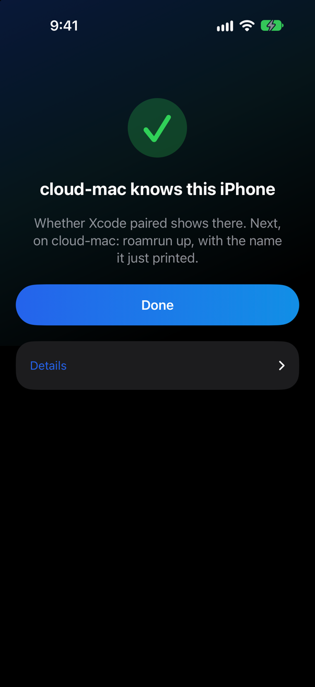

# デバイスと同じ場所にいたことのない Mac のペアリング

<p align="center"><a href="far-mac.md">English</a> | 日本語</p>

ブリッジには、Xcode がデバイスとペアリングした Mac が必要です。Xcode のペアリングは、1 つのネットワークの中で行われます。データセンターの Mac、エージェント用の Mac、別の場所にある自分の Mac は、デバイスと同じネットワークに入ることがありません。**iOS 27 と Xcode 27** なら、デバイスのそばの Mac（デバイスと同じネットワークにある Mac）が一度だけ仲介して、離れた Mac をペアリングできます。

離れた Mac には、Xcode、RoamRun、Tailscale が必要です。何もない状態の Mac を用意する手順は、[another-mac.md](another-mac.md)（英語）にあります。

どの手順にも、iOS 27 と Xcode 27 が必要です。名前は、すべて Tailscale 上の名前です。以下では、デバイスと同じ Wi-Fi にある Mac を「デバイスのそばの Mac」、ペアリングされる側の Mac を「離れた Mac」と呼びます。

## 2 台の Mac が同じ tailnet にある場合

2 台の Mac が同じ tailnet にあれば、互いの名前を指定するだけで済みます。手で運ぶものはありません。

```sh
# 離れた Mac で。Xcode の Device Hub › ＋ › Pair Nearby Device を開いておく（コマンドの前でも後でもよい）
roamrun pair xcode --with macbook-pro                # macbook-pro は、デバイスのそばの Mac の Tailscale 上の名前

# デバイスのそばの Mac で。デバイスは、デバイスのそばの Mac の RoamRun に保存しておく
roamrun pair introduce --host cloud-mac --to iPhone   # cloud-mac は、離れた Mac の Tailscale 上の名前
#   デバイスで、設定 › プライバシーとセキュリティ › デベロッパモード › Pair with “cloud-mac” を選び、
#   離れた Mac の Device Hub に表示されたコードを入力する

# 離れた Mac で。デバイスを保存したと表示されたあとに実行する
roamrun up iPhone
```

知っておくべきことは、次のとおりです。

- 離れた Mac は、デバイスのそばの Mac を最大 10 分待ちます。そのあと、ペアリングを最大 7 分待ちます。
- 「保存した」は、「ペアリングできた」という意味ではありません。離れた Mac は、ペアリングが試みられた時点でデバイスを保存します。ペアリングができたかどうかは、離れた Mac で `roamrun up` を実行すると分かります。`pair introduce` からは、コードの間違いと、まだ入力されていない状態を区別できません。
- 離れた Mac の Device Hub でボタンを押し、表示されたコードを読む人が必要です。画面の前にいるか、画面共有で操作します。ssh だけではできません。
- この作業の間だけ、デバイスは、デバイスのそばの Mac と同じ Wi-Fi にある必要があります。ペアリングが済めば、ブリッジはどこからでも使えます。
- `pair introduce` を実行すると、Wi-Fi 上に公開を始める前に、離れた Mac の持ち主が表示されます。Tailscale の情報をもとにした表示です。Apple Vision Pro の場合は、代わりに、離れた Mac の側にデバイスの持ち主が表示されます。

**ペアリングした Mac は、デバイスを開発者として使えるようになります**。アプリのインストールと実行、デバッグ、アプリのデータの読み取りができます。iPhone と iPad で取り消すには、設定 › プライバシーとセキュリティ › デベロッパモード で、その Mac を削除します。一覧には、その Mac 自身に付いている名前で表示されます。その名前は、`pair introduce` の出力で確かめられます。Apple Vision Pro と Apple TV からの削除は試していません。デバイス操作と違って、Xcode のペアリングは RoamRun からオフにできません。デバイスで削除するしかありません。

1 行のテキストを手で運ぶ方法、それぞれの側が確かめること、離れた Mac でのデバッグに必要なシンボル、これまでに試したことは、このページの後半にあります。

## デバイス自身に仲介させる

デバイスのそばに RoamRun を入れた Mac がない場合は、デバイス上のアプリが仲介します。[`iOS/`](../iOS/) にある RoamRun Introducer です。Xcode でビルドしてインストールするアプリで、iOS 27 以降で動きます。App Store にはありません。

<p align="center">
  
  
  
</p>

```sh
# 離れた Mac で。Device Hub › ＋ › Pair Nearby Device を開いて、次を実行する
roamrun pair xcode --with iphone-15-pro --qr   # iphone-15-pro は、デバイスの Tailscale 上の名前
# デバイスで。アプリを開き、Scan（または離れた Mac の名前を入力）、Introduce の順に操作する。続けて、
#   設定 › プライバシーとセキュリティ › デベロッパモード › Pair with “cloud-mac” を選び、Device Hub に表示されたコードを入力する
# 離れた Mac で。デバイスを保存したと表示されたあとに実行する
roamrun up iphone-15-pro
```

`--qr` を付けると、離れた Mac の Tailscale 上の名前が、QR コードとしてターミナルに表示されます。アプリでこれを読み取ります。アプリは名前を覚えるので、次からは QR コードは要りません。

デバイス操作のペアリングも、同じ流れでできます。離れた Mac で RoamRun のアプリを開き、`roamrun pair control --with iphone-15-pro` を実行します。この場合、入力するコードは、デバイスに通知として表示されます。iOS がアプリにバックグラウンドでの処理を認めなかった場合、アプリが動けるのは約 30 秒です。アプリにその旨が表示されるので、すぐに「設定」を開いて、コードを入力してください。

## Windows や Linux のマシンに仲介させる

デバイスのそばのマシンが仲介する方法もあります。RoamRun を入れていないマシン向けのコマンド、[`roamrunctl`](../Rust/roamrunctl/README.ja.md) を使います。

```sh
# 離れた Mac で。Device Hub › ＋ › Pair Nearby Device を開いて、次を実行する
roamrun pair xcode --with my-pc                                # my-pc は、仲介するマシンの Tailscale 上の名前
# 仲介するマシンで。デバイスと同じ Wi-Fi に接続しておく
roamrunctl pair introduce --host cloud-mac --to iphone-15-pro   # cloud-mac は離れた Mac、iphone-15-pro はデバイスの、Tailscale 上の名前
# デバイスで。設定 › プライバシーとセキュリティ › デベロッパモード › Pair with “cloud-mac” を選び、Device Hub に表示されたコードを入力する
# 離れた Mac で。デバイスを保存したと表示されたあとに実行する
roamrun up iphone-15-pro
```

デバイス操作のペアリングも、同じ流れでできます。離れた Mac で RoamRun のアプリを開き、`roamrun pair control --with my-pc` を実行します。この場合、入力するコードは `roamrunctl` が表示するので、`roamrunctl` は自分で実行してください。

逆に、Mac の `roamrun pair introduce` の `--host` には、Linux や Windows のマシンも指定できます。相手のマシンでは、`roamrunctl pair control --with <name>` を実行して待っておきます。この場合にできるのは、デバイス操作のペアリングだけです。`roamrunctl` を使うと、Mac も Xcode もないマシンでデバイスとペアリングして、デバイスを使えます。詳しくは [roamrunctl の README](../Rust/roamrunctl/README.ja.md#xcode-のないマシンからデバイスを使う) を参照してください。

`roamrun` と `roamrunctl` は互いに通信するので、同じバージョンにそろえてください。0.7.0 より前の `pair introduce` は、相手のマシンを `--mac` で指定していました。いまは、どちらのコマンドでも `--host` です。

<a id="apple-vision-pro"></a>

## Apple Vision Pro と Apple TV

Apple Vision Pro と Apple TV のペアリングは、iPhone とは手順が違います。デバイスのほうが待っていて、Mac がデバイスを選びます。使うコマンドは、iPhone の場合と同じ 2 つです。Apple TV には、tvOS 用の Tailscale のアプリを入れておきます。また、両方の Mac に RoamRun 0.12.0 以降が必要です。それより古い RoamRun は、iPhone、iPad、Apple Vision Pro のどれでもないとして Apple TV を断ります。

```sh
# デバイスで、次の画面を開いたままにする
#   Apple Vision Pro: 設定 › 一般 › Remote Devices
#   Apple TV: 設定 › リモコンとデバイス › リモコンアプリとデバイス
# 離れた Mac で
roamrun pair xcode --with home-mac            # home-mac は、デバイスのそばの Mac の Tailscale 上の名前
# デバイスのそばの Mac で。デバイスは、デバイスのそばの Mac の RoamRun に保存しておく
roamrun pair introduce --host cloud-mac --to vision-pro
# 離れた Mac で。コマンドに案内が出たら、Device Hub › ＋ › Pair Nearby Device › Apple Vision Pro（または Apple TV）を開き、
# デバイスを選んで Next を押し、デバイスに表示されたコードを入力する
roamrun up vision-pro
```

- 離れた Mac のコマンドは、Device Hub でペアリングが済むと、自動で終了します。終了の判断には、Device Hub がシステムログに書く 1 行を使います。この行にはデバイスの名前が含まれません。そのため、コマンドが動いている間は、Device Hub でほかのデバイスをペアリングしないでください。コマンドは、Ctrl-C を押したときと、5 分たったときにも終了します。
- デバイスのそばの Mac から、Tailscale がデバイスに IPv4 で直接つながっている必要があります。
- コマンドが動いている間、離れた Mac は、自分のネットワーク上にデバイスを公開します。中継するのは、離れた Mac 自身からデバイスへの接続だけです。コマンドが終了するまでに離れた Mac がデバイスに接続できていれば、デバイスが保存されます。
- `--host` に指定できるのは Mac だけです。待っている状態のデバイスに対して、`pair introduce` は Mac 以外の `--host` を拒否します。Introducer アプリと `roamrunctl` は、Vision Pro と Apple TV の仲介に対応していません。
- ペアリングのあと、Device Hub にデバイスが出てこない場合は、「Available」と「Unavailable」の見出しが折りたたまれていないか確かめてください。見出しにポインタを合わせると矢印が出るので、それをクリックします。

2026-10-13 に、Apple Vision Pro 1 台と、仮想マシンの離れた Mac で、上のコマンドを実行しました。ペアリングができ、離れた Mac のコマンドが自動で終了し、離れた Mac でブリッジが Ready になりました。

2026-11-01 には、tvOS 27.2 の Apple TV 4K（第 2 世代）で同じ手順を実行しました。離れた Mac は、Apple TV のそばの Mac の中で動く仮想マシンです。仮想マシンは、そばの Mac とは別のネットワークにあります。ペアリングができ、離れた Mac のコマンドが自動で終了し、ブリッジが Ready になりました。さらに、離れた Mac の Xcode 27.0 からアプリを実行し、ブレークポイントで止まりました。Apple TV の画面の名前は、日本語の表示で確かめたものです。

試していないのは、自宅の外にある離れた Mac、自宅の外にあるデバイス、Apple TV でのデバイスの操作（look や tap）です。

## テキストを手で運ぶ方法

2 台の Mac の間が tailnet でつながっていない場合は、同じやり取りを、2 行のテキストで運びます。1 行目は「オファー」です。オファーは、ペアリングを始めるために離れた Mac が出すデータです。

```sh
# 離れた Mac で。Device Hub › ＋ › Pair Nearby Device を開き、“Waiting to pair.” の画面を開いたままにして、次を実行する
roamrun pair xcode                                           # 離れた Mac のオファーが、1 行で表示される

# デバイスのそばの Mac で。デバイスは、デバイスのそばの Mac の RoamRun に保存しておく
roamrun pair introduce <offer> --host cloud-mac --to iPhone
#   デバイスで、設定 › プライバシーとセキュリティ › デベロッパモード › Pair with “cloud-mac” を選び、
#   離れた Mac の Device Hub に表示されたコードを入力する
#   コマンドは自動で終了する。ペアリングが試みられていれば、デバイスの情報が 1 行で表示される

# もう一度、離れた Mac で
roamrun devices add <line>                                   # デバイスを保存する。鍵と UDID は含まれない
roamrun up iPhone
```

どのコマンドも、標準出力には、渡すべき 1 行だけを出します。そのため、離れた Mac に ssh で入れるなら、手でコピーする必要はありません。

```sh
OFFER=$(ssh cloud-mac roamrun pair xcode) &&
LINE=$(roamrun pair introduce "$OFFER" --host cloud-mac --to iPhone) &&
ssh cloud-mac roamrun devices add "$LINE"
```

この手順では、離れた Mac で RoamRun のアプリを開いておく必要はありません。保存したデバイスは、アプリを次に開いたとき、一覧に出ます。アプリが開いていれば、数秒で出ます。

`roamrun pair xcode --qr` を実行すると、オファーが QR コードとしてターミナルに表示されます。これを Introducer アプリで読み取ります。読み取ったあと、アプリには `roamrun devices add <line>` に渡す行が表示されます。ターミナルのウインドウが小さくて QR コードが収まらない場合は、必要な大きさが表示されます。

## それぞれの Mac が行うことと、確かめること

**離れた Mac**（`pair xcode --with` か `pair control --with` を実行している間）

- 離れた Mac は、自分の Tailscale のアドレスで、ポート 41830 を待ち受けます。2 つのコマンドのうち、同時に待てるのは片方だけです。離れた Mac のファイアウォールが有効な場合は、RoamRun への接続を許可しておきます。有効な場合は、コマンドの開始時に、そのことが表示されます。
- 離れた Mac が応答するのは、指定したマシンだけです。接続してきたのが指定したマシンかどうかは、アドレスと、その時点でそのアドレスを持つマシンを Tailscale に問い合わせて確かめます。
- Xcode のペアリングでは、ペアリングが試みられた時点で、デバイスを保存します。「保存した」は「ペアリングできた」という意味ではありません。ペアリングができたかどうかは、`roamrun up` で分かります。デバイス操作のペアリングを保存するのは、成立したときだけです。

**デバイスのそばの Mac**（`pair introduce` を実行している間）

- デバイスのそばの Mac は、離れた Mac のオファーを、自分の Wi-Fi 上に公開します。公開するときの名前は、Tailscale が離れた Mac に付けている名前です。デバイスからの接続は、tailnet 経由で離れた Mac に中継します。tailnet の側では、何も待ち受けません。
- 接続を受け付けるのは、その Wi-Fi 上でのデバイス自身のアドレスからだけです。このアドレスは Tailscale から取得します。Tailscale がしばらくデバイスと通信していない場合は、デバイスに問い合わせます。
- Tailscale とデバイスの間が、中継サーバー経由か IPv6 でしかつながっていない場合、仲介は始まりません。デバイスを Tailscale のデバイスとしてではなく、アドレスで保存している場合も同じです。
- 公開を始める前に、離れた Mac の持ち主が表示されます。自分のものか、ほかの人のものか、共有の（タグ付きの）マシンかを、Tailscale の情報をもとに示します。仲介するのは、`--host` で指定した Mac だけです。
- デバイスがペアリングを試みたとき、または 5 分たったときに、コマンドは終了します。Ctrl-C を押したとき、デバイスのそばの Mac のアドレスが変わったとき、離れた Mac のコマンドが終了したときにも終了します。終了すると、公開も待ち受けも残っていないことが表示されます。公開用の補助プロセスが残っている可能性がある場合は、`roamrun doctor` で確かめるよう表示されます。
- ペアリングができたかどうかは、デバイスのそばの Mac からは分かりません。コードの間違いと、まだ入力されていない状態を区別できないためです。

ペアリングそのものは、デバイスと離れた Mac の間で行われます。デバイスがペアリングするのは、離れた Mac の Xcode です。デバイス操作の場合は、離れた Mac の RoamRun のアプリです。デバイスのそばの Mac は、通信の中身を読まずに渡し、何も保存しません。通る通信から鍵を取り出せないことは、ペアリング自体の暗号化によります。デバイス操作のペアリングでは、コードがデバイスのそばの Mac に表示されます。仲介には、信頼できる Mac を使ってください。2 台の Mac の間の接続が途中で切れた場合は、どちらの Mac にも、次にすることが表示されます。上の「テキストを手で運ぶ方法」なら、2 台の間の接続は要りません。

## 必要なもの

- **一度でもどれかの Mac とペアリングしたことがあり、デバイスのそばの Mac の RoamRun に保存してあるデバイス**。一度もペアリングしていないデバイスは、自分の情報を Wi-Fi 上に公開しません。そのため、RoamRun にはデバイスを追加する手がかりがありません。先に、デバイスと同じ Wi-Fi にあるどれか 1 台の Mac で、一度ペアリングしてください。仲介するデバイスのそばの Mac は、その Mac でなくても、デバイスとペアリングしていなくても構いません。Introducer アプリか `roamrunctl` を使う場合は、デバイスを保存しておく必要はありません。その場で、デバイスが公開している情報を読み取ります。
- **デバイスが、デバイスのそばの Mac と同じ Wi-Fi にあること**。必要なのは、仲介する間だけです。ゲスト用のネットワークや隔離されたネットワークでは動きません。その Wi-Fi につないだ別の機器のテザリングでも動きません。
- **離れた Mac の画面を操作できる人**。Device Hub のボタンを押し、表示されたコードを読みます。画面の前にいるか、画面共有で操作します。
- **離れた Mac の Tailscale が、サインインしたままであること**。エフェメラルキーで参加した Mac は、再起動するとサインアウトされます。

## ペアリングのあと

- **離れた Mac でデバッグするには、デバイスの OS のシンボルが離れた Mac に必要です**。Xcode は、最初の接続のときに、シンボルをデバイスからコピーします。約 6 GB あり、Tailscale の中継サーバー経由ではほとんど進みませんでした。すでにシンボルを持っている Mac から、次のフォルダをコピーすると、うまくいきました。

  `~/Library/Developer/Xcode/iOS DeviceSupport/<モデル> <バージョン> (<ビルド>)`

  コピーしたあとは、離れた Mac の `lldb` が約 20 秒でアタッチし、ブレークポイントで止まりました。コピーする前は、`lldb` は 4 分待っても接続できませんでした。`devicectl`、`roamrun run`、`roamrun logs` には、シンボルは要りません。
- **同じイメージから作った複数の Mac は、デバイスからは 1 台の Mac に見えます**。2 台目をペアリングすると、デバイス上の 1 台目の項目が置き換えられます。その項目を削除すると、どちらの Mac からも、デバイスを使えなくなります。
- **レンタルやクラウドの Mac で作ったペアリングは、その Mac のディスク、イメージ、スナップショットに残ります**。デバイスで削除するまで有効です。
- **離れた Mac が保存しているデバイスの情報は、デバイスのそばの Mac が持つ情報のコピーです**。デバイスの Bonjour のレコードが変わると、2 つは食い違います。その場合は、デバイスのそばの Mac でデバイスを追加し直し、同じ Mac で `roamrun devices export <name>` を実行します。出力された行を、離れた Mac で `roamrun devices add <line>` に渡します。離れた Mac にすでに保存してあるデバイスなら、レコードが新しいものに置き換わります。デバイスのアドレス、ポート、Tailscale 上の名前も変わっている場合は、`--replace <name>` を付けてください。このときは、離れた Mac のアプリと、そのデバイスのブリッジを止めておきます。

## 試したこと

iOS 27 の iPhone 15 Pro と Xcode 27、仮想マシンの離れた Mac で、次のことを試しました。

- テキストを運ぶ方法と、名前を指定する方法の両方で、ペアリング、`devices add`、ブリッジの Ready、`devicectl` での起動、`lldb` でのブレークポイントまで確かめました。離れた Mac からデバイスへの経路は、直接の場合と、Tailscale の中継サーバー経由の場合の両方です。2 台の Mac から、同時にデバイスを使うことも確かめました。
- デバイスとペアリングしていない Mac をデバイスのそばの Mac にしても、同じ結果でした。
- Introducer アプリでは、Xcode のペアリングを、名前を指定する方法とテキストを運ぶ方法で行い、そのあとブリッジが Ready になりました。デバイス操作のペアリングも行い、そのあと `roamrun look` が通りました。
- `roamrunctl` での仲介は、Ubuntu 24.04 と、ARM 版の Windows 11 から行いました。Xcode のペアリングのあと、ブリッジが Ready になりました。デバイス操作のペアリングも通りました。
- 2026-10-13 に、RoamRun 0.7.0 で、次の 3 つを確かめました。
  - 名前を指定する方法での Xcode のペアリング（離れた Mac でブリッジが Ready）
  - 名前を指定する方法でのデバイス操作のペアリング（離れた Mac から `look` が通り、2 回目の試行は両方の Mac で拒否）
  - Introducer アプリを使ったデバイス操作のペアリング
- 同じ日に、Apple Vision Pro でも確かめました。名前を指定する方法でペアリングができ、離れた Mac のコマンドが自動で終了し、離れた Mac でブリッジが Ready になりました。

次のものは試していません。

- iPad
- デバイスのそばの Mac より古い RoamRun を入れた、離れた Mac
- 仮想マシンではない、離れた Mac
- 別の Tailscale ユーザーのものである離れた Mac と、タグ付きの離れた Mac
- 別の tailnet から共有された Mac
- ファイアウォールを有効にした、デバイスのそばの Mac
