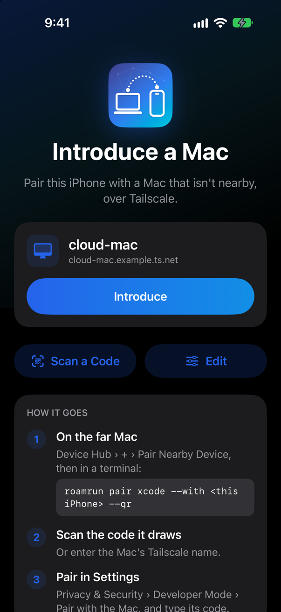
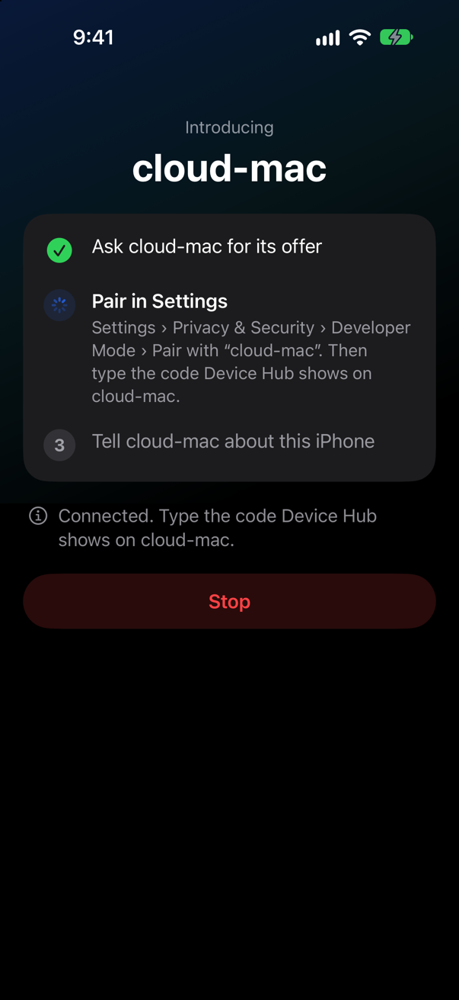
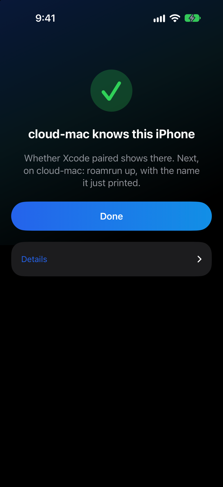

# Pairing a Mac the device was never near

<p align="center">English | <a href="far-mac.ja.md">日本語</a></p>

A bridge needs a Mac that Xcode has paired with the device, and Xcode pairs on one network. A Mac
elsewhere — in a data centre, an agent's, yours in another place — never shares one with the
device. With **iOS 27 and Xcode 27**, a Mac that does share one can introduce it, once.

The far Mac needs Xcode, RoamRun and Tailscale. Setting such a Mac up from nothing is in
[another-mac.md](another-mac.md).

It all needs iOS 27 and Xcode 27. Names are Tailscale names. "The introducing Mac" is the one on
the device's Wi-Fi; "the far Mac" is the one that comes to be paired.

## Both Macs on one tailnet

When both Macs are on one tailnet, each names the other and nothing is carried by hand:

```sh
# on the far Mac: Xcode's Device Hub › + › Pair Nearby Device (before or after), and
roamrun pair xcode --with macbook-pro                # macbook-pro: the Tailscale name of the Mac beside the device

# on the Mac beside the device, with the device saved in RoamRun:
roamrun pair introduce --host cloud-mac --to iPhone   # cloud-mac: the far Mac's Tailscale name
#   on the device: Settings › Privacy & Security › Developer Mode › Pair with “cloud-mac”,
#   and the code that Device Hub shows on the far Mac

# on the far Mac, once it says the device is saved:
roamrun up iPhone
```

What to know:

- The far Mac waits up to 10 minutes for the other Mac, then up to 7 minutes for the pairing.
- "Saved" is not "paired". The far Mac saves the device when a pairing was tried; `roamrun up`
  there shows whether it was made. `pair introduce` cannot tell: a wrong code looks the same to it
  as one not yet typed.
- Someone has to press the button in Device Hub on the far Mac and read its code, at its screen
  or over screen sharing. It cannot be done over ssh alone.
- The device has to be on the introducing Mac's own Wi-Fi for this one step. Afterwards the bridge
  works from anywhere.
- `pair introduce` says whose Mac the far one is, as Tailscale has it, before it announces
  anything. (For an Apple Vision Pro the far Mac says whose device it is instead.)

**Who gets the device.** Introducing a Mac lets it use the device as a developer from then on:
install and run apps, debug them, read their data. To withdraw that, remove the Mac on the device
under Settings › Privacy & Security › Developer Mode. It is listed there under the name the Mac
gives itself, which `pair introduce` tells you. Unlike device control, Xcode's pairing cannot be
switched off in RoamRun: removing it on the device is the only way.

The same exchange with a line carried by hand, what each side checks, debugging symbols on the
far Mac, and what was tried are further down this page.

## From the device itself

Where no Mac with RoamRun is beside the device, an app on the device introduces instead: RoamRun
Introducer, in [`iOS/`](../iOS/). It is built and installed with Xcode, for iOS 27 or later, and is
not on the App Store.

<p align="center">
  
  
  
</p>

```sh
# on the far Mac: Device Hub › + › Pair Nearby Device, and
roamrun pair xcode --with iphone-15-pro --qr   # iphone-15-pro: the device's Tailscale name
# on the device: the app, Scan (or type the far Mac's name), Introduce; then
#   Settings › Privacy & Security › Developer Mode › Pair with “cloud-mac”, and the code Device Hub shows
# on the far Mac, once it says the device is saved:
roamrun up iphone-15-pro
```

`--qr` draws the far Mac's Tailscale name as a code in the terminal for the app to read. The app
keeps the name, so the code is not needed next time. `roamrun pair control --with iphone-15-pro`,
with the RoamRun app open on the far Mac, pairs for device control the same way; the code to type
then shows on the device, in a notification. If iOS refuses the app its background task, the app
has about 30 seconds and says so: go to Settings and type the code straight away.

## From a Windows or Linux machine

Or the machine beside the device introduces, with [`roamrunctl`](../Rust/roamrunctl/README.md), a
separate command for a machine without RoamRun:

```sh
# on the far Mac: Device Hub › + › Pair Nearby Device, and
roamrun pair xcode --with my-pc                                # my-pc: that machine's Tailscale name
# on that machine, on the device's Wi‑Fi:
roamrunctl pair introduce --host cloud-mac --to iphone-15-pro   # the far Mac's Tailscale name, and the device's
# on the device: Settings › Privacy & Security › Developer Mode › Pair with “cloud-mac”, and the code Device Hub shows
# on the far Mac, once it says the device is saved:
roamrun up iphone-15-pro
```

`roamrun pair control --with my-pc`, with the RoamRun app open on the far Mac, pairs for device
control the same way. `roamrunctl` then prints the code to type, so run it yourself.

In the other direction, the `--host` of a Mac's `roamrun pair introduce` can also be a Linux or Windows
machine that waits with `roamrunctl pair control --with <name>`, for device control only. And
`roamrunctl` can hold a pairing and use a device with no Mac and no Xcode on that machine; see
[its README](../Rust/roamrunctl/README.md#using-a-device-from-a-machine-without-xcode). Keep `roamrun`
and `roamrunctl` at the same version, since they talk to each other. Before 0.7.0 `pair introduce`
named its machine with `--mac`; it is `--host` now in both.

<a id="apple-vision-pro"></a>

## Apple Vision Pro and Apple TV

An Apple Vision Pro or Apple TV is paired the other way round: it waits, and the Mac picks it.
The two commands are the same as for an iPhone. An Apple TV needs Tailscale's app for tvOS, and
RoamRun 0.12.0 or later on both Macs: an older one refuses it as not an iPhone, iPad or Apple
Vision Pro.

```sh
# on the device, left open: Settings › General › Remote Devices (Apple Vision Pro),
#   Settings › Remotes and Devices › Remote App and Devices (Apple TV)
# on the far Mac:
roamrun pair xcode --with home-mac            # home-mac: the Tailscale name of a Mac on the device's Wi‑Fi
# on that Mac, with the device saved in RoamRun there:
roamrun pair introduce --host cloud-mac --to vision-pro
# on the far Mac, when its command says so: Device Hub › + › Pair Nearby Device › Apple Vision Pro
# (or Apple TV), pick the device, Next, and type the code the device shows
roamrun up vision-pro
```

- The far Mac's command ends by itself once Device Hub has paired. It reads that from a line
  Device Hub writes to the system log, and that line does not name the device: do not pair another
  device in Device Hub meanwhile. It also ends with Ctrl-C, or after five minutes.
- Tailscale has to reach the device directly, over IPv4, on the Wi-Fi of the Mac beside it.
- The far Mac announces the device on its own network while this runs, and carries only its own
  connections to the device. It saves the device if it had connected to it by the time it ends.
- The host has to be a Mac. For a device that waits to be picked, `pair introduce` refuses another
  kind of `--host`, and neither the Introducer app nor `roamrunctl` introduces one.
- If Device Hub lists no device afterwards, its Available and Unavailable headings may be
  collapsed: point at one and click the arrow that appears.

Run with these commands on 2026-10-13, with one Apple Vision Pro and a virtual Mac as the far one:
the pairing, the far Mac's command ending by itself, and the bridge Ready there. On 2026-11-01,
with an Apple TV 4K (2nd generation) on tvOS 27.2 and, as the far Mac, a virtual Mac on its own
network inside the Mac beside the Apple TV: the same, then Xcode 27.0 there ran an app on it and
stopped at a breakpoint. The Apple TV's settings were in Japanese, so its menu names above are
the English ones as they are expected to read. Not tried: a far Mac elsewhere than at home, the
device away from home, and device control (look, tap) on an Apple TV.

## With a line carried by hand

Without a tailnet connection between the two Macs, the same exchange is carried as two lines of
text:

```sh
# on the far Mac: Device Hub › + › Pair Nearby Device, leave “Waiting to pair.” open, then
roamrun pair xcode                                           # prints that Mac's offer to pair, one line

# on the introducing Mac, with the device saved in RoamRun:
roamrun pair introduce <offer> --host cloud-mac --to iPhone
#   on the device: Settings › Privacy & Security › Developer Mode › Pair with “cloud-mac”,
#   and the code Device Hub shows on the far Mac
#   it ends by itself and, when a pairing was tried, prints the device as a line

# on the far Mac again:
roamrun devices add <line>                                   # the device, saved without a key or a UDID
roamrun up iPhone
```

Each command prints its line alone on standard output, so with ssh to the far Mac nothing has to
be copied by hand:

```sh
OFFER=$(ssh cloud-mac roamrun pair xcode) &&
LINE=$(roamrun pair introduce "$OFFER" --host cloud-mac --to iPhone) &&
ssh cloud-mac roamrun devices add "$LINE"
```

None of this needs the RoamRun app open on the far Mac. The app lists the device when it is next
opened, or within seconds if it is open.

`roamrun pair xcode --qr` draws the offer as a QR code in the terminal, for the Introducer app to
read; the app then shows the line for `roamrun devices add <line>`. If the terminal's window is
too small for the code, the command says the size it needs.

## What each side does and checks

**The far Mac**, while `pair xcode --with` or `pair control --with` runs:

- It listens on its Tailscale address, port 41830. Only one of the two commands can wait at a
  time. A firewall on the far Mac has to let RoamRun in; when the firewall is on, the command says
  so as it starts.
- It answers only the machine it was given, which it checks by its address and by the machine
  Tailscale says holds that address at that moment.
- For Xcode's pairing, it saves the device when a pairing was tried. "Saved" is not "paired":
  `roamrun up` shows whether the pairing was made. For device control, it keeps the pairing only
  once it is made.

**The introducing Mac**, while `pair introduce` runs:

- It announces the far Mac's offer on its Wi-Fi, under the name Tailscale has for that Mac, and
  carries the device's connection to it over the tailnet. It listens for nothing on the tailnet.
- It takes connections from the device's own address on that Wi-Fi only. It has that address from
  Tailscale, and asks the device when Tailscale has not talked to it lately.
- It does not start when Tailscale reaches the device only through a relay or over IPv6, or when
  the device was saved by its address rather than as a Tailscale device.
- It says whose Mac the far one is, as Tailscale has it — yours, another person's, or a shared
  (tagged) machine — before it announces anything. It introduces only the Mac you name with
  `--host`.
- It stops when the device has tried to pair, or after five minutes. It also stops on Ctrl-C, when
  this Mac's address changes, and when the far Mac's command ends. It then says that nothing is
  announced or listening, or, if its announcement's helper may still be running, says that
  `roamrun doctor` will tell.
- It cannot tell whether the pairing was made: a wrong code looks the same from there as one not
  yet typed.

The pairing itself is made between the device and the far Mac: its Xcode, or for device control
its RoamRun app. The introducing Mac passes the connection on without reading it and saves
nothing of it; that no key can be taken from what passes rests on the pairing's own encryption.
For device control the introducing Mac shows the code, so it is a Mac you trust. If a
connection between the two Macs is lost on the way, each side says what to do; the commands with
a line carried by hand, above, need no such connection.

## What it needs

- **A device that has been paired with something before, saved in RoamRun on the introducing
  Mac.** A device with no pairing at all does not announce itself, so RoamRun has nothing to add
  it from: pair it once first, with any Mac on its Wi-Fi. The introducing Mac need not be that Mac,
  nor be paired with the device itself. The Introducer app and `roamrunctl` need nothing saved:
  they see the device's announcement at the time.
- **The device on the introducing Mac's own Wi-Fi** for that one step: not a guest or isolated
  network, and not a hotspot behind it.
- **Someone at the far Mac's screen**, or on screen sharing, to press the button in Device Hub and
  read its code.
- **Tailscale on the far Mac that stays signed in.** A Mac joined with an ephemeral key is signed
  out when it restarts.

## After the pairing

- **Debugging from the far Mac needs the device's OS symbols there.** Xcode copies them from the
  device on first contact, about 6 GB, which hardly moves over Tailscale's relay servers. Copying
  `~/Library/Developer/Xcode/iOS DeviceSupport/<model> <version> (<build>)` from a Mac that has it
  works: with it, `lldb` on the far Mac attached and reached a breakpoint in about 20 seconds;
  without it, `lldb` waited four minutes and attached nothing. `devicectl`, `roamrun run` and
  `roamrun logs` do not need the symbols.
- **Macs made from one image are one Mac to the device.** Pairing a second replaces the first's
  entry on the device, and removing it cuts off both.
- **A pairing made on a rented or cloud Mac stays with that machine's disk, image and snapshots**
  until it is removed on the device.
- **What the far Mac has saved of the device is a copy of the introducing Mac's.** If that stops
  matching — the device's Bonjour record changed — add the device again on the introducing Mac,
  run `roamrun devices export <name>` there, and `roamrun devices add <line>` on the far Mac. For a
  device already saved there, that takes the line's record. When the device's address, port or
  Tailscale name moved too, use `--replace <name>`, with the app and that device's bridge stopped.

## What was tried

With an iPhone 15 Pro on iOS 27 and Xcode 27, and a virtual Mac as the far one:

- By line and by name: the pairing, `devices add`, the bridge Ready, `devicectl` launch, and `lldb`
  at a breakpoint — with the far Mac reaching the device directly and through Tailscale's relay
  servers — and both Macs using the device at the same moment.
- An introducing Mac that was not itself paired with the device did the same.
- With the Introducer app: Xcode's pairing by name and by hand, with the bridge Ready afterwards,
  and device control's pairing, with `roamrun look` afterwards.
- With `roamrunctl` introducing from Ubuntu 24.04 and from Windows 11 on ARM: Xcode's pairing with
  the bridge Ready afterwards, and device control's pairing.
- On 2026-10-13, with RoamRun 0.7.0: by name for Xcode (the bridge Ready on the far Mac), by name
  for device control (a look from the far Mac, and a second try refused on both sides), and device
  control's pairing through the Introducer app. With an Apple Vision Pro: the pairing by name, the
  far Mac's command ending by itself, and the bridge Ready there.

Not tried: an iPad, a far Mac with an older RoamRun than the introducing one, a far Mac that is not virtual, a far Mac of another Tailscale user or a tagged
one, a Mac shared in from another tailnet, an introducing Mac with its firewall on.
