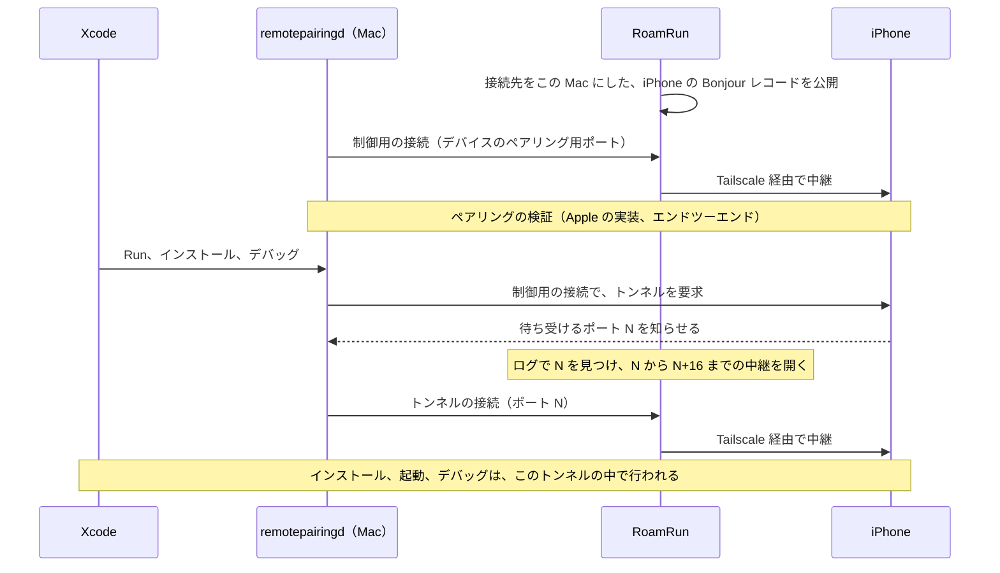
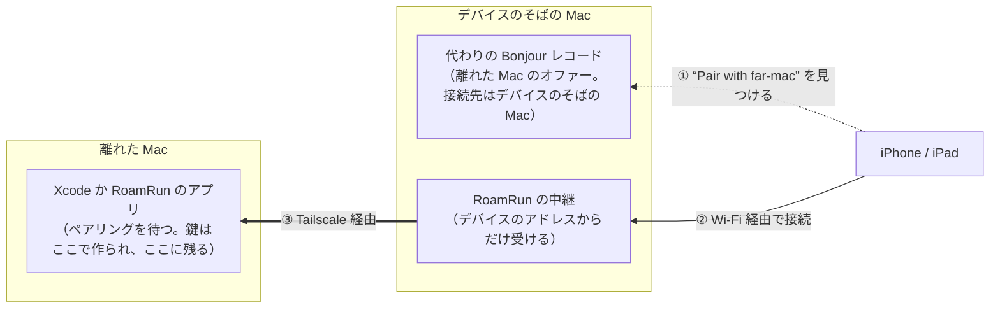

# RoamRun の仕組み

<a href="how-it-works.md">English</a> | 日本語

ブリッジが何をしているかを順に説明し、それぞれの処理がソースのどこにあるかを示します。RoamRun で何ができるかと、使い方は、[README](../README.ja.md) にあります。

iOS、Xcode、`remotepairingd` の動作についての記述は、RoamRun を作る過程で、実際の動作を見て確かめたものです。これは RoamRun ではなく Apple の動作なので、新しいリリースで変わる可能性があります。

## ブリッジ

iOS 17 以降のワイヤレスデバッグは、Apple の CoreDevice の上で動きます。Mac の `remotepairingd` は、Bonjour（`_remotepairing._tcp`）でローカルネットワーク上のデバイスを探します。Bonjour はリンクローカルのマルチキャストなので、Tailscale のようなレイヤー 3 の VPN は越えられません。そのうえ、`remotepairingd` は、デバイスを見つけたインターフェイスに接続を限定します。そのため、デバイスの VPN 上のアドレスを公開するだけでは動きません。

RoamRun は、Xcode には「デバイスは同じ Wi-Fi にある」と見せて、実際の通信を VPN に流します。

1. デバイスを追加するとき、RoamRun は、ローカルネットワークからデバイスの Bonjour のレコードを取得します。ブリッジ中は、接続先をこの Mac に変えたレコードを、`dns-sd -P` の補助プロセスで公開します。公開先は、Mac の LAN インターフェイスです。Settings › Network で選んだインターフェイスがあれば、それを使います。選んでいなければ en0 を使い、en0 にアドレスがないときは、アドレスを持つ最初の en* を使います。
2. `remotepairingd` がそのレコードを見つけて、この Mac に接続してきます。RoamRun の中継がその接続を受けます。この Mac 自身のアドレス以外からの接続は、拒否します。
3. 中継は、受けた通信を、VPN 経由でデバイスに送ります。ペアリングの検証と暗号化は、Apple の実装のまま、Mac とデバイスの間で行われます。RoamRun が通信の中身を読むことも、書き換えることもありません。

トンネルについて、2 つ補足します。

- **トンネルのポートは、毎回変わります**。動作を見たかぎり、ポートは 1 ずつ増えます。`remotepairingd` は、ポートを知ってから数ミリ秒で接続してきます。RoamRun は、`log stream` で `remotepairingd` のログを読んでいます。ログにポートが出るたびに、そのポートと続く 16 個のポートの中継を、先に開いておきます。
- **ブリッジを始めた直後の最初のトンネルには、中継を開くのが間に合いません**。そこで RoamRun は、デバイスが最初に接続した時点で、バックグラウンドで `devicectl device info details` を実行して、最初のトンネルを先に使ってしまいます。CoreDevice の一覧にデバイスがまだ出ていなければ、やり直します。こうしておくと、最初の Run の時点で、中継が開いています。

制御用の接続の中継は、デバイス自身のペアリング用ポートで待ち受けます。動作を見たかぎり、このポートは 49152 です。そのポートが使われている場合は、続く 20 個のポートのどれかを使います。

デバイスが Mac と同じ Wi-Fi にある間、ブリッジは何もせずに待機し、RoamRun は「On this Wi‑Fi」と表示します。このとき、Xcode はデバイスに直接つながっています。デバイスが別のネットワークに移ると、ブリッジは自動で再開します。Mac のアドレスが変わった場合、ブリッジは再起動します。

## デバイスと同じ場所にいたことのない Mac のペアリング

ブリッジには、デバイスとペアリングした Mac が必要です。ペアリングは、1 つの Wi-Fi の中で行われます。デバイスは、その Wi-Fi 上で Bonjour を使って Mac を見つけ、Mac に接続します。別の場所にある Mac は、見つけてもらえません。そこで、デバイスと同じ Wi-Fi の側に、離れた Mac の代わりをするものを用意します。代わりをするのは、RoamRun を入れた Mac、デバイス上の Introducer アプリ、`roamrunctl` を入れたマシンのいずれかです。以下では、デバイスと同じ Wi-Fi にある Mac を「デバイスのそばの Mac」と呼びます。ブリッジと同じ方法を、逆向きに使います。デバイスには「離れた Mac は同じ Wi-Fi にある」と見せて、通信を Tailscale に流します。

1. 離れた Mac が、ペアリングのオファーを出します。Xcode のペアリングでは Device Hub › Pair Nearby Device が、デバイス操作のペアリングでは RoamRun のアプリが出します。離れた Mac は、このオファーを、Tailscale 経由で、デバイスのそばの Mac へ渡します。2 台の Mac は、互いの名前を指定します。Xcode のペアリングの場合は、オファーを 1 行のテキストとして、手で運ぶこともできます。
2. デバイスのそばの Mac は、接続先を自分にしたオファーを、自分の Wi-Fi 上に公開します。公開は、最大 5 分間です。デバイスからの接続は、離れた Mac に中継します。受け付けるのは、デバイス自身のアドレスからの接続だけです。
3. ペアリングは、デバイスと離れた Mac の間で、エンドツーエンドで行われます。コードは、デバイスに入力します。間にある Mac は、通信の中身を読まずに渡し、何も保存しません。通る通信から鍵を取り出せないことは、ペアリング自体の暗号化によります。Xcode のペアリングで入力するのは、離れた Mac の Device Hub に表示されるコードです。デバイス操作のペアリングでは、離れた Mac のアプリがコードを作ります。そのコードは、仲介する側に表示されます。仲介する側とは、デバイスのそばの Mac、デバイス上のアプリ、`roamrunctl` のいずれかです。そのため、仲介には信頼できるものを使ってください。

これ以降、離れた Mac は、ほかの Mac と同じように、デバイスへのブリッジを使えます。

Apple Vision Pro は、向きが逆です。Vision Pro は、Mac に選ばれるのを待ちます。そのため、デバイスのそばの Mac が、Vision Pro の公開している情報を離れた Mac に送り、離れた Mac がそれを自分のネットワーク上に公開します。離れた Mac の Device Hub は、そこから Vision Pro を選びます。Vision Pro への接続は、離れた Mac が自分で中継します。

## ソースの構成

`Sources/RoamRun/` に、アプリと CLI があります。この 2 つは、1 つのバイナリです。部分ごとに、フォルダに分かれています。

| ファイル | 役割 |
|---|---|
| `App/RoamRunApp.swift` | エントリーポイント。`roamrun <command>` なら CLI を実行し、それ以外ならアプリを開く |
| `App/AppCoordinator.swift` | アプリの状態。保存したデバイス、ブリッジの制御、デバイスがあるかどうかの確認、デバイス操作のペアリング |
| `App/AppCoordinator+OTA.swift` | OTA のページ。そのサーバーと、`tailscale serve` への登録 |
| `App/Views/` | 画面。メインウインドウ、デバイスのページ、Add Device、Settings、メニューバー |
| `App/LogStore.swift` | アクティビティログ |
| `CLI/CLI.swift` | `roamrun` コマンド。引数の解釈、使い方の表示、各コマンドへの振り分け、`init` |
| `CLI/CLI+Pairing.swift` | `pair` と、`devices export` / `add`。Mac どうしのペアリングと仲介 |
| `CLI/CLI+Status.swift` | `devices`、`status`、`doctor` |
| `CLI/CLI+Bridge.swift` | `up` と `down`、バックグラウンドで動かすブリッジ |
| `CLI/CLI+Install.swift` | `install`、`run`、`logs`、`ota` |
| `CLI/CLI+Control.swift` | デバイス操作のコマンド。`look`、`tap`、`swipe`、`type` / `paste` / `press`、`elements`、`screenshot`、`key` |
| `CLI/CLIInstaller.swift` | `/usr/local/bin/roamrun` を、アプリのバイナリにリンクする |
| `CLI/TerminalQR.swift` | ターミナルに表示する QR コード |
| `Bridge/ProxyBridge.swift` | 1 台のデバイスに対する 1 つのブリッジ。下の各部品を動かす |
| `Bridge/StatusFile.swift` | アプリと CLI が共有するブリッジの状態。どちらがどのデバイスのブリッジを動かしているか |
| `Bridge/BridgeSupervisor.swift`、`Bridge/BridgeEnv.swift` | ブリッジをいつ始め直すかの判断と、ブリッジが外部に対して行う操作（テストでは差し替える） |
| `Bridge/BonjourCapture.swift` | `dns-sd -Z` のゾーンダンプを解析する |
| `Bridge/DNSServiceProxy.swift` | `dns-sd -P` の子プロセスで、代わりのレコードを公開する。残った子プロセスの後始末もする |
| `Bridge/Relays.swift` | TCP の中継。ブリッジの中継は、この Mac からの接続だけを受ける。仲介の中継は、デバイスからの接続だけを受ける |
| `Bridge/TunnelPortWatcher.swift` | `log stream` からトンネルのポートを見つけて、どのデバイスのものかを判定する |
| `Bridge/InterfaceMonitor.swift` | LAN インターフェイスを選び、アドレスの変化を検知する |
| `Bridge/ReachabilityProbe.swift` | TCP で接続できるかの確認と、RemotePairing のハンドシェイクの確認 |
| `Pairing/IntroductionLines.swift` | Mac どうしで運ぶ行（オファーとデバイス）の形式と、その決まり。Introducer アプリも、このファイルをコンパイルする |
| `Pairing/Introductions.swift` | 離れた Mac の仲介。行からのデバイスの保存と、代わりのレコードの公開 |
| `Pairing/PairByName.swift` | 互いの名前を指定した 2 台の Mac のやり取り（ポート 41830） |
| `Pairing/ControlIntroductions.swift` | 別の Mac が仲介する場合の、デバイス操作のペアリング |
| `Control/DeviceControlHub.swift` | デバイス操作。アプリが保つ接続と、ペアリング |
| `Control/DeviceControlWire.swift` | CLI と MCP のツールが、アプリに問い合わせるためのソケット |
| `Control/SharedPairing.swift` | 別の Mac のために作ったペアリング。`roamrun key create` が書き出し、`key import` が読み込む |
| `Control/DeviceControlKey.swift`、`Control/DeviceControlAllowed.swift` | 保存したペアリングを暗号化するキーチェーンの鍵と、スイッチがオンのデバイスの一覧 |
| `Control/DeviceMCP.swift` | `roamrun mcp`。デバイス操作を MCP のツールとして提供する |
| `Control/MCPHTTP.swift` | `roamrun mcp --http`。同じツールを、tailnet の許可したマシンに HTTP で提供する |
| `OTA/OTA.swift`、`OTA/OTAPage.swift`、`OTA/OTAServer.swift` | OTA でのインストール。保存したビルドと署名の確認、インストール用のページと `itms-services` のマニフェスト、`tailscale serve` の後ろで動くローカルのサーバー |
| `Support/ProfileStore.swift`、`Support/Models.swift` | 保存したデバイスと、取得した Bonjour のレコード |
| `Support/TailscaleClient.swift` | `tailscale` に、status、ping、whois、serve の状態を問い合わせる |
| `Support/Proc.swift` | 補助のツールを実行する |

そのほかの場所は、次のとおりです。

| パス | 役割 |
|---|---|
| `Sources/DeviceControl/` | デバイス操作のための、デバイスへの接続（Swift） |
| `Rust/RoamRunDevice/` | idevice クレートを C から使うためのインターフェイス。`Sources/DeviceControl/` が呼び出す |
| `Sources/DeviceProbe/` | デバイス操作を単独で試すための小さなツール |
| `Rust/roamrunctl/` | RoamRun を入れていないマシン向けの `roamrunctl` |
| `iOS/` | デバイスから仲介するアプリ、RoamRun Introducer |
| `skills/` | エージェント用のスキル。`roamrun init` が入れ、roamrunctl のアーカイブにも入っている |
| `Tests/` | ユニットテスト |
