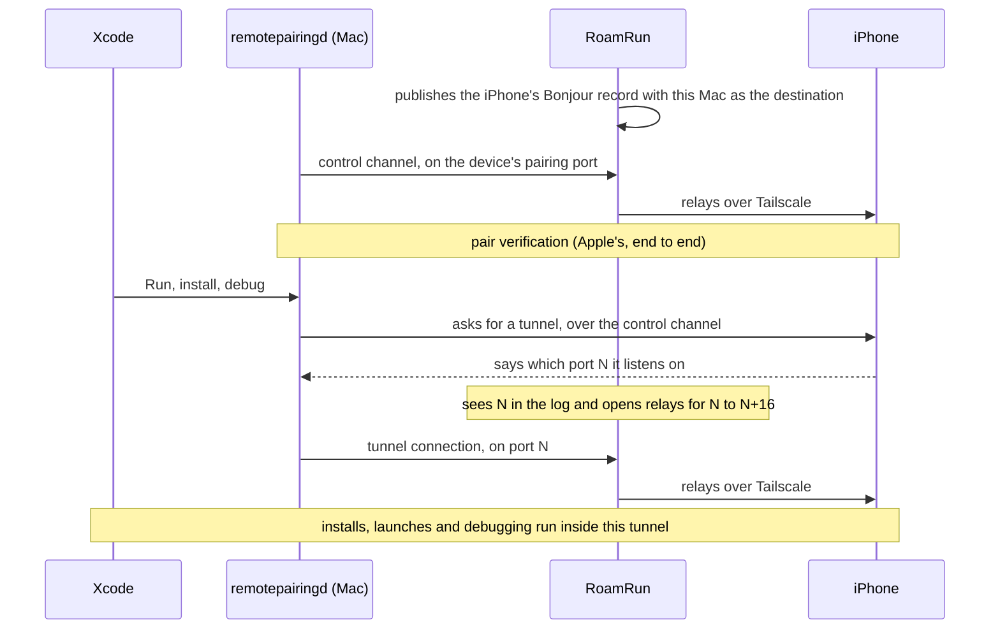
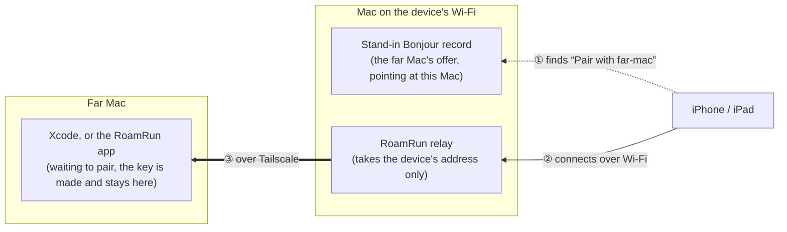

# How RoamRun works

English | <a href="how-it-works.ja.md">日本語</a>

What the bridge does, step by step, and where each part lives in the source. The
[README](../README.md) says what RoamRun is for and how to use it.

Statements about what iOS, Xcode and `remotepairingd` do are what was seen while building RoamRun.
They are Apple's behaviour, not RoamRun's, and a new release can change them.

## The bridge

Since iOS 17, wireless debugging runs on Apple's CoreDevice stack. The Mac's `remotepairingd`
looks for devices on the local network with Bonjour (`_remotepairing._tcp`). Bonjour is
link-local multicast, so it does not cross a layer-3 VPN such as Tailscale. `remotepairingd` also
ties its connection to the interface where it found the device, so advertising the device's VPN
address does not work either.

RoamRun tells Xcode that the device is on the same Wi-Fi, and carries the traffic over the VPN.

1. When you add a device, RoamRun captures its Bonjour record from the local network. While
   bridging, it publishes that record again with this Mac as the destination, through a
   `dns-sd -P` helper, on the Mac's LAN interface. That is the interface chosen under Settings ›
   Network; otherwise en0, or the first other en* port with an address when en0 has none.
2. `remotepairingd` finds the record and connects to this Mac. RoamRun's relay takes the
   connection, and refuses any that does not come from this Mac's own address.
3. The relay forwards the bytes to the device over the VPN. Pairing verification and encryption
   happen end to end between the Mac and the device, as Apple implements them. RoamRun does not
   read or change the traffic.

Two details of the tunnel:

- **The tunnel's port is new each time.** As seen, it goes up by one, and `remotepairingd`
  connects a few milliseconds after it learns the port. So each time RoamRun sees a port in
  `remotepairingd`'s log (through `log stream`), it opens relays for that port and the next 16.
- **The first tunnel after a bridge starts cannot be caught in time.** When the device first
  connects, RoamRun runs `devicectl device info details` in the background to use up that first
  tunnel, and tries again if CoreDevice does not list the device yet. A first Run then finds the
  relays open.

The control channel's relay listens on the device's own pairing port — 49152 as seen — or on one
of the next 20 if that port is taken.

While the device is on the Mac's own Wi-Fi, RoamRun stops bridging and shows "On this Wi‑Fi":
Xcode reaches the device directly. When the device leaves, the bridge resumes by itself. When the
Mac's address changes, the bridge restarts.

## Pairing a Mac that is never near the device

A bridge needs a Mac that is paired with the device, and pairing happens on one Wi-Fi: the device
finds the Mac there by Bonjour and connects to it. A Mac elsewhere is never found. So something on
the device's Wi-Fi stands in for the far Mac — a Mac with RoamRun, the Introducer app on the
device, or a machine with `roamrunctl`. It is the bridge's trick turned around: the device is told
that the far Mac is on its Wi-Fi, and the traffic goes over Tailscale.

1. The far Mac offers to pair: Xcode's Device Hub › Pair Nearby Device, or the RoamRun app for
   device control. It hands its offer to the Mac on the device's Wi-Fi, over Tailscale, each
   naming the other. For Xcode's pairing the offer can also be carried by hand, as one line.
2. That Mac announces the offer on its Wi-Fi with itself as the destination, for five minutes at
   most, and relays the device's connection to the far Mac. It takes connections from the device's
   own address only.
3. The pairing is made end to end between the device and the far Mac, with the code typed on the
   device. The Mac in between passes the connection on without reading it and saves nothing of
   it; that no key can be taken from what passes rests on the pairing's own encryption. For
   Xcode, the code is the one Device Hub shows on the far Mac. For device control, the far Mac's
   app makes the code, and whichever introduces shows it: that Mac, the app on the device, or
   `roamrunctl`. So whatever introduces is something you trust.

From then on the far Mac bridges to the device like any other.

An Apple Vision Pro goes the other way round. It waits to be picked, so what it announces is sent
to the far Mac, which announces it on its own network for its own Device Hub to pick, and carries
its own connections to the device.

## Source layout

`Sources/RoamRun/` holds the app and the CLI, which are one binary, in a folder for each part.

| File | Role |
|---|---|
| `App/RoamRunApp.swift` | The entry point: `roamrun <command>` runs the CLI, anything else opens the app |
| `App/AppCoordinator.swift` | The app's state: saved devices, bridge control, presence checks, device control's pairing |
| `App/AppCoordinator+OTA.swift` | The over-the-air page: its server, and its entry in `tailscale serve` |
| `App/Views/` | The windows: main window, device page, Add Device, Settings, menu bar |
| `App/LogStore.swift` | The activity log |
| `CLI/CLI.swift` | The `roamrun` command: its arguments, usage and dispatch, and `init` |
| `CLI/CLI+Pairing.swift` | `pair`, and `devices export` / `add`: pairing and introducing across Macs |
| `CLI/CLI+Status.swift` | `devices`, `status` and `doctor` |
| `CLI/CLI+Bridge.swift` | `up` and `down`, and a bridge run in the background |
| `CLI/CLI+Install.swift` | `install`, `run`, `logs` and `ota` |
| `CLI/CLI+Control.swift` | Device control's commands: `look`, `tap`, `swipe`, `type` / `paste` / `press`, `elements`, `screenshot`, `key` |
| `CLI/CLIInstaller.swift` | Links `/usr/local/bin/roamrun` to the app's binary |
| `CLI/TerminalQR.swift` | A QR code drawn in the terminal |
| `Bridge/ProxyBridge.swift` | One bridge for one device: it runs the parts below |
| `Bridge/StatusFile.swift` | Bridge status shared by the app and the CLI: who has which device |
| `Bridge/BridgeSupervisor.swift`, `Bridge/BridgeEnv.swift` | When a bridge is started again, and what a bridge reaches outside itself (swapped in tests) |
| `Bridge/BonjourCapture.swift` | Parses the `dns-sd -Z` zone dump |
| `Bridge/DNSServiceProxy.swift` | The stand-in advertisement, through a `dns-sd -P` child process, and the cleanup of ones left behind |
| `Bridge/Relays.swift` | The TCP relay. A bridge's accepts connections from this Mac only; a stand-in's, from the device only |
| `Bridge/TunnelPortWatcher.swift` | Finds tunnel ports in `log stream` and attributes them to their device |
| `Bridge/InterfaceMonitor.swift` | Picks the LAN interface and notices when its address changes |
| `Bridge/ReachabilityProbe.swift` | TCP reachability, and the RemotePairing handshake check |
| `Pairing/IntroductionLines.swift` | The lines carried between Macs, the offer and the device, and their rules: the Introducer app compiles this file too |
| `Pairing/Introductions.swift` | Introducing a far Mac: saving a device from its line, and the stand-in |
| `Pairing/PairByName.swift` | The exchange between two Macs that name each other (port 41830) |
| `Pairing/ControlIntroductions.swift` | Device control's pairing when another Mac introduces |
| `Control/DeviceControlHub.swift` | Device control: the connections the app holds, and the pairing |
| `Control/DeviceControlWire.swift` | The socket the CLI and MCP tools ask the app through |
| `Control/SharedPairing.swift` | A pairing made for another Mac: what `roamrun key create` writes and `key import` takes |
| `Control/DeviceControlKey.swift`, `Control/DeviceControlAllowed.swift` | The Keychain key that saved pairings are sealed with, and the list of devices switched on |
| `Control/DeviceMCP.swift` | `roamrun mcp`: device control as MCP tools |
| `Control/MCPUploads.swift` | `roamrun mcp --http --allow-install`: the one .ipa kept from `PUT /upload`, for an install |
| `Control/MCPHTTP.swift` | `roamrun mcp --http`: the same tools over HTTP, for allowed machines of the tailnet |
| `OTA/OTA.swift`, `OTA/OTAPage.swift`, `OTA/OTAServer.swift` | Over-the-air installs: stored builds and signing checks, the install page and its `itms-services` manifest, and the local server behind `tailscale serve` |
| `Support/ProfileStore.swift`, `Support/Models.swift` | Saved devices and the captured Bonjour record |
| `Support/TailscaleClient.swift` | Asks `tailscale` for status, ping, whois and what it serves |
| `Support/Proc.swift` | Runs helper tools |

Elsewhere:

| Path | Role |
|---|---|
| `Sources/DeviceControl/` | Device control's connection to the device, in Swift |
| `Rust/RoamRunDevice/` | RoamRun's C interface to the idevice crate, which `Sources/DeviceControl/` calls |
| `Sources/DeviceProbe/` | A small tool that tests device control by itself |
| `Rust/roamrunctl/` | `roamrunctl`, for a machine without RoamRun |
| `iOS/` | RoamRun Introducer, the app that introduces from the device |
| `skills/` | The agent skills that `roamrun init` and the roamrunctl archives carry |
| `Tests/` | Unit tests |
