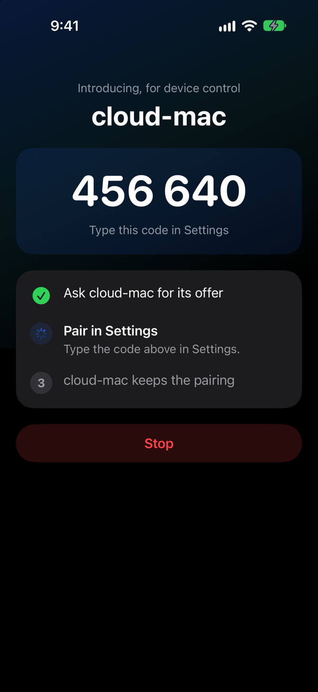
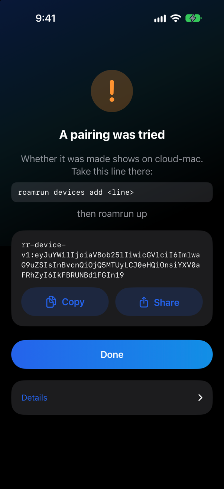

# RoamRun Introducer

<p align="center">English | <a href="README.ja.md">日本語</a></p>

RoamRun Introducer is an iPhone app that lets a machine elsewhere pair with the iPhone it runs on.
It does on the device what `roamrun pair introduce` does on a Mac beside the device: it advertises
the far machine's pairing offer on the device's own Wi-Fi, takes the connections Settings makes to
it, and relays them to the far machine over the Tailscale VPN already on the device. No Mac near
the device is needed.

The far machine is a Mac with RoamRun, or — for device control only, since RoamRun 0.7.0 — a machine
with `roamrunctl` (Linux, Windows or macOS). How it looks from the far Mac's side is in the main README,
under [From the device itself](../README.md#from-the-device-itself).

<p align="center">
  
  
  
</p>

The app is not on the App Store and is not part of `make app`: you build it yourself. It needs
iOS 27 or later, and is built for iPhone only. iOS 27 is needed because the app stands in for a
Mac waiting in Device Hub's Pair Nearby Device, which Xcode 27 offers for devices on iOS 27 and
later (Xcode's release notes, under Device Hub). On the Home Screen and in Settings it is called
"RoamRun", because the whole name does not fit under an icon.

## Build and install

You need a Mac with Xcode 27 and [XcodeGen](https://github.com/yonaskolb/XcodeGen)
(`brew install xcodegen`). This is needed once; afterwards the app needs no Mac near the device.
Signed with a free personal team, the app runs for seven days and is then installed again; with a
paid team, a year.

```
cd iOS
xcodegen generate
open RoamRunIntroducer.xcodeproj   # set your team under Signing, then run on the iPhone
```

From the shell, this builds it without signing:
`xcodebuild -project RoamRunIntroducer.xcodeproj -scheme RoamRunIntroducer -destination 'generic/platform=iOS' CODE_SIGNING_ALLOWED=NO build`.

The app has no entitlements file and declares no `UIBackgroundModes`. It asks for Local Network access when it
first introduces, for the camera when you scan a code, and for notifications when it pairs for
device control. Its own version stays 0.1; what matters is the version of RoamRun on the far Mac,
0.5.0 or later.

## Pairing a far Mac for Xcode

No text is carried by hand: the app takes the introducing side of `roamrun pair xcode --with`.

1. On the far Mac, open Xcode › Device Hub › Pair Nearby Device, and run
   `roamrun pair xcode --with <this iPhone's Tailscale name>`.
2. In the app, type the far Mac's Tailscale name and tap **Introduce**. Allow Local Network access
   when asked.
3. In Settings › Privacy & Security › Developer Mode, pick Pair with "<far Mac>", and type the code
   that Device Hub shows on the far Mac.
4. The app tells the far Mac, which saves this iPhone under its Tailscale name. On the far Mac, run
   `roamrun up <name>`.

To avoid typing the name, add `--qr` to the command in step 1. The far Mac then draws a code in
its terminal. Scan it in the app (the button reads "Scan the Mac's Code" until a name is held, and
"Scan a Code" after), or with the iPhone's camera, which opens the app with the name filled in
through a `roamrun-introducer://<far Mac's Tailscale name>` link. The app keeps the name once you
tap Introduce with it, so the next time nothing is typed or scanned.

How long things wait: the app waits up to 10 minutes for the far Mac's offer, and advertises it
for up to 5 minutes.

## Pairing for device control

Device control (`look`, `tap` and the rest) is paired the same way. The far machine runs one of:

- on a Mac, with the RoamRun app open: `roamrun pair control --with <this iPhone's Tailscale name>`
  (`--qr` works here too);
- on a machine with `roamrunctl`: `roamrunctl pair control --with <this iPhone's Tailscale name>`.
  `roamrunctl` has no `--qr`: type that machine's Tailscale name in the app.

The app needs no other setting: the far machine's answer says which pairing it is. The code to type
is made on the far machine and shown on this iPhone: in the app in large digits, in a notification,
and where iOS shows the app's background task. With `roamrunctl` the code also shows on the far
machine.

<p align="center">
  
  
</p>

Two things to know:

- **The iPhone must have been paired with something before.** The app looks for this iPhone's own
  pairing service on the Wi-Fi, which the iPhone advertises only once it has been paired. If the
  app says the iPhone isn't announcing itself, pair Xcode first.
- **Go to Settings and type the code straight away.** The app asks iOS for a background task to
  carry the introduction while you are in Settings. If iOS refuses it, the app has about
  30 seconds in the background, and says so. This holds for Xcode's pairing too.

## Carrying the lines by hand

For a far Mac that cannot be asked over Tailscale, use **Carry the lines by hand**. It is for
Xcode's pairing only.

1. On the far Mac, with Pair Nearby Device open, run `roamrun pair xcode`. It prints one line that
   starts with `rr-xcode-offer-v1:`. (`roamrun pair xcode --qr` draws that line and the far Mac's
   name as a code, for the app to scan.)
2. In the app, paste that line, and enter the far Mac's Tailscale name and this iPhone's. (A code
   from `--qr` fills in the line and the far Mac's name.)
3. Pair in Settings as above.
4. The app shows a line that starts with `rr-device-v1:`. On the far Mac, give it to
   `roamrun devices add <line>`.

The app also shows that line when the far Mac did not say whether it saved the device.

The offer line is not kept between launches: it works only while its Pair Nearby Device sheet is
open on the far Mac, and each press of that button makes another. The far Mac's name and this
iPhone's Tailscale name are kept.

## What the app connects to

- It takes connections from this device's own addresses only, two at most at a time, and stops
  once a connection that carried bytes both ways has closed. "A pairing was tried" in the app means that: a connection
  passed through. It does not mean Xcode accepted the code.
- A far machine is named as Tailscale names it: one word, a name under `ts.net`, or its `100.x`
  address. An IPv6 address is refused.
- The app sends its question, and relays the pairing, only to an address in Tailscale's range,
  whatever a code, a link or a name led to. It checks this after the connection opens: a connection
  to an address outside that range is dropped with nothing sent.
- To find which pairing service on the Wi-Fi is this iPhone's own, the app opens a connection to
  each one that is advertised there, and closes it without sending anything.

## If it does not work

- **The app says it could not see this iPhone's own announcement.** On the far Mac, run
  `roamrun devices` first: a record that is already there can be used with `roamrun up <name>`.
  Otherwise, on a Mac that has this iPhone saved, run `roamrun devices export <name>`, and add the
  line it prints on the far Mac.
- **Nothing was paired in 5 minutes.** The app stopped advertising. Start again from step 1.
- **iOS stopped it in the background.** See "Go to Settings and type the code straight away" above.

Where a connection from Settings came from is shown under Details on the screen the app ends on.
It is also in the device's log: in Console on a Mac, select the device and filter by the subsystem
`io.github.mh-mobile.roamrun.introducer`.

## What was tried

On an iPhone 15 Pro on iOS 27, with a far Mac reached over Tailscale: Xcode's pairing by name and
by a code from `--qr`, the lines carried by hand, and device control's pairing.

Not tried: device control's pairing with a machine running `roamrunctl` as the far one, an iPad
(the app is built for iPhone only), and other iOS versions.

## For developers

`Sources/Introduction.swift` holds the formats of the lines and their rules, as
`Sources/RoamRun/Pairing/Introductions.swift` does in the main app. Change them in both.

`Sources/Session.swift` holds one introduction: its stage, the code, and how it ended.
`Sources/ContentView.swift` shows it: a first screen, the three steps while it runs, and how it
ended, with the line to carry when there is one. To look at a screen without a far Mac, in a debug
build in the simulator:

```
SIMCTL_CHILD_INTRODUCER_PREVIEW=pairing xcrun simctl launch booted io.github.mh-mobile.roamrun.introducer
```

The values are `empty`, `asking`, `pairing`, `code`, `finishing`, `done`, `byhand` and `failed`. Any
other value shows the first screen with a name held. The
pictures on this page are that preview: its names and its code are made up.

`Checks/relay-check.swift` builds the app's engine for macOS and runs it under a test service type,
`_rrtest._tcp`, never the real one. Among what it checks: a fake far Mac echoing on 127.0.0.1, a stranger
refused, an allowed connection relayed both ways, the end when a connection has carried, the record
removed, the deadline, how the lines between the app and the far machine are read, and which
addresses count as Tailscale's. Run it from `iOS/`:

```
xcrun swiftc -swift-version 6 -parse-as-library -o /tmp/relay-check Sources/StandIn.swift Sources/Introduction.swift Sources/Wire.swift Checks/relay-check.swift && /tmp/relay-check
```

The icon is RoamRun's, edge to edge:
`xcrun swift ../scripts/make-icon.swift --ios Sources/Assets.xcassets/AppIcon.appiconset/icon-1024.png`.
